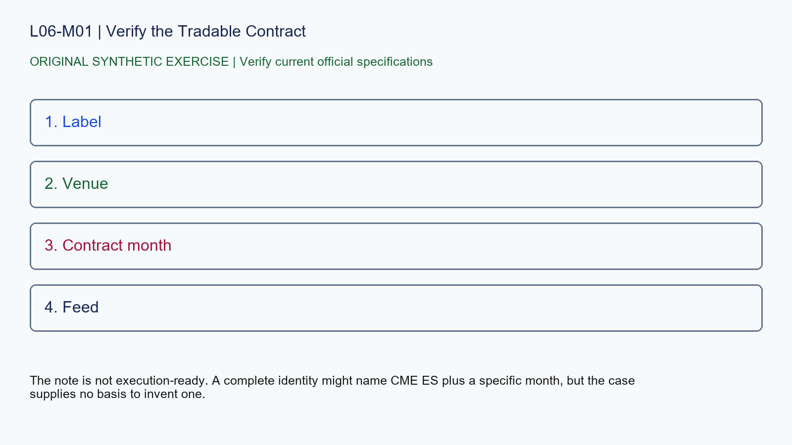

# L06-M01 - Verify the Tradable Contract

## Objective
Apply verify the tradable contract with a source-stamped specification record.

## Synthetic case
A note says only "S&P at 6200" with no venue, symbol, expiry or feed.

## Concept
An index value, ETF, CFD and futures contract are different instruments. Record venue, product, contract month, currency and data source before calculating risk.

## Practice
Rewrite the note as a verification checklist and leave every unsupported field unknown.

## Answer rationale
The note is not execution-ready. A complete identity might name CME ES plus a specific month, but the case supplies no basis to invent one.

## References
- [E-mini S&P 500 Futures Contract Specs - CME Group](https://www.cmegroup.com/markets/equities/sp/e-mini-sandp500.contractSpecs.html)
- [E-mini Nasdaq-100 Futures Contract Specs - CME Group](https://www.cmegroup.com/markets/equities/nasdaq/e-mini-nasdaq-100.contractSpecs.html)
- [Gold Futures Contract Specs - CME Group](https://www.cmegroup.com/markets/metals/precious/gold.contractSpecs.html)
- [Micro E-mini Equity Index Futures - CME Group](https://www.cmegroup.com/markets/equities/micro-e-mini-futures.html)
- [Micro Gold Futures Contract Specs - CME Group](https://www.cmegroup.com/markets/metals/precious/e-micro-gold.contractSpecs.html)
- [CME Group Holiday and Trading Hours](https://www.cmegroup.com/trading-hours.html)
- [Delayed Quotes - CME Group](https://www.cmegroup.com/market-data/browse-data/delayed-quotes.html)
- [Real-Time and Historical Data - CME Group](https://www.cmegroup.com/market-data/real-time-and-historical-data.html)
