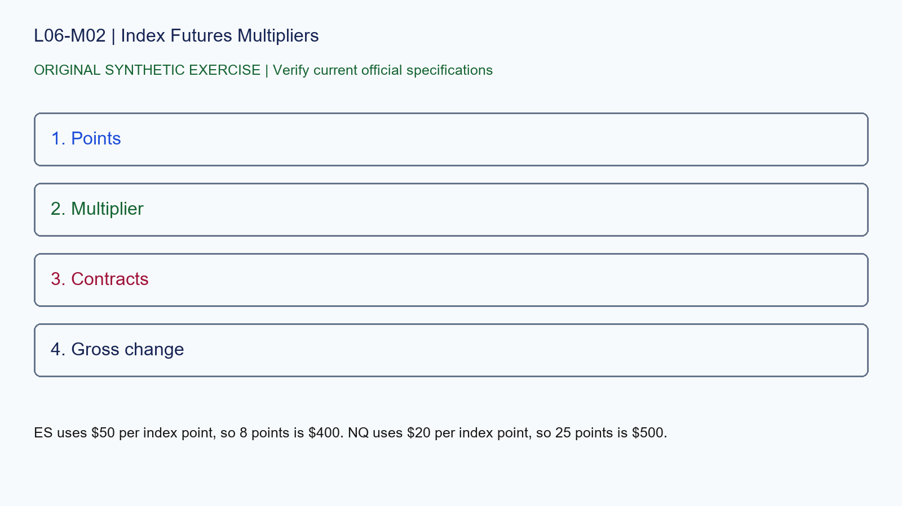

# L06-M02 - Index Futures Multipliers

## Objective
Apply index futures multipliers with a source-stamped specification record.

## Synthetic case
A synthetic ES move is 8.00 index points and a synthetic NQ move is 25.00 points, one contract each.

## Concept
Contract value changes by price move times the exchange multiplier. Current specifications must be checked at the exchange rather than copied from memory.

## Practice
Using the cited specifications, compute gross changes before fees and explain why equal point moves are not equal risk.

## Answer rationale
ES uses $50 per index point, so 8 points is $400. NQ uses $20 per index point, so 25 points is $500.

## References
- [E-mini S&P 500 Futures Contract Specs - CME Group](https://www.cmegroup.com/markets/equities/sp/e-mini-sandp500.contractSpecs.html)
- [E-mini Nasdaq-100 Futures Contract Specs - CME Group](https://www.cmegroup.com/markets/equities/nasdaq/e-mini-nasdaq-100.contractSpecs.html)
- [Gold Futures Contract Specs - CME Group](https://www.cmegroup.com/markets/metals/precious/gold.contractSpecs.html)
- [Micro E-mini Equity Index Futures - CME Group](https://www.cmegroup.com/markets/equities/micro-e-mini-futures.html)
- [Micro Gold Futures Contract Specs - CME Group](https://www.cmegroup.com/markets/metals/precious/e-micro-gold.contractSpecs.html)
- [CME Group Holiday and Trading Hours](https://www.cmegroup.com/trading-hours.html)
- [Delayed Quotes - CME Group](https://www.cmegroup.com/market-data/browse-data/delayed-quotes.html)
- [Real-Time and Historical Data - CME Group](https://www.cmegroup.com/market-data/real-time-and-historical-data.html)
