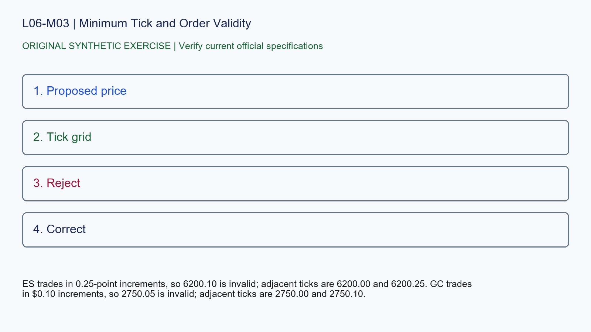

# L06-M03 - Minimum Tick and Order Validity

## Objective
Apply minimum tick and order validity with a source-stamped specification record.

## Synthetic case
A learner proposes an ES limit at 6200.10 and a GC limit at 2750.05.

## Concept
A price must conform to the contract minimum fluctuation. Display precision is not permission to submit every decimal value.

## Practice
Check both prices against the cited minimum ticks and provide the nearest valid prices on either side.

## Answer rationale
ES trades in 0.25-point increments, so 6200.10 is invalid; adjacent ticks are 6200.00 and 6200.25. GC trades in $0.10 increments, so 2750.05 is invalid; adjacent ticks are 2750.00 and 2750.10.

## References
- [E-mini S&P 500 Futures Contract Specs - CME Group](https://www.cmegroup.com/markets/equities/sp/e-mini-sandp500.contractSpecs.html)
- [E-mini Nasdaq-100 Futures Contract Specs - CME Group](https://www.cmegroup.com/markets/equities/nasdaq/e-mini-nasdaq-100.contractSpecs.html)
- [Gold Futures Contract Specs - CME Group](https://www.cmegroup.com/markets/metals/precious/gold.contractSpecs.html)
- [Micro E-mini Equity Index Futures - CME Group](https://www.cmegroup.com/markets/equities/micro-e-mini-futures.html)
- [Micro Gold Futures Contract Specs - CME Group](https://www.cmegroup.com/markets/metals/precious/e-micro-gold.contractSpecs.html)
- [CME Group Holiday and Trading Hours](https://www.cmegroup.com/trading-hours.html)
- [Delayed Quotes - CME Group](https://www.cmegroup.com/market-data/browse-data/delayed-quotes.html)
- [Real-Time and Historical Data - CME Group](https://www.cmegroup.com/market-data/real-time-and-historical-data.html)
