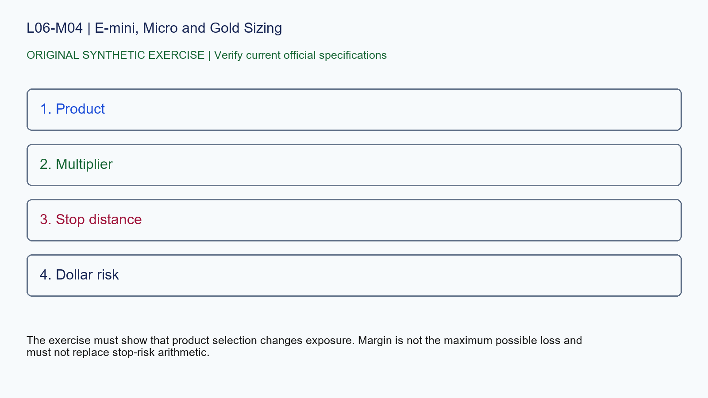

# L06-M04 - E-mini, Micro and Gold Sizing

## Objective
Apply e-mini, micro and gold sizing with a source-stamped specification record.

## Synthetic case
A plan compares one ES, one MES, one GC and one MGC without recording multipliers.

## Concept
Similar product names can hide tenfold size differences. Verify the exact product and calculate dollar risk from stop distance before choosing quantity.

## Practice
Create a four-row specification card with multiplier, tick and a clearly labeled hypothetical stop distance.

## Answer rationale
The exercise must show that product selection changes exposure. Margin is not the maximum possible loss and must not replace stop-risk arithmetic.

## References
- [E-mini S&P 500 Futures Contract Specs - CME Group](https://www.cmegroup.com/markets/equities/sp/e-mini-sandp500.contractSpecs.html)
- [E-mini Nasdaq-100 Futures Contract Specs - CME Group](https://www.cmegroup.com/markets/equities/nasdaq/e-mini-nasdaq-100.contractSpecs.html)
- [Gold Futures Contract Specs - CME Group](https://www.cmegroup.com/markets/metals/precious/gold.contractSpecs.html)
- [Micro E-mini Equity Index Futures - CME Group](https://www.cmegroup.com/markets/equities/micro-e-mini-futures.html)
- [Micro Gold Futures Contract Specs - CME Group](https://www.cmegroup.com/markets/metals/precious/e-micro-gold.contractSpecs.html)
- [CME Group Holiday and Trading Hours](https://www.cmegroup.com/trading-hours.html)
- [Delayed Quotes - CME Group](https://www.cmegroup.com/market-data/browse-data/delayed-quotes.html)
- [Real-Time and Historical Data - CME Group](https://www.cmegroup.com/market-data/real-time-and-historical-data.html)
