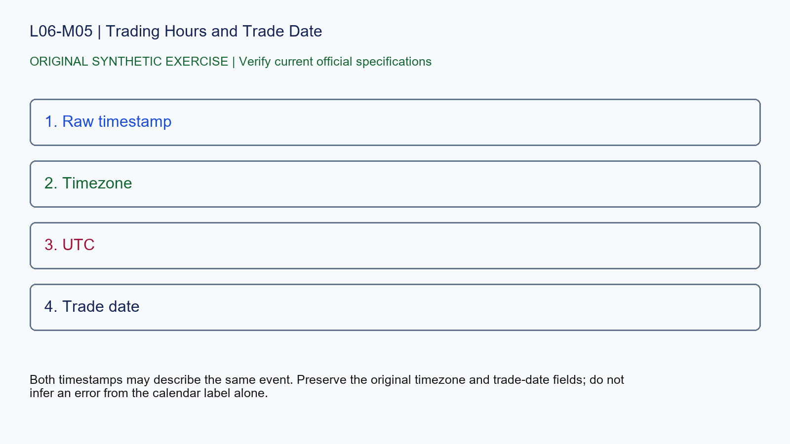

# L06-M05 - Trading Hours and Trade Date

## Objective
Apply trading hours and trade date with a source-stamped specification record.

## Synthetic case
A platform chart labels a Sunday-evening fill as Monday while a local export shows Sunday.

## Concept
Globex sessions can cross midnight and use exchange trade dates. Timezone, daylight-saving rule, session template and holiday schedule must accompany timestamps.

## Practice
Normalize the record to UTC and exchange time, then state which label remains platform-defined.

## Answer rationale
Both timestamps may describe the same event. Preserve the original timezone and trade-date fields; do not infer an error from the calendar label alone.

## References
- [E-mini S&P 500 Futures Contract Specs - CME Group](https://www.cmegroup.com/markets/equities/sp/e-mini-sandp500.contractSpecs.html)
- [E-mini Nasdaq-100 Futures Contract Specs - CME Group](https://www.cmegroup.com/markets/equities/nasdaq/e-mini-nasdaq-100.contractSpecs.html)
- [Gold Futures Contract Specs - CME Group](https://www.cmegroup.com/markets/metals/precious/gold.contractSpecs.html)
- [Micro E-mini Equity Index Futures - CME Group](https://www.cmegroup.com/markets/equities/micro-e-mini-futures.html)
- [Micro Gold Futures Contract Specs - CME Group](https://www.cmegroup.com/markets/metals/precious/e-micro-gold.contractSpecs.html)
- [CME Group Holiday and Trading Hours](https://www.cmegroup.com/trading-hours.html)
- [Delayed Quotes - CME Group](https://www.cmegroup.com/market-data/browse-data/delayed-quotes.html)
- [Real-Time and Historical Data - CME Group](https://www.cmegroup.com/market-data/real-time-and-historical-data.html)
