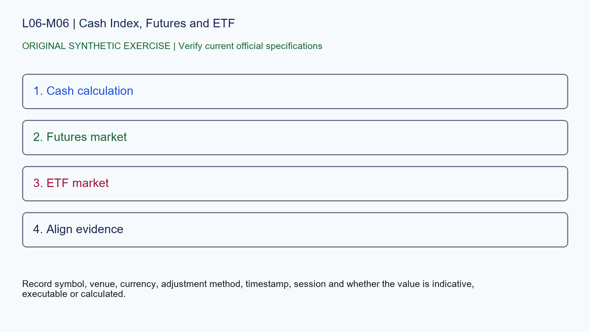

# L06-M06 - Cash Index, Futures and ETF

## Objective
Apply cash index, futures and etf with a source-stamped specification record.

## Synthetic case
A screenshot overlays an S&P 500 cash index, ES futures and an ETF, then claims every price difference is bad data.

## Concept
Cash indices, futures and ETFs have different construction, trading hours and carrying relationships. Alignment requires instrument identity and synchronized timestamps.

## Practice
List the evidence required before comparing the three series. Do not force them onto one price scale.

## Answer rationale
Record symbol, venue, currency, adjustment method, timestamp, session and whether the value is indicative, executable or calculated.

## References
- [E-mini S&P 500 Futures Contract Specs - CME Group](https://www.cmegroup.com/markets/equities/sp/e-mini-sandp500.contractSpecs.html)
- [E-mini Nasdaq-100 Futures Contract Specs - CME Group](https://www.cmegroup.com/markets/equities/nasdaq/e-mini-nasdaq-100.contractSpecs.html)
- [Gold Futures Contract Specs - CME Group](https://www.cmegroup.com/markets/metals/precious/gold.contractSpecs.html)
- [Micro E-mini Equity Index Futures - CME Group](https://www.cmegroup.com/markets/equities/micro-e-mini-futures.html)
- [Micro Gold Futures Contract Specs - CME Group](https://www.cmegroup.com/markets/metals/precious/e-micro-gold.contractSpecs.html)
- [CME Group Holiday and Trading Hours](https://www.cmegroup.com/trading-hours.html)
- [Delayed Quotes - CME Group](https://www.cmegroup.com/market-data/browse-data/delayed-quotes.html)
- [Real-Time and Historical Data - CME Group](https://www.cmegroup.com/market-data/real-time-and-historical-data.html)
