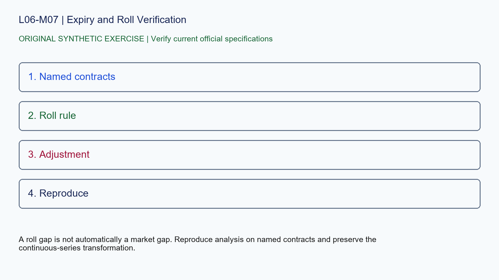

# L06-M07 - Expiry and Roll Verification

## Objective
Apply expiry and roll verification with a source-stamped specification record.

## Synthetic case
A continuous futures chart jumps when its provider changes the lead contract.

## Concept
Futures expire. Continuous-series providers can roll on different dates and can back-adjust prices, changing historical levels without changing individual contracts.

## Practice
Separate the raw contract series from the continuous series and document the provider roll rule.

## Answer rationale
A roll gap is not automatically a market gap. Reproduce analysis on named contracts and preserve the continuous-series transformation.

## References
- [E-mini S&P 500 Futures Contract Specs - CME Group](https://www.cmegroup.com/markets/equities/sp/e-mini-sandp500.contractSpecs.html)
- [E-mini Nasdaq-100 Futures Contract Specs - CME Group](https://www.cmegroup.com/markets/equities/nasdaq/e-mini-nasdaq-100.contractSpecs.html)
- [Gold Futures Contract Specs - CME Group](https://www.cmegroup.com/markets/metals/precious/gold.contractSpecs.html)
- [Micro E-mini Equity Index Futures - CME Group](https://www.cmegroup.com/markets/equities/micro-e-mini-futures.html)
- [Micro Gold Futures Contract Specs - CME Group](https://www.cmegroup.com/markets/metals/precious/e-micro-gold.contractSpecs.html)
- [CME Group Holiday and Trading Hours](https://www.cmegroup.com/trading-hours.html)
- [Delayed Quotes - CME Group](https://www.cmegroup.com/market-data/browse-data/delayed-quotes.html)
- [Real-Time and Historical Data - CME Group](https://www.cmegroup.com/market-data/real-time-and-historical-data.html)
