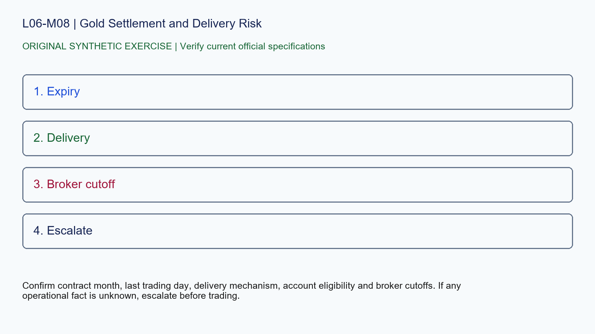

# L06-M08 - Gold Settlement and Delivery Risk

## Objective
Apply gold settlement and delivery risk with a source-stamped specification record.

## Synthetic case
A learner holds a GC contract toward expiry believing every futures position is always cash settled.

## Concept
GC is a physically delivered COMEX contract. Delivery procedures and broker liquidation rules require current verification; education must not imply that a stop guarantees exit before delivery obligations.

## Practice
Build a pre-expiry checklist using the contract page and broker-specific unknowns.

## Answer rationale
Confirm contract month, last trading day, delivery mechanism, account eligibility and broker cutoffs. If any operational fact is unknown, escalate before trading.

## References
- [E-mini S&P 500 Futures Contract Specs - CME Group](https://www.cmegroup.com/markets/equities/sp/e-mini-sandp500.contractSpecs.html)
- [E-mini Nasdaq-100 Futures Contract Specs - CME Group](https://www.cmegroup.com/markets/equities/nasdaq/e-mini-nasdaq-100.contractSpecs.html)
- [Gold Futures Contract Specs - CME Group](https://www.cmegroup.com/markets/metals/precious/gold.contractSpecs.html)
- [Micro E-mini Equity Index Futures - CME Group](https://www.cmegroup.com/markets/equities/micro-e-mini-futures.html)
- [Micro Gold Futures Contract Specs - CME Group](https://www.cmegroup.com/markets/metals/precious/e-micro-gold.contractSpecs.html)
- [CME Group Holiday and Trading Hours](https://www.cmegroup.com/trading-hours.html)
- [Delayed Quotes - CME Group](https://www.cmegroup.com/market-data/browse-data/delayed-quotes.html)
- [Real-Time and Historical Data - CME Group](https://www.cmegroup.com/market-data/real-time-and-historical-data.html)
