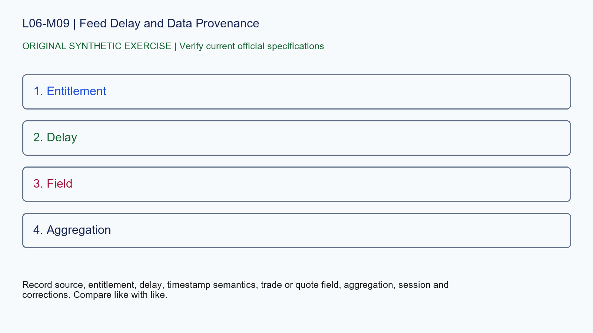

# L06-M09 - Feed Delay and Data Provenance

## Objective
Apply feed delay and data provenance with a source-stamped specification record.

## Synthetic case
A public CME quote, broker chart and paid API show different last prices at the same wall-clock moment.

## Concept
Public CME quotes are delayed by at least ten minutes, while licensed products can provide real-time, delayed or end-of-day data. Vendors may also use different aggregation and session settings.

## Practice
Create a provenance record that can explain the difference without choosing a winner by appearance.

## Answer rationale
Record source, entitlement, delay, timestamp semantics, trade or quote field, aggregation, session and corrections. Compare like with like.

## References
- [E-mini S&P 500 Futures Contract Specs - CME Group](https://www.cmegroup.com/markets/equities/sp/e-mini-sandp500.contractSpecs.html)
- [E-mini Nasdaq-100 Futures Contract Specs - CME Group](https://www.cmegroup.com/markets/equities/nasdaq/e-mini-nasdaq-100.contractSpecs.html)
- [Gold Futures Contract Specs - CME Group](https://www.cmegroup.com/markets/metals/precious/gold.contractSpecs.html)
- [Micro E-mini Equity Index Futures - CME Group](https://www.cmegroup.com/markets/equities/micro-e-mini-futures.html)
- [Micro Gold Futures Contract Specs - CME Group](https://www.cmegroup.com/markets/metals/precious/e-micro-gold.contractSpecs.html)
- [CME Group Holiday and Trading Hours](https://www.cmegroup.com/trading-hours.html)
- [Delayed Quotes - CME Group](https://www.cmegroup.com/market-data/browse-data/delayed-quotes.html)
- [Real-Time and Historical Data - CME Group](https://www.cmegroup.com/market-data/real-time-and-historical-data.html)
