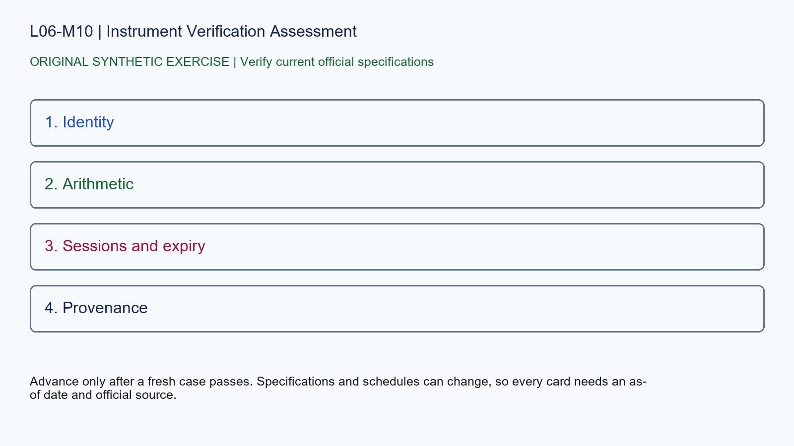

# L06-M10 - Instrument Verification Assessment

## Objective
Apply instrument verification assessment with a source-stamped specification record.

## Synthetic case
An unseen case mixes ES, NQ and GC records with invalid ticks, missing expiries, ambiguous timestamps and a delayed feed.

## Concept
Score identity, specification arithmetic, session normalization, expiry handling, delivery awareness and provenance from 0 to 2. Require 10/12 and no critical failure.

## Practice
Submit corrected specification cards, calculations and a source-stamped decision log. Trading an unidentified contract or inventing a missing field is a critical failure.

## Answer rationale
Advance only after a fresh case passes. Specifications and schedules can change, so every card needs an as-of date and official source.

## References
- [E-mini S&P 500 Futures Contract Specs - CME Group](https://www.cmegroup.com/markets/equities/sp/e-mini-sandp500.contractSpecs.html)
- [E-mini Nasdaq-100 Futures Contract Specs - CME Group](https://www.cmegroup.com/markets/equities/nasdaq/e-mini-nasdaq-100.contractSpecs.html)
- [Gold Futures Contract Specs - CME Group](https://www.cmegroup.com/markets/metals/precious/gold.contractSpecs.html)
- [Micro E-mini Equity Index Futures - CME Group](https://www.cmegroup.com/markets/equities/micro-e-mini-futures.html)
- [Micro Gold Futures Contract Specs - CME Group](https://www.cmegroup.com/markets/metals/precious/e-micro-gold.contractSpecs.html)
- [CME Group Holiday and Trading Hours](https://www.cmegroup.com/trading-hours.html)
- [Delayed Quotes - CME Group](https://www.cmegroup.com/market-data/browse-data/delayed-quotes.html)
- [Real-Time and Historical Data - CME Group](https://www.cmegroup.com/market-data/real-time-and-historical-data.html)
