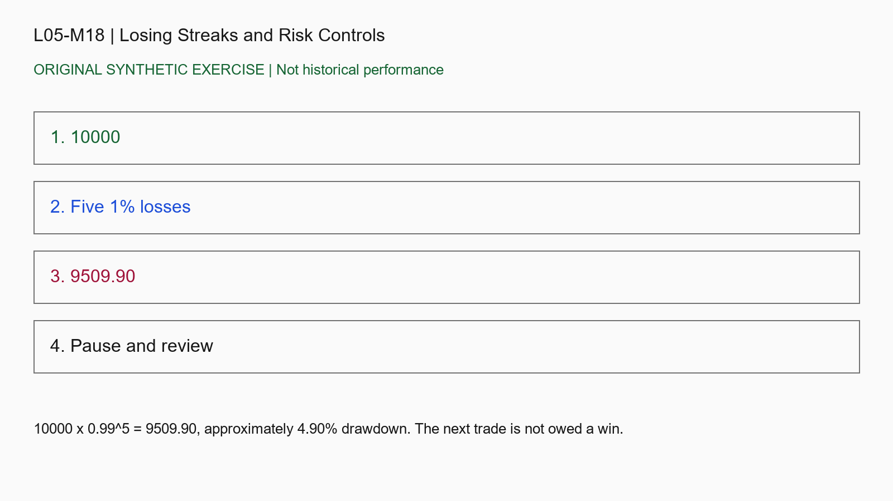

# L05-M18 - Losing Streaks and Risk Controls

## Objective
Apply losing streaks and risk controls to a reproducible decision record.

## Synthetic case
Five simulated losses each remove 1% of then-current equity from an initial 10000, ignoring costs.

## Concept
Compounding changes risk dollars. Streak probabilities require assumptions; a small backtest cannot guarantee a maximum future losing streak.

## Practice
Compute remaining equity. Write a precommitted pause/review rule without increasing size to recover losses.

## Answer rationale
10000 x 0.99^5 = 9509.90, approximately 4.90% drawdown. The next trade is not owed a win.

## References
- [Position and Risk Management - CME Group](https://www.cmegroup.com/education/courses/things-to-know-before-trading-cme-futures/position-and-risk-management)
- [Asset Allocation and Diversification - Investor.gov](https://www.investor.gov/introduction-investing/getting-started/asset-allocation)
- [Commodity Trading Systems Sold on the Internet - CFTC](https://www.cftc.gov/LearnAndProtect/AdvisoriesAndArticles/fraudadv_tradingsystem.html)
