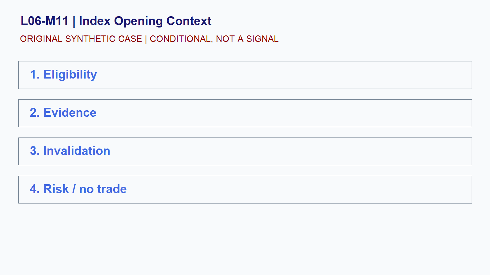

# L06-M11 - Index Opening Context

## Objective
Build and test a conditional index opening context playbook.

## Synthetic case
ES opens above the prior synthetic value area after an overnight rise.

## Concept
Separate the overnight auction, cash open, and prior-session references. An opening location is context, not a direction forecast.

## Practice
Write bullish, bearish, and no-trade hypotheses with observable invalidation.

## Answer rationale
A valid plan states what would disconfirm each path and avoids treating the opening location as a signal.

## References
- [E-mini S&P 500 Futures Contract Specs - CME Group](https://www.cmegroup.com/markets/equities/sp/e-mini-sandp500.contractSpecs.html)
- [E-mini Nasdaq-100 Futures Contract Specs - CME Group](https://www.cmegroup.com/markets/equities/nasdaq/e-mini-nasdaq-100.contractSpecs.html)
- [Gold Futures - CME Group](https://www.cmegroup.com/markets/metals/precious/gold.html)
- [CME Group Holiday and Trading Hours](https://www.cmegroup.com/trading-hours.html)
- [Basics of Futures Trading - CFTC](https://www.cftc.gov/LearnAndProtect/AdvisoriesAndArticles/FuturesMarketBasics/index.htm)
- [FOMC Calendars - Federal Reserve](https://www.federalreserve.gov/monetarypolicy/fomccalendars.htm)
- [BLS Release Calendar - U.S. Bureau of Labor Statistics](https://www.bls.gov/schedule/)
