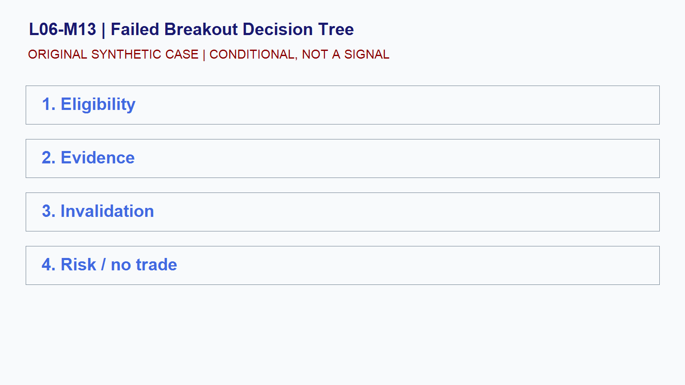

# L06-M13 - Failed Breakout Decision Tree

## Objective
Build and test a conditional failed breakout decision tree playbook.

## Synthetic case
ES trades above a prior synthetic high, then returns inside the range.

## Concept
A breakout and a failed breakout require acceptance tests, time windows, and explicit risk limits rather than narrative hindsight.

## Practice
Build continue, fail, and stand-aside branches without choosing one in advance.

## Answer rationale
Branching rules protect against converting one rejected price into a guaranteed reversal call.

## References
- [E-mini S&P 500 Futures Contract Specs - CME Group](https://www.cmegroup.com/markets/equities/sp/e-mini-sandp500.contractSpecs.html)
- [E-mini Nasdaq-100 Futures Contract Specs - CME Group](https://www.cmegroup.com/markets/equities/nasdaq/e-mini-nasdaq-100.contractSpecs.html)
- [Gold Futures - CME Group](https://www.cmegroup.com/markets/metals/precious/gold.html)
- [CME Group Holiday and Trading Hours](https://www.cmegroup.com/trading-hours.html)
- [Basics of Futures Trading - CFTC](https://www.cftc.gov/LearnAndProtect/AdvisoriesAndArticles/FuturesMarketBasics/index.htm)
- [FOMC Calendars - Federal Reserve](https://www.federalreserve.gov/monetarypolicy/fomccalendars.htm)
- [BLS Release Calendar - U.S. Bureau of Labor Statistics](https://www.bls.gov/schedule/)
