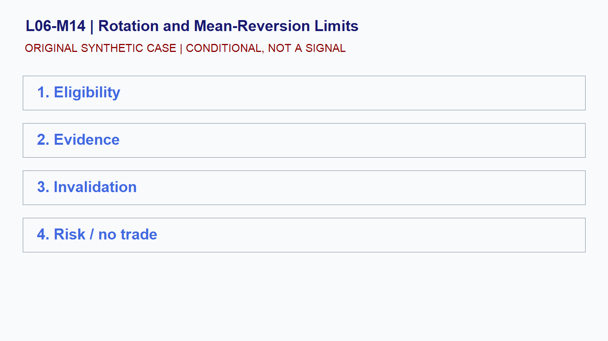

# L06-M14 - Rotation and Mean-Reversion Limits

## Objective
Build and test a conditional rotation and mean-reversion limits playbook.

## Synthetic case
Synthetic ES rotates repeatedly through a reference price in a balanced session.

## Concept
Mean reversion is a regime-dependent hypothesis. Expansion, event risk, thin liquidity, or changing value can invalidate it.

## Practice
Specify eligibility, entry evidence, target logic, and hard invalidation.

## Answer rationale
A rotation playbook is valid only while balance evidence persists; it is not a promise that extremes will hold.

## References
- [E-mini S&P 500 Futures Contract Specs - CME Group](https://www.cmegroup.com/markets/equities/sp/e-mini-sandp500.contractSpecs.html)
- [E-mini Nasdaq-100 Futures Contract Specs - CME Group](https://www.cmegroup.com/markets/equities/nasdaq/e-mini-nasdaq-100.contractSpecs.html)
- [Gold Futures - CME Group](https://www.cmegroup.com/markets/metals/precious/gold.html)
- [CME Group Holiday and Trading Hours](https://www.cmegroup.com/trading-hours.html)
- [Basics of Futures Trading - CFTC](https://www.cftc.gov/LearnAndProtect/AdvisoriesAndArticles/FuturesMarketBasics/index.htm)
- [FOMC Calendars - Federal Reserve](https://www.federalreserve.gov/monetarypolicy/fomccalendars.htm)
- [BLS Release Calendar - U.S. Bureau of Labor Statistics](https://www.bls.gov/schedule/)
