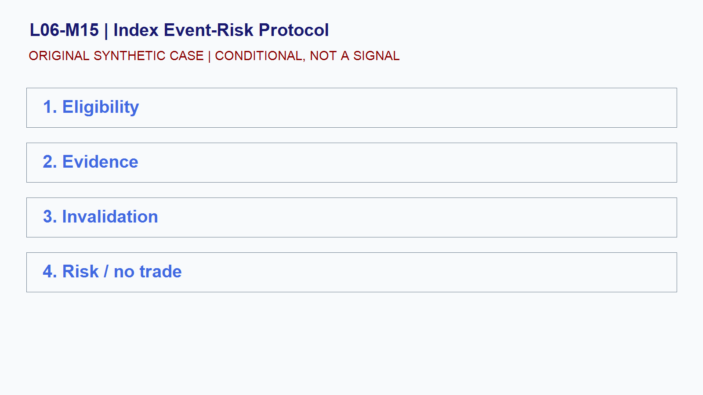

# L06-M15 - Index Event-Risk Protocol

## Objective
Build and test a conditional index event-risk protocol playbook.

## Synthetic case
A position idea overlaps a scheduled FOMC announcement and employment release.

## Concept
Scheduled events can change liquidity, volatility, spreads, and correlation. The safe default is to reduce assumptions and predefine exposure.

## Practice
Create before, during, and after-event gates including a no-trade option.

## Answer rationale
The protocol manages uncertainty; it does not predict the announcement or market response.

## References
- [E-mini S&P 500 Futures Contract Specs - CME Group](https://www.cmegroup.com/markets/equities/sp/e-mini-sandp500.contractSpecs.html)
- [E-mini Nasdaq-100 Futures Contract Specs - CME Group](https://www.cmegroup.com/markets/equities/nasdaq/e-mini-nasdaq-100.contractSpecs.html)
- [Gold Futures - CME Group](https://www.cmegroup.com/markets/metals/precious/gold.html)
- [CME Group Holiday and Trading Hours](https://www.cmegroup.com/trading-hours.html)
- [Basics of Futures Trading - CFTC](https://www.cftc.gov/LearnAndProtect/AdvisoriesAndArticles/FuturesMarketBasics/index.htm)
- [FOMC Calendars - Federal Reserve](https://www.federalreserve.gov/monetarypolicy/fomccalendars.htm)
- [BLS Release Calendar - U.S. Bureau of Labor Statistics](https://www.bls.gov/schedule/)
