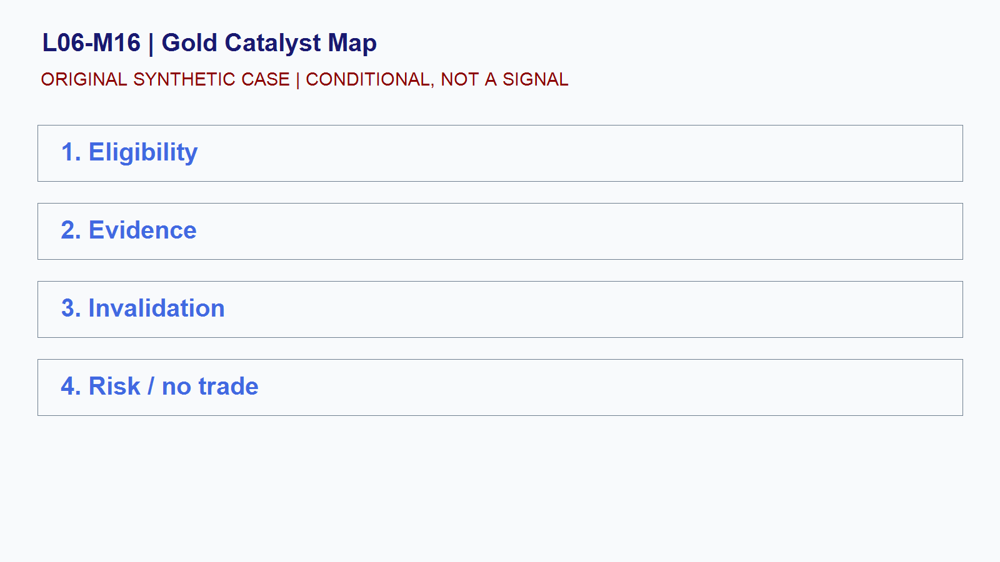

# L06-M16 - Gold Catalyst Map

## Objective
Build and test a conditional gold catalyst map playbook.

## Synthetic case
GC moves sharply while the dollar and yields also change in a synthetic scenario.

## Concept
Gold can respond to rates, currencies, inflation expectations, risk sentiment, and positioning, but relationships vary through time.

## Practice
List competing explanations and the evidence needed to distinguish them.

## Answer rationale
Cross-market moves are context, not causal proof or automatic confirmation.

## References
- [E-mini S&P 500 Futures Contract Specs - CME Group](https://www.cmegroup.com/markets/equities/sp/e-mini-sandp500.contractSpecs.html)
- [E-mini Nasdaq-100 Futures Contract Specs - CME Group](https://www.cmegroup.com/markets/equities/nasdaq/e-mini-nasdaq-100.contractSpecs.html)
- [Gold Futures - CME Group](https://www.cmegroup.com/markets/metals/precious/gold.html)
- [CME Group Holiday and Trading Hours](https://www.cmegroup.com/trading-hours.html)
- [Basics of Futures Trading - CFTC](https://www.cftc.gov/LearnAndProtect/AdvisoriesAndArticles/FuturesMarketBasics/index.htm)
- [FOMC Calendars - Federal Reserve](https://www.federalreserve.gov/monetarypolicy/fomccalendars.htm)
- [BLS Release Calendar - U.S. Bureau of Labor Statistics](https://www.bls.gov/schedule/)
