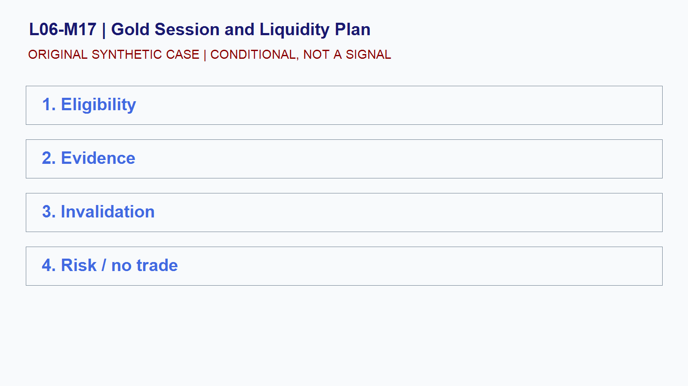

# L06-M17 - Gold Session and Liquidity Plan

## Objective
Build and test a conditional gold session and liquidity plan playbook.

## Synthetic case
A GC setup appears during a thin synthetic interval before a major release.

## Concept
Session participation and order-book conditions affect slippage and stop behavior. A chart pattern cannot substitute for liquidity checks.

## Practice
Define minimum liquidity evidence, maximum execution uncertainty, and cancellation rules.

## Answer rationale
The plan stands aside when execution conditions cannot be bounded.

## References
- [E-mini S&P 500 Futures Contract Specs - CME Group](https://www.cmegroup.com/markets/equities/sp/e-mini-sandp500.contractSpecs.html)
- [E-mini Nasdaq-100 Futures Contract Specs - CME Group](https://www.cmegroup.com/markets/equities/nasdaq/e-mini-nasdaq-100.contractSpecs.html)
- [Gold Futures - CME Group](https://www.cmegroup.com/markets/metals/precious/gold.html)
- [CME Group Holiday and Trading Hours](https://www.cmegroup.com/trading-hours.html)
- [Basics of Futures Trading - CFTC](https://www.cftc.gov/LearnAndProtect/AdvisoriesAndArticles/FuturesMarketBasics/index.htm)
- [FOMC Calendars - Federal Reserve](https://www.federalreserve.gov/monetarypolicy/fomccalendars.htm)
- [BLS Release Calendar - U.S. Bureau of Labor Statistics](https://www.bls.gov/schedule/)
