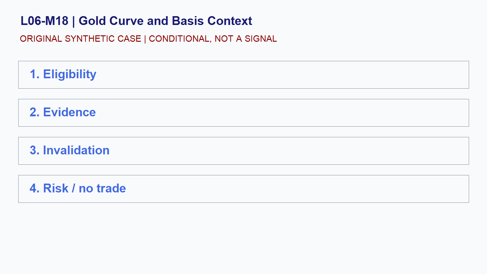

# L06-M18 - Gold Curve and Basis Context

## Objective
Build and test a conditional gold curve and basis context playbook.

## Synthetic case
Near and deferred synthetic gold contracts show different prices.

## Concept
Futures curves reflect financing, storage, convenience, expectations, and contract mechanics. A spread is not a simple spot-direction signal.

## Practice
Compare like-for-like contracts and record expiry, units, timestamp, and source.

## Answer rationale
A defensible comparison normalizes contract identity and avoids inferring direction from curve shape alone.

## References
- [E-mini S&P 500 Futures Contract Specs - CME Group](https://www.cmegroup.com/markets/equities/sp/e-mini-sandp500.contractSpecs.html)
- [E-mini Nasdaq-100 Futures Contract Specs - CME Group](https://www.cmegroup.com/markets/equities/nasdaq/e-mini-nasdaq-100.contractSpecs.html)
- [Gold Futures - CME Group](https://www.cmegroup.com/markets/metals/precious/gold.html)
- [CME Group Holiday and Trading Hours](https://www.cmegroup.com/trading-hours.html)
- [Basics of Futures Trading - CFTC](https://www.cftc.gov/LearnAndProtect/AdvisoriesAndArticles/FuturesMarketBasics/index.htm)
- [FOMC Calendars - Federal Reserve](https://www.federalreserve.gov/monetarypolicy/fomccalendars.htm)
- [BLS Release Calendar - U.S. Bureau of Labor Statistics](https://www.bls.gov/schedule/)
