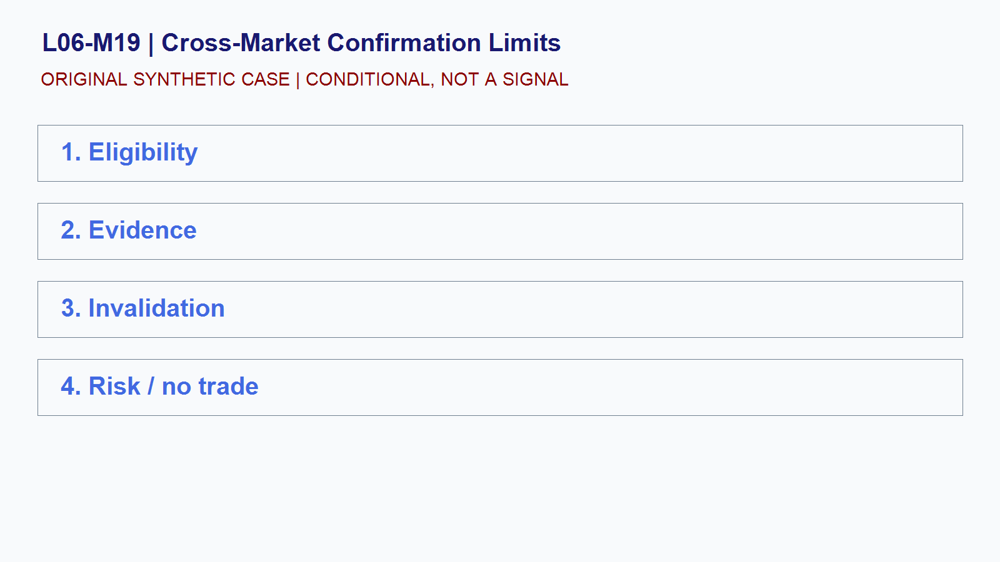

# L06-M19 - Cross-Market Confirmation Limits

## Objective
Build and test a conditional cross-market confirmation limits playbook.

## Synthetic case
ES, NQ, GC, yields, and a currency index move together for fifteen minutes.

## Concept
Confirmation is sensitive to window, lag, common catalysts, and data quality. Correlation can change or be coincidental.

## Practice
Create a confirmation score that includes disagreement and missing-data penalties.

## Answer rationale
Divergence and missing evidence reduce confidence; they are not permission to invent a story.

## References
- [E-mini S&P 500 Futures Contract Specs - CME Group](https://www.cmegroup.com/markets/equities/sp/e-mini-sandp500.contractSpecs.html)
- [E-mini Nasdaq-100 Futures Contract Specs - CME Group](https://www.cmegroup.com/markets/equities/nasdaq/e-mini-nasdaq-100.contractSpecs.html)
- [Gold Futures - CME Group](https://www.cmegroup.com/markets/metals/precious/gold.html)
- [CME Group Holiday and Trading Hours](https://www.cmegroup.com/trading-hours.html)
- [Basics of Futures Trading - CFTC](https://www.cftc.gov/LearnAndProtect/AdvisoriesAndArticles/FuturesMarketBasics/index.htm)
- [FOMC Calendars - Federal Reserve](https://www.federalreserve.gov/monetarypolicy/fomccalendars.htm)
- [BLS Release Calendar - U.S. Bureau of Labor Statistics](https://www.bls.gov/schedule/)
