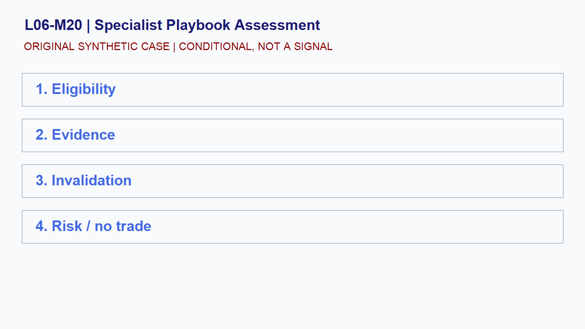

# L06-M20 - Specialist Playbook Assessment

## Objective
Build and test a conditional specialist playbook assessment playbook.

## Synthetic case
An unseen case combines an index open, a scheduled event, GC curve data, and conflicting cross-market evidence.

## Concept
A specialist playbook is a precommitted decision process with eligibility, evidence, invalidation, sizing, execution, and review.

## Practice
Submit an index or gold playbook plus a source-stamped decision log.

## Answer rationale
Pass only when the learner can choose no trade, identify invalidation, and separate evidence from inference.

## References
- [E-mini S&P 500 Futures Contract Specs - CME Group](https://www.cmegroup.com/markets/equities/sp/e-mini-sandp500.contractSpecs.html)
- [E-mini Nasdaq-100 Futures Contract Specs - CME Group](https://www.cmegroup.com/markets/equities/nasdaq/e-mini-nasdaq-100.contractSpecs.html)
- [Gold Futures - CME Group](https://www.cmegroup.com/markets/metals/precious/gold.html)
- [CME Group Holiday and Trading Hours](https://www.cmegroup.com/trading-hours.html)
- [Basics of Futures Trading - CFTC](https://www.cftc.gov/LearnAndProtect/AdvisoriesAndArticles/FuturesMarketBasics/index.htm)
- [FOMC Calendars - Federal Reserve](https://www.federalreserve.gov/monetarypolicy/fomccalendars.htm)
- [BLS Release Calendar - U.S. Bureau of Labor Statistics](https://www.bls.gov/schedule/)
