# ITA English Handbook - Missions 01-100

Version 0.11.0 build candidate

## L00-M01 - Why Markets Exist

**Objective:** Explain the economic purpose of financial markets before learning how to trade them.

**Why it matters:** A learner who sees a market only as a place to win money will misunderstand nearly every later concept. Markets help transfer ownership, allocate capital, manage risk, and discover prices.

**Core ideas:**
- Primary markets connect issuers with capital; secondary markets let existing claims change hands.
- Futures and derivatives can transfer price risk between participants with different needs.
- The displayed price is the latest result of interacting orders, not a promise about the future.

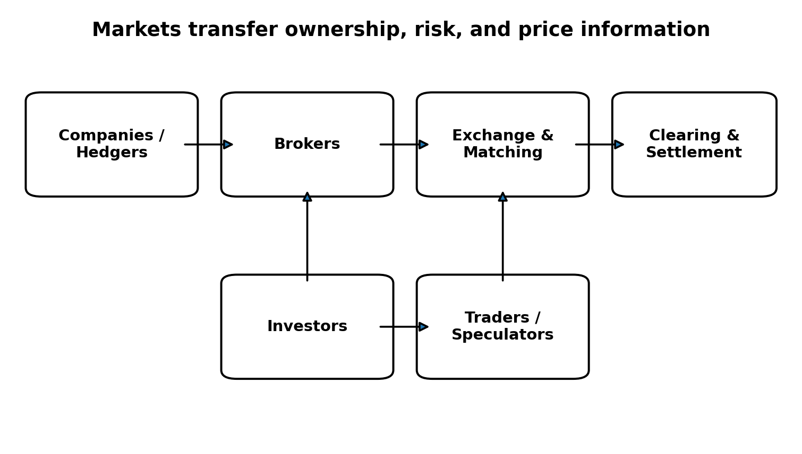

**Case:**

A European manufacturer expects a US-dollar payment in three months and wants less currency uncertainty. Another participant is willing to accept that exposure because of a different forecast or business need. The same market serves both.

**Practice:** Write one sentence explaining how an airline, a pension fund, and a short-term trader might each use a financial market.

**Common mistake:** Treating the market as a machine designed to pay traders.

**Knowledge checks and answer rationale:**

- Which is a core market function?
  Answer: Transferring ownership, capital, and risk.
- Do all participants seek the same outcome?
  Answer: No.
- Does an indicator create price?
  Answer: No.

**References:**
- [Understanding the Role of Hedgers - CME Group](https://www.cmegroup.com/education/courses/introduction-to-futures/understanding-the-role-of-hedgers)
- [Understanding the Role of Speculators - CME Group](https://www.cmegroup.com/education/courses/introduction-to-futures/understanding-the-role-of-speculators)
- [Introduction to Futures - CME Group YouTube playlist](https://www.youtube.com/playlist?list=PLkJQh4MWlJksEOMuHaYxkK0-yHsrhS8kW)

## L00-M02 - Investing, Trading, Speculation, and Gambling

**Objective:** Distinguish activities by decision process rather than by holding period or outcome.

**Why it matters:** A short holding period does not automatically make an activity gambling. The important differences are evidence, risk limits, repeatability, and whether the decision has a rational basis.

**Core ideas:**
- Investing usually seeks participation in longer-term economic value or cash flows.
- Trading seeks to manage a shorter-term opportunity with a defined thesis, invalidation, and risk.
- Speculation accepts uncertainty in pursuit of gain and can be disciplined or reckless.
- Gambling behavior appears when hope, excitement, or uncontrolled size replaces a tested process.

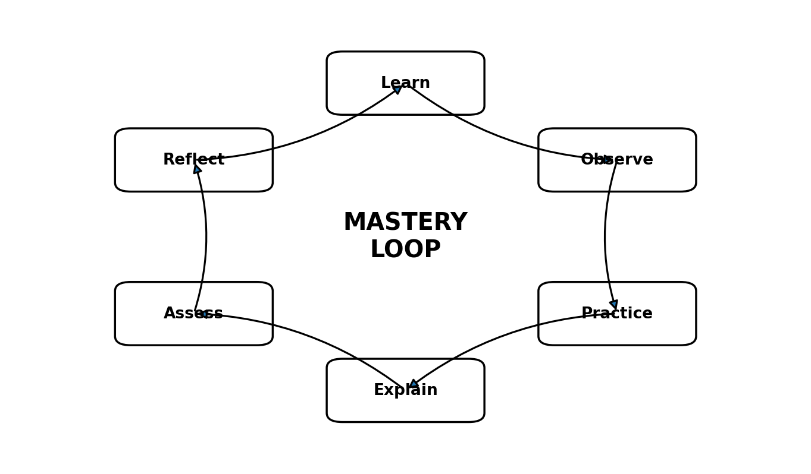

**Case:**

Two people buy the same index. One follows a diversified ten-year plan. The other uses extreme leverage after reading a social-media prediction. The instrument is identical; the process is not.

**Practice:** Classify three past market decisions as investment, disciplined trade, or gambling behavior. Explain each classification without referring to whether it made money.

**Common mistake:** Judging decision quality only by the profit or loss.

**Knowledge checks and answer rationale:**

- Can a profitable trade be a poor decision?
  Answer: Yes.
- Is holding time the only distinction?
  Answer: No.
- What matters most?
  Answer: Process, evidence, and risk.

**References:**
- [Position and Risk Management - CME Group](https://www.cmegroup.com/education/courses/things-to-know-before-trading-cme-futures/position-and-risk-management)

## L00-M03 - Who Participates in Markets?

**Objective:** Identify major participant groups and understand why their motives differ.

**Why it matters:** A hedge, an investment, a market-making action, and a speculative trade can produce similar transactions for very different reasons.

**Core ideas:**
- Hedgers seek to reduce an existing commercial or portfolio risk.
- Speculators intentionally accept price risk in pursuit of profit.
- Investors allocate capital according to longer-term objectives.
- Market makers quote prices and manage inventory risk.
- Brokers provide customer access and route or execute orders.
- Exchanges and clearing systems establish rules, matching, and post-trade obligations.

**Case:**

A gold producer sells futures to stabilize revenue while a macro fund buys because it expects lower real yields. The matched transaction does not reveal each participant's complete motive.

**Practice:** Create a two-column table: participant and likely objective. Include a bank, pension fund, airline, market maker, day trader, and central bank.

**Common mistake:** Assuming every large transaction is directional speculation.

**Knowledge checks and answer rationale:**

- Who commonly reduces commercial price risk?
  Answer: A hedger.
- Who provides market access to customers?
  Answer: A broker.
- Does a trade print reveal motive with certainty?
  Answer: No.

**References:**
- [Understanding the Role of Hedgers - CME Group](https://www.cmegroup.com/education/courses/introduction-to-futures/understanding-the-role-of-hedgers)
- [Understanding the Role of Speculators - CME Group](https://www.cmegroup.com/education/courses/introduction-to-futures/understanding-the-role-of-speculators)

## L00-M04 - Exchanges, Brokers, Clearing, and Settlement

**Objective:** Trace a transaction from the learner's instruction through execution and settlement.

**Why it matters:** A platform makes execution look instant, but legal relationships, routing, matching or dealer execution, clearing, and settlement sit behind a click.

**Core ideas:**
- A broker receives the client instruction and provides market access.
- An exchange or trading venue applies its rules and matches compatible orders.
- Clearing manages obligations and counterparty risk according to the market structure.
- Settlement completes the transfer of cash and the financial instrument.
- CFDs, exchange-traded futures, and shares can have materially different execution and legal structures.

**Case:**

A learner presses Buy and sees a confirmation. Behind that message may be routing, execution at a venue or dealer, trade confirmation, clearing, and settlement.

**Practice:** Draw the transaction path for one exchange-traded share order and one OTC CFD order. Highlight where their structures differ.

**Common mistake:** Assuming all instruments and brokers use the same execution model.

**Knowledge checks and answer rationale:**

- Who usually provides the learner's access?
  Answer: The broker.
- Where are compatible exchange orders matched?
  Answer: At a trading venue or exchange.
- Is every product centrally cleared?
  Answer: No.

**References:**
- [Executing an Order - Investor.gov](https://www.investor.gov/introduction-investing/investing-basics/how-stock-markets-work/executing-order)
- [How Online Stock Trading Works - FINRA](https://www.finra.org/investors/insights/online-trade-lifecycle)

## L00-M05 - Bid, Ask, and the Last Traded Price

**Objective:** Differentiate the last traded price from current executable quotations.

**Why it matters:** The last price shown on a chart is not automatically available for a new order.

**Core ideas:**
- The bid is the highest displayed price a buyer is currently willing to pay.
- The ask is the lowest displayed price a seller is currently willing to accept.
- The last price records a completed transaction and may no longer be available.
- Quotes can change before an order reaches the market.
- Different venues, data feeds, instruments, and brokers can display slightly different prices.

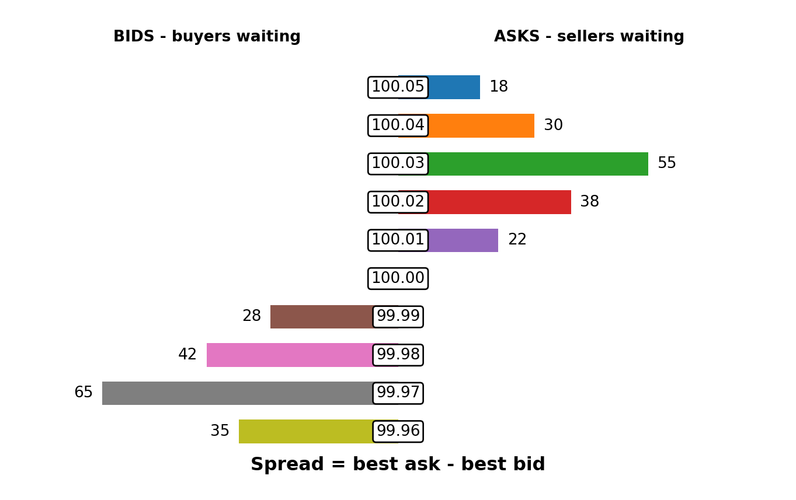

**Case:**

The chart shows 100.00, while the best ask is 100.03. An immediate market buy is likely to execute at the ask or worse, not automatically at 100.00.

**Practice:** On a demo platform, record bid, ask, spread, and last price five times during an active session.

**Common mistake:** Using the last candle close as a guaranteed execution price.

**Knowledge checks and answer rationale:**

- Which quotation is relevant to an immediate buy?
  Answer: The ask.
- Is the last price guaranteed for a new order?
  Answer: No.
- What does the last price represent?
  Answer: A completed transaction.

**References:**
- [Types of Orders - Investor.gov](https://www.investor.gov/introduction-investing/investing-basics/how-stock-markets-work/types-orders)
- [Order Types - FINRA](https://www.finra.org/investors/investing/investment-products/stocks/order-types)
- [Placing Orders on Charts - TradingView video](https://www.youtube.com/watch?v=DuhcjrwSRDQ)

## L00-M06 - The Bid-Ask Spread and Liquidity

**Objective:** Explain the spread as an immediate cost and a partial clue about liquidity.

**Why it matters:** An aggressive buyer crosses to the ask and an aggressive seller crosses to the bid. This matters especially in frequent trading and thin markets.

**Core ideas:**
- Spread equals best ask minus best bid.
- Tighter spreads often accompany liquid conditions, but top-of-book size alone does not fully describe liquidity.
- Spreads can widen around news, session changes, quiet hours, or stress.
- Total transaction cost may include spread, commission, fees, financing, and slippage.

**Case:**

Gold has a normal spread before a major release. Seconds before the announcement, quotations widen and available depth changes, increasing execution uncertainty.

**Practice:** Compare the spread of the same instrument during its primary session and during a quiet period. Record the difference and possible reason.

**Common mistake:** Backtesting without realistic spread and transaction-cost assumptions.

**Knowledge checks and answer rationale:**

- How is spread calculated?
  Answer: Best ask minus best bid.
- Can the spread change quickly?
  Answer: Yes.
- Is spread the only cost?
  Answer: No.

**References:**
- [Order Types - FINRA](https://www.finra.org/investors/investing/investment-products/stocks/order-types)
- [How Online Stock Trading Works - FINRA](https://www.finra.org/investors/insights/online-trade-lifecycle)
- [Futures Order Types - CME Group](https://www.cmegroup.com/education/courses/things-to-know-before-trading-cme-futures/futures-order-types)

## L00-M07 - Market Orders: Execution First

**Objective:** Understand what a market order prioritizes and what it cannot guarantee.

**Why it matters:** Market orders seek execution against available liquidity. In fast or thin conditions, the actual average price can differ significantly from the expected price.

**Core ideas:**
- A market order seeks immediate execution against available opposite-side liquidity.
- It offers high execution certainty in normal conditions but no exact price guarantee.
- A large order can fill at several price levels.
- Slippage is the difference between a referenced or expected price and actual execution.

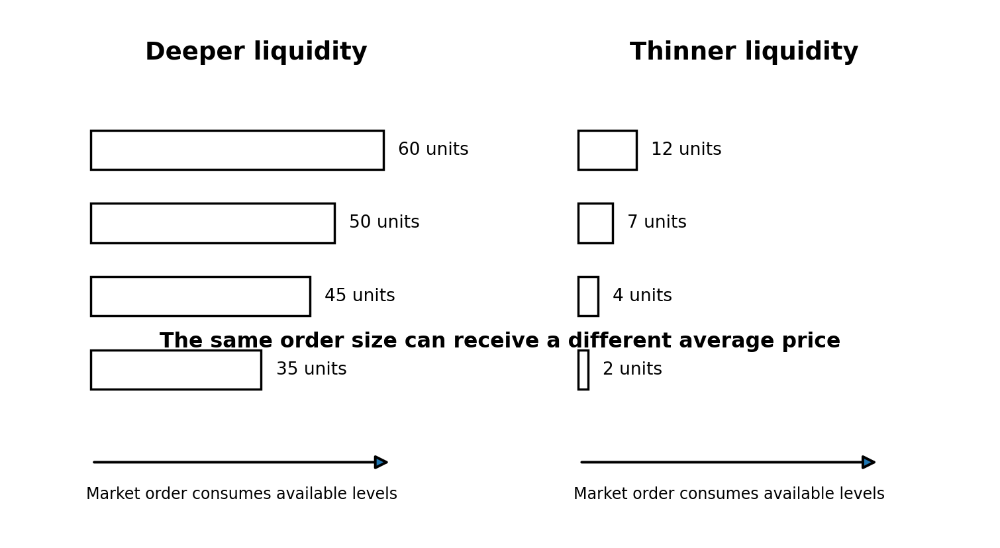

**Case:**

A large buy order enters a thin ask book. The first units fill near the best ask; the remainder consumes higher offers, producing a worse average price.

**Practice:** Use the order-book illustration to estimate how a small and a large market order could receive different average fills.

**Common mistake:** Using market orders around high-impact news without considering liquidity and slippage.

**Knowledge checks and answer rationale:**

- What does a market order prioritize?
  Answer: Execution.
- Does it guarantee an exact price?
  Answer: No.
- Can one order fill at multiple prices?
  Answer: Yes.

**References:**
- [Types of Orders - Investor.gov](https://www.investor.gov/introduction-investing/investing-basics/how-stock-markets-work/types-orders)
- [Order Types - FINRA](https://www.finra.org/investors/investing/investment-products/stocks/order-types)
- [Futures Order Types - CME Group](https://www.cmegroup.com/education/courses/things-to-know-before-trading-cme-futures/futures-order-types)

## L00-M08 - Limit Orders: Price First

**Objective:** Understand the trade-off between price control and execution uncertainty.

**Why it matters:** A limit order protects the permitted price but cannot force another participant to trade with you.

**Core ideas:**
- A buy limit can execute at the limit price or lower.
- A sell limit can execute at the limit price or higher.
- A limit order can partially fill, remain unfilled, or lose queue priority after modification.
- A historical price touch does not prove that every waiting order filled.

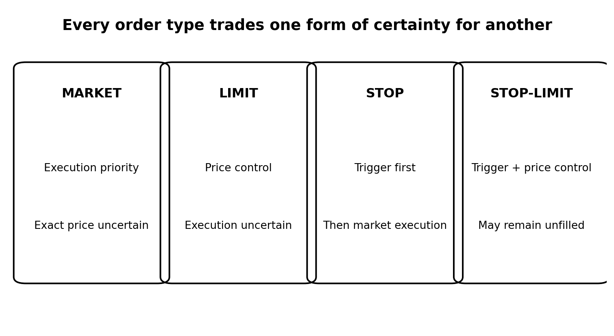

**Case:**

Price touches a learner's buy limit and rises immediately. The learner assumes a fill, but insufficient sell volume reached the order after earlier orders in the queue.

**Practice:** Define the execution condition for a buy limit at 99.50 and a sell limit at 101.20. Give one reason each might remain unfilled.

**Common mistake:** Treating every historical touch as a filled limit order in a backtest.

**Knowledge checks and answer rationale:**

- What does a limit order control?
  Answer: The permitted execution price.
- Is execution guaranteed?
  Answer: No.
- Can a limit order partially fill?
  Answer: Yes.

**References:**
- [Types of Orders - Investor.gov](https://www.investor.gov/introduction-investing/investing-basics/how-stock-markets-work/types-orders)
- [Order Types - FINRA](https://www.finra.org/investors/investing/investment-products/stocks/order-types)
- [Futures Order Types - CME Group](https://www.cmegroup.com/education/courses/things-to-know-before-trading-cme-futures/futures-order-types)

## L00-M09 - Stop and Stop-Limit Orders

**Objective:** Distinguish a stop trigger from a guaranteed exit price.

**Why it matters:** A stop defines when another order activates. It does not guarantee the exact execution price during a gap or rapid move.

**Core ideas:**
- A stop order generally becomes a market order after the trigger condition is met.
- A stop-limit becomes a limit order after activation.
- A stop may slip but prioritizes execution.
- A stop-limit controls price but can remain unfilled, leaving exposure open.
- Broker and venue rules must be checked because implementation details can differ.

**Case:**

A long position gaps below its stop. The stop activates and sells into the next available bids. A stop-limit might not execute if the market is already below its limit.

**Practice:** For a long position, explain the difference between a stop at 98 and a stop-limit with trigger 98 and limit 97.80.

**Common mistake:** Calling the stop trigger a guaranteed exit price.

**Knowledge checks and answer rationale:**

- What does a stop order become after activation?
  Answer: A market order.
- What does a stop-limit become?
  Answer: A limit order.
- Which can remain unfilled after activation?
  Answer: A stop-limit.

**References:**
- [Stop, Stop-Limit, and Trailing Stop Orders - Investor.gov](https://www.investor.gov/introduction-investing/general-resources/news-alerts/alerts-bulletins/investor-bulletins-15)
- [Stop Orders During Volatile Markets - FINRA](https://www.finra.org/investors/insights/stop-orders-factors-consider-during-volatile-markets)
- [Futures Order Types - CME Group](https://www.cmegroup.com/education/courses/things-to-know-before-trading-cme-futures/futures-order-types)

## L00-M10 - Risk, Leverage, and Survival

**Objective:** Explain why controlled exposure and survival come before strategy optimization.

**Why it matters:** A valid analysis can still produce a loss. Excessive size converts ordinary uncertainty into account-threatening damage.

**Core ideas:**
- Risk is uncertainty that can negatively affect capital or financial welfare.
- Leverage creates exposure larger than the cash committed.
- Margin is collateral, not the maximum possible loss.
- Position size should come from acceptable account risk and the distance to invalidation, not the maximum leverage offered.
- A professional plan sets per-trade and daily loss limits before considering targets.

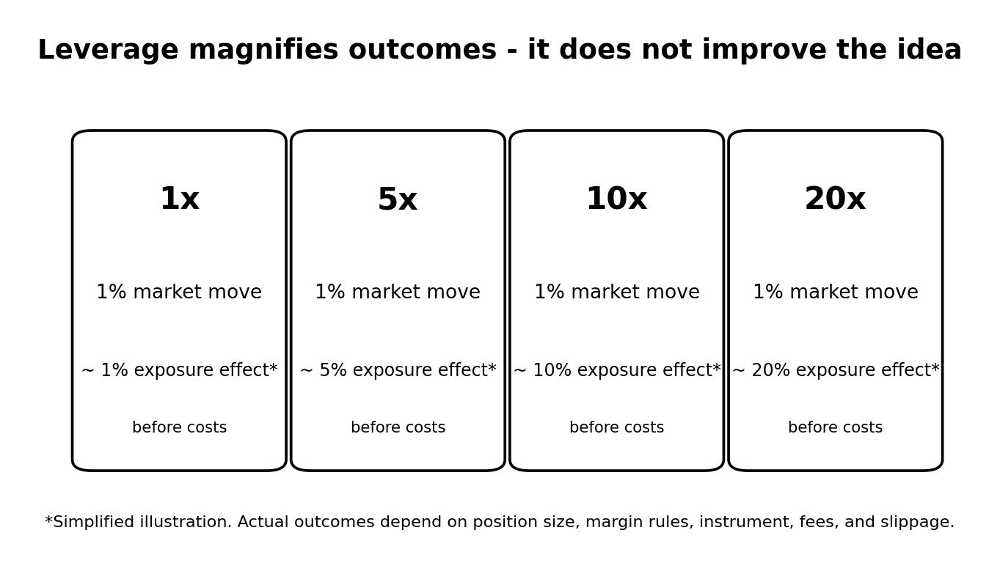

**Case:**

Two learners use the same setup and stop distance. One risks 0.5% of capital; the other risks 20%. The market outcome is the same, but the consequences for survival are radically different.

**Practice:** For a EUR 10,000 account, calculate the cash amount represented by 0.25%, 0.5%, 1%, and 2%. Explain which is more appropriate for a novice simulation plan and why.

**Common mistake:** Choosing the position size first and forcing the stop to fit afterward.

**Knowledge checks and answer rationale:**

- Is margin the maximum possible loss?
  Answer: No.
- What should determine position size?
  Answer: Accepted account risk and invalidation distance.
- Does leverage improve a trading edge?
  Answer: No.

**References:**
- [Position and Risk Management - CME Group](https://www.cmegroup.com/education/courses/things-to-know-before-trading-cme-futures/position-and-risk-management)

## L01-M01 - Candlesticks and OHLC: What One Bar Actually Says

**Objective:** Read open, high, low, and close values without attaching unsupported stories to a candle shape.

**Why it matters:** Candles compress a period of trading into four prices. They are useful summaries, but a candle does not reveal every order, participant, or reason behind the move.

**Core ideas:**
- The open is the first recorded price for the selected interval; the close is the last recorded price for that interval.
- The high and low mark the interval extremes.
- A candle body shows the distance between open and close; wicks show prices traded beyond the body.
- The same market move appears differently when the timeframe changes.
- A single candle is evidence of price movement, not a complete trading signal.

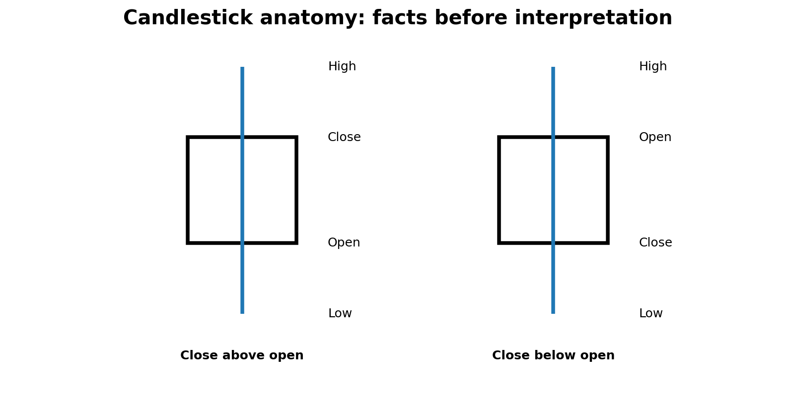

**Case:**

A five-minute candle opens at 100, trades to 103, falls to 99, and closes at 102. A learner calls it bullish. A professional description first records the OHLC facts, then asks where it formed and what preceded it.

**Practice:** Draw a candle for O=50, H=55, L=48, C=53. Then redraw the same values when C=49. Label every component.

**Common mistake:** Memorizing candle names while ignoring location, timeframe, and context.

**Knowledge checks and answer rationale:**

- What four prices define an OHLC bar?
  Answer: Open, high, low, and close.
- Does a long wick prove manipulation?
  Answer: No.
- Can the same data look different on another timeframe?
  Answer: Yes.

**References:**
- [TradingView Help Center](https://www.tradingview.com/support/)

## L01-M02 - Timeframes and Multi-Timeframe Context

**Objective:** Explain how higher and lower timeframes answer different questions without letting a small chart override broader context.

**Why it matters:** A market can be rising on the daily chart, correcting on the hourly chart, and rallying on the five-minute chart at the same time. These statements can all be true.

**Core ideas:**
- Higher timeframes compress more trading and usually define broader structure.
- Lower timeframes reveal execution detail but contain more noise.
- Analysis should assign a purpose to each timeframe: context, setup, or trigger.
- A lower-timeframe reversal may be only a pullback inside a higher-timeframe trend.
- Timeframe selection should match the expected holding period and risk plan.

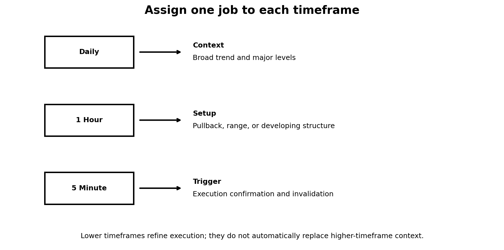

**Case:**

The daily chart is in an uptrend. The hourly chart is pulling back. The five-minute chart breaks upward. The correct interpretation depends on whether the five-minute move confirms the end of the hourly pullback or is only temporary noise.

**Practice:** Create a three-row plan using Daily for context, 1H for setup, and 5m for execution. Write one question each timeframe must answer.

**Common mistake:** Changing timeframe until a preferred trade appears.

**Knowledge checks and answer rationale:**

- Can different timeframes show different trends?
  Answer: Yes.
- Which timeframe should define strategic bias?
  Answer: The designated higher context timeframe.
- Should a two-minute signal automatically reverse a daily bias?
  Answer: No.

**References:**
- [TradingView Help Center](https://www.tradingview.com/support/)

## L01-M03 - Trading Sessions, Opens, and Market Overlap

**Objective:** Recognize how exchange hours, regional sessions, and overlaps influence liquidity and volatility.

**Why it matters:** Participation is not evenly distributed across the day. A strategy tested during a liquid open may behave very differently during a quiet period or extended hours.

**Core ideas:**
- Cash equities trade around an exchange-defined regular session, with separate pre-market and after-hours conditions where available.
- Futures and foreign exchange may trade for longer hours, but liquidity still changes by time of day.
- Session opens can reprice markets as new participants and information arrive.
- Overlaps may increase activity, while off-hours can bring wider spreads and thinner depth.
- Daylight-saving changes can shift local clock times relative to another region.

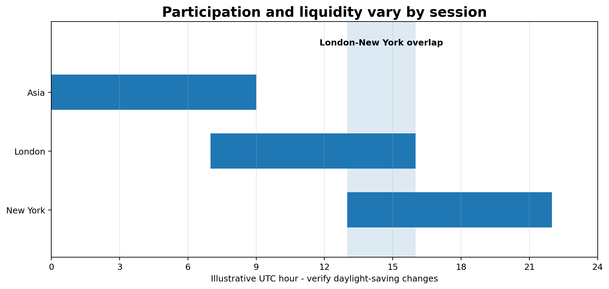

**Case:**

A stock has a narrow spread during the main US session but a much wider spread after hours. The chart still prints prices, yet execution quality and available liquidity are different.

**Practice:** Build a session table for your local timezone with London open, New York cash open, and the London-New York overlap. Add a daylight-saving reminder.

**Common mistake:** Backtesting at one session and trading the same rules at every hour.

**Knowledge checks and answer rationale:**

- Is liquidity constant throughout the day?
  Answer: No.
- Why can extended hours be riskier?
  Answer: Lower liquidity, wider spreads, and higher volatility can occur.
- Do long trading hours guarantee deep liquidity at every moment?
  Answer: No.

**References:**
- [Extended-Hours Trading: Know the Risks - FINRA](https://www.finra.org/investors/insights/extended-hours-trading)
- [Trading Terms: Time Parameters and Qualifiers - FINRA](https://www.finra.org/investors/insights/time-parameters-qualifiers-stock-orders)

## L01-M04 - Volatility and ATR: Measuring Movement, Not Direction

**Objective:** Use range and Average True Range as context for movement and risk without treating volatility as a directional forecast.

**Why it matters:** Stops, targets, and expectations should account for how much an instrument normally moves. A fixed ten-point stop can be huge in one regime and insignificant in another.

**Core ideas:**
- Volatility describes the magnitude and variability of price movement.
- True range accounts for the current high-low range and gaps from the previous close.
- ATR averages true range over a selected lookback.
- ATR rises after larger ranges and falls after quieter ranges; it does not predict direction.
- ATR settings depend on timeframe, instrument, and purpose.

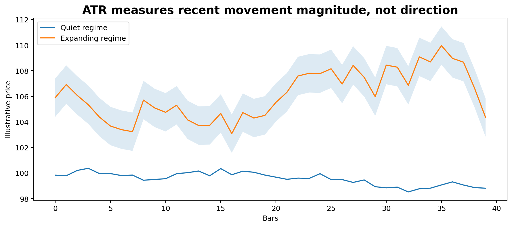

**Case:**

Two instruments both trade at 100. One has a daily ATR of 1; the other has a daily ATR of 8. The same two-point stop represents very different market breathing room.

**Practice:** Record the current 14-period ATR for one instrument on Daily, 1H, and 5m. Compare your proposed stop distance to each ATR and explain the relevant comparison.

**Common mistake:** Buying because ATR rises or using ATR without a structural invalidation level.

**Knowledge checks and answer rationale:**

- Does ATR indicate bullish or bearish direction?
  Answer: No.
- What does rising ATR suggest?
  Answer: Recent ranges are expanding.
- Should ATR be identical across timeframes?
  Answer: No.

**References:**
- [TradingView Help Center](https://www.tradingview.com/support/)

## L01-M05 - Gaps, Repricing, and the Market Open

**Objective:** Identify a gap and distinguish the observation from assumptions about whether it must fill.

**Why it matters:** A gap can reflect new information or a discontinuity between sessions. Traders often turn the visible space into a rule that price must return, but no such guarantee exists.

**Core ideas:**
- A gap appears when the next traded range does not overlap a prior reference range.
- Stocks commonly gap after earnings or news outside the regular session.
- Futures can show weekend or session gaps depending on chart settings and trading hours.
- A gap may fill, partially fill, or remain open.
- The opening auction and early liquidity can produce rapid repricing and slippage.

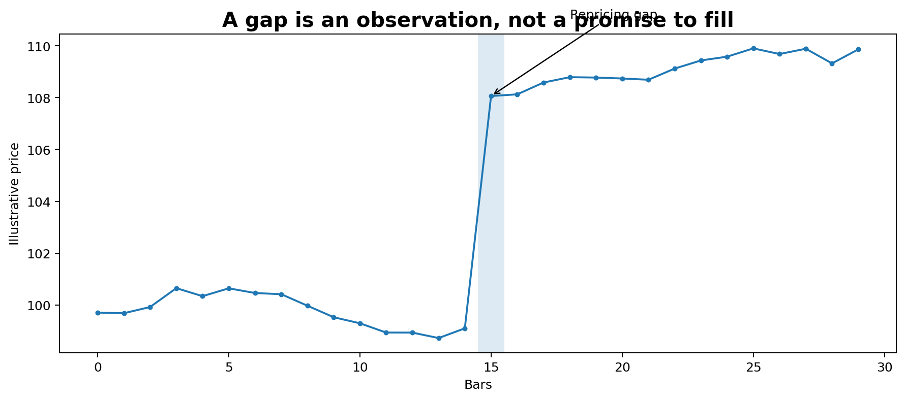

**Case:**

A company reports earnings after the close and opens 8% higher the next day. The gap is evidence that market participants accepted materially different prices; it is not automatically a short signal.

**Practice:** Find three historical gaps. Label the catalyst if known, initial direction, maximum extension, whether the gap filled, and how long that took.

**Common mistake:** Trading against every gap because “all gaps fill.”

**Knowledge checks and answer rationale:**

- Must every gap fill?
  Answer: No.
- Can news outside regular hours contribute to a gap?
  Answer: Yes.
- Is an unfilled gap alone a complete setup?
  Answer: No.

**References:**
- [Extended-Hours Trading: Know the Risks - FINRA](https://www.finra.org/investors/insights/extended-hours-trading)

## L01-M06 - Stocks, ETFs, Futures, Forex, and CFDs

**Objective:** Compare major instrument types by ownership, contract structure, trading venue, leverage, expiry, and counterparty risk.

**Why it matters:** A symbol that tracks the S&P 500 may represent an ETF share, a futures contract, a CFD, or another derivative. Similar-looking charts do not mean identical rights, costs, or risks.

**Core ideas:**
- A stock represents an ownership interest in a company.
- An ETF is a pooled product whose shares trade on an exchange and may track a basket or strategy.
- A futures contract is a standardized agreement with defined terms and an expiry or settlement process.
- Retail forex commonly involves leveraged over-the-counter trading through a dealer or broker.
- A CFD is a broker-provided derivative in permitted jurisdictions; the learner must understand local regulation and counterparty terms.

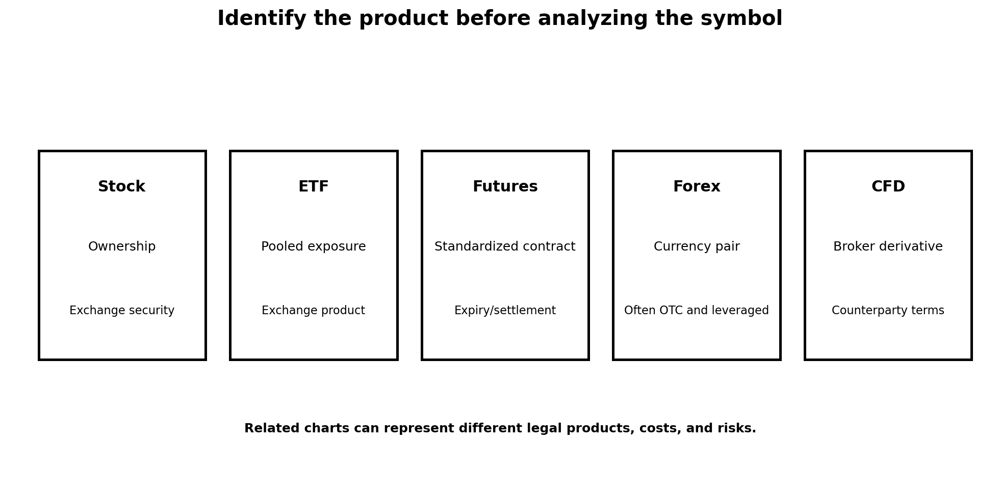

**Case:**

SPY, an S&P 500 futures contract, and an S&P 500 CFD all respond to related market forces, yet they differ in contract size, trading hours, fees, tax treatment, regulation, and counterparty exposure.

**Practice:** Create a comparison matrix for SPY, ES futures, and one broker’s index CFD. Include ownership, expiry, minimum size, spread/commission, financing, market hours, and regulator.

**Common mistake:** Choosing an instrument only because its chart looks familiar.

**Knowledge checks and answer rationale:**

- Does buying a CFD make you a shareholder?
  Answer: No.
- Does a futures contract have standardized terms?
  Answer: Yes.
- Can related instruments have different costs and risks?
  Answer: Yes.

**References:**
- [Stocks - Investor.gov](https://www.investor.gov/introduction-investing/investing-basics/investment-products/stocks)
- [Exchange-Traded Funds (ETFs) - Investor.gov](https://www.investor.gov/introduction-investing/investing-basics/investment-products/mutual-funds-and-exchange-traded-2)
- [Basics of Futures Trading - CFTC](https://www.cftc.gov/LearnAndProtect/AdvisoriesAndArticles/FuturesMarketBasics/index.htm)
- [Eight Things You Should Know Before Trading Forex - CFTC](https://www.cftc.gov/LearnAndProtect/AdvisoriesAndArticles/CustomerAdvisory_MustKnowForex.html)

## L01-M07 - Chart Platforms, Brokers, and Data Feeds

**Objective:** Describe the path from venue and data vendor to chart platform and broker execution.

**Why it matters:** The chart, broker, and underlying exchange can be separate systems. Small differences in symbols, feeds, sessions, and aggregation can produce different candles and indicator values.

**Core ideas:**
- A charting platform displays data obtained from one or more providers.
- A broker routes or internalizes orders according to its execution model and product.
- The same market can have multiple symbols, contract months, composite feeds, or broker-specific prices.
- Session settings and adjusted data can change historical candles.
- Platform tools should support analysis; they do not guarantee execution quality.

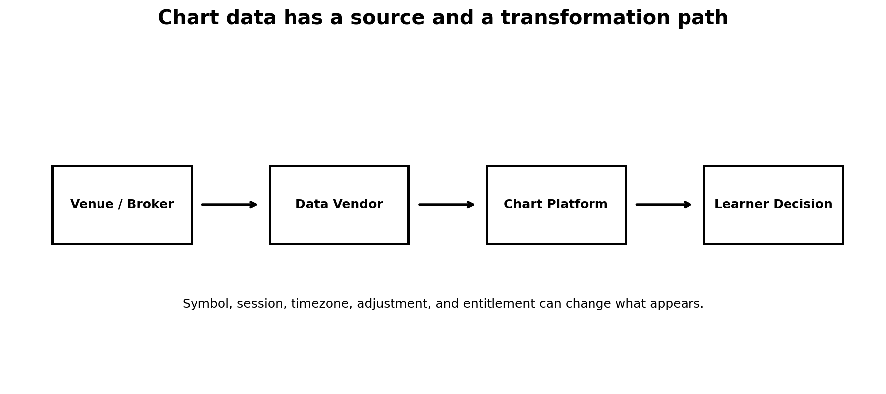

**Case:**

Two learners compare a gold CFD chart with COMEX gold futures. The broad direction is similar, but exact highs, lows, spreads, and session behavior differ because the instruments and feeds are not identical.

**Practice:** For one instrument, record platform, symbol, exchange or broker, data status, timezone, session setting, and whether the series is adjusted or continuous.

**Common mistake:** Assuming every symbol with the same nickname is the same product.

**Knowledge checks and answer rationale:**

- Can two legitimate feeds print slightly different candles?
  Answer: Yes.
- Is a chart platform always the executing broker?
  Answer: No.
- Why document the exact symbol?
  Answer: To make analysis and review reproducible.

**References:**
- [TradingView Help Center](https://www.tradingview.com/support/)

## L01-M08 - Real-Time, Delayed, and Historical Data

**Objective:** Verify whether a chart is real-time, delayed, replayed, or historical before making a time-sensitive decision.

**Why it matters:** A clean chart is not necessarily current. Exchanges may require separate market-data permissions, and platforms can display delayed or vendor-dependent information.

**Core ideas:**
- Real-time data is delivered with minimal distribution delay under the relevant entitlement.
- Delayed data can be suitable for education but unsuitable for live execution decisions.
- Historical and replay modes deliberately show past data.
- Bid/ask data, last-trade data, and indicative prices are different information types.
- Data quality checks belong in every trading checklist.

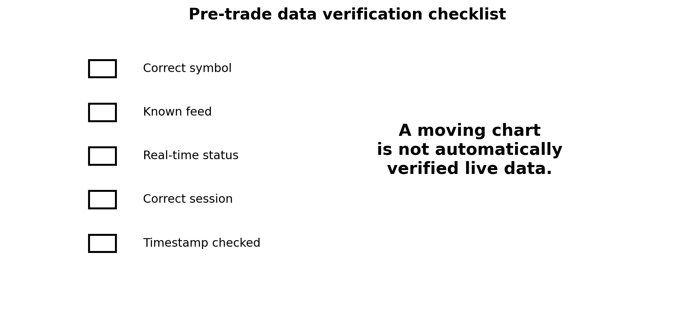

**Case:**

A learner sees a breakout on a delayed index feed and enters through a separate broker whose live price has already moved far beyond the planned level.

**Practice:** Audit five symbols on your platform. Record feed source, delay indicator, exchange entitlement, last-trade time, and comparison with your execution venue.

**Common mistake:** Assuming a moving screen equals exchange-grade real-time data.

**Knowledge checks and answer rationale:**

- Can delayed data look visually normal?
  Answer: Yes.
- Should a live order be based on an unverified delayed feed?
  Answer: No.
- Are bid/ask and last price identical concepts?
  Answer: No.

**References:**
- [TradingView Help Center](https://www.tradingview.com/support/)

## L01-M09 - Economic Calendars, Scheduled Risk, and News

**Objective:** Use official release schedules to identify event risk without pretending to know the market reaction in advance.

**Why it matters:** Employment, inflation, growth, and central-bank decisions can sharply change volatility, spreads, and liquidity. The release time is knowable; the size and direction of the reaction are not.

**Core ideas:**
- An economic calendar lists scheduled releases and events.
- Official statistical agencies and central banks are primary sources for timing and published data.
- Consensus forecasts are estimates, not facts.
- A release can cause slippage, spread expansion, and rapid two-way movement.
- The correct response may be reduced size, wider planned risk, waiting, or no trade.

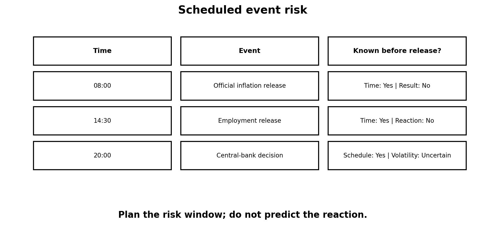

**Case:**

Inflation data is released at 14:30 local platform time. Price first spikes upward, then reverses sharply. A directional guess was fragile; an event-risk plan was controllable.

**Practice:** Build tomorrow’s event-risk sheet using official sources. Include release time, affected markets, expected volatility window, and your rule for trading or standing aside.

**Common mistake:** Treating the “high impact” label as a guaranteed direction.

**Knowledge checks and answer rationale:**

- Is the release time usually more knowable than the market reaction?
  Answer: Yes.
- Is a consensus forecast guaranteed?
  Answer: No.
- Can spreads and slippage increase around news?
  Answer: Yes.

**References:**
- [BLS Release Calendar](https://www.bls.gov/schedule/)
- [Federal Reserve FOMC Calendars and Information](https://www.federalreserve.gov/monetarypolicy/fomccalendars.htm)
- [BEA News Release Schedule](https://www.bea.gov/news/schedule)

## L01-M10 - Foundation Assessment: Read the Market Screen

**Objective:** Demonstrate that you can identify what is on a trading screen before analyzing direction or placing a trade.

**Why it matters:** Most avoidable beginner errors occur before strategy: wrong symbol, wrong session, wrong timeframe, delayed data, misunderstood product, or unrecognized event risk.

**Core ideas:**
- Identify the instrument and legal product.
- Confirm venue or broker, contract month if relevant, and price currency.
- Confirm timeframe, timezone, session, and data status.
- Read OHLC and current volatility context.
- Check scheduled event risk and define a no-trade condition.

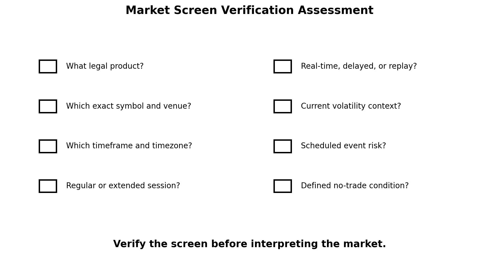

**Case:**

You receive a screenshot labeled “NAS100.” It has no visible broker, exchange, data status, timezone, or contract specification. The professional answer is not immediately bullish or bearish; it is a list of missing facts.

**Practice:** Complete the Market Screen Verification Checklist for three instruments: SPY, a DAX futures contract, and a gold CFD. Then explain which comparisons are valid and which are not.

**Common mistake:** Starting with pattern recognition before confirming the screen itself.

**Knowledge checks and answer rationale:**

- What comes before directional analysis?
  Answer: Instrument and data verification.
- Can a nickname uniquely identify a legal product?
  Answer: Not always.
- What is a valid outcome when key information is missing?
  Answer: No decision until verified.

**References:**
- [Stocks - Investor.gov](https://www.investor.gov/introduction-investing/investing-basics/investment-products/stocks)
- [Exchange-Traded Funds (ETFs) - Investor.gov](https://www.investor.gov/introduction-investing/investing-basics/investment-products/mutual-funds-and-exchange-traded-2)
- [Basics of Futures Trading - CFTC](https://www.cftc.gov/LearnAndProtect/AdvisoriesAndArticles/FuturesMarketBasics/index.htm)
- [TradingView Help Center](https://www.tradingview.com/support/)

## L02-M01 - Swing Highs and Swing Lows

**Objective:** Identify swing highs and swing lows without forcing structure onto every candle.

**Why it matters:** Market structure starts with objective turning points. If a learner cannot mark meaningful swings, every later concept such as trend, pullback, BOS, and CHoCH becomes subjective.

**Core ideas:**
- A swing high is a local turning point where buying failed to continue and price rotated lower.
- A swing low is a local turning point where selling failed to continue and price rotated higher.
- Not every minor candle wiggle deserves a structural label.
- Useful swing points should be visible enough to influence future decisions.

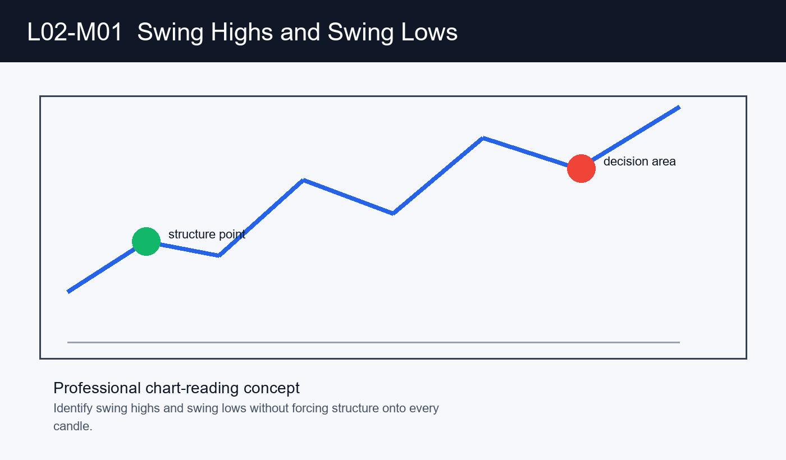

**Case:**

A five-minute chart shows many tiny pullbacks during the New York open. The professional task is to separate noise from the points that actually changed the auction path.

**Practice:** Open one clean trending chart and one choppy chart. Mark only the swing points that would matter for a trading decision, then explain why you ignored the rest.

**Common mistake:** Marking every candle fluctuation as structure.

**Knowledge checks and answer rationale:**

- What is a swing high?
  Answer: A local turning point where price rotates lower after an upward move.
- Should every small candle pause be marked?
  Answer: No.
- Why do swing points matter?
  Answer: They form the building blocks of trend and range structure.

**References:**
- [TradingView Help Center](https://www.tradingview.com/support/)

## L02-M02 - Trend Structure

**Objective:** Read trend through structural progression rather than through a single indicator line.

**Why it matters:** Beginners often call a market bullish because one candle is green. Professional trend reading asks whether buyers or sellers keep defending increasingly favorable prices.

**Core ideas:**
- An uptrend is generally a sequence of higher highs and higher lows.
- A downtrend is generally a sequence of lower lows and lower highs.
- Healthy trends show continuation and controlled pullbacks.
- A trend is weakened when the side in control fails to defend the prior structural point.

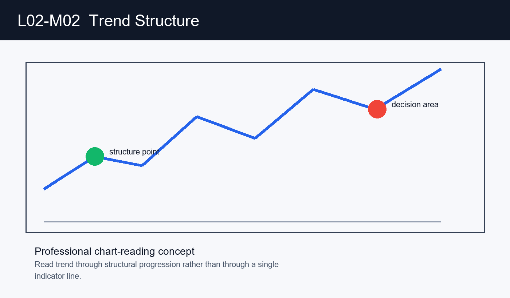

**Case:**

US100 rallies strongly, pulls back, then fails to break the prior high. A trader should not simply assume the trend is intact; the quality of continuation must be evaluated.

**Practice:** Mark the last three major highs and lows on US30, DAX40, and Gold. Classify each as uptrend, downtrend, or unclear.

**Common mistake:** Calling one strong candle a trend.

**Knowledge checks and answer rationale:**

- What defines an uptrend structurally?
  Answer: Higher highs and higher lows.
- What weakens a trend?
  Answer: Failure to continue or failure to defend the prior structural point.
- Can a trend be unclear?
  Answer: Yes.

**References:**
- [TradingView Help Center](https://www.tradingview.com/support/)

## L02-M03 - Ranges and Balance

**Objective:** Recognize when price is rotating inside a range instead of trending.

**Why it matters:** Many losses come from applying trend tactics inside balanced markets. A range requires different expectations: fade extremes, wait for acceptance, or do nothing.

**Core ideas:**
- A range forms when neither side can sustain continuation.
- Range highs and lows often collect liquidity because many traders place stops beyond obvious extremes.
- The middle of a range usually offers poor reward-to-risk for directional trades.
- A breakout is not confirmed by crossing a line; it needs acceptance or follow-through.

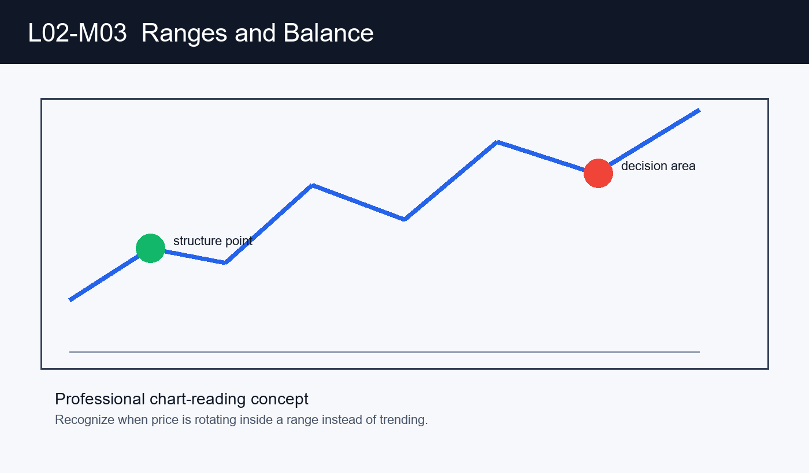

**Case:**

UK100 spends the London morning oscillating between yesterday's high and the session low. Buying the middle after a green candle has weak context.

**Practice:** Find one chart that is clearly ranging. Mark the range high, range low, midpoint, and two areas where false breaks could trap traders.

**Common mistake:** Trading the middle of a range as if it were a fresh trend.

**Knowledge checks and answer rationale:**

- What is a range?
  Answer: A balanced area where price rotates without sustained continuation.
- Where is trade location usually weakest?
  Answer: Near the middle of the range.
- Does a wick outside the range prove breakout?
  Answer: No.

**References:**
- [TradingView Help Center](https://www.tradingview.com/support/)

## L02-M04 - Support and Resistance Zones

**Objective:** Draw support and resistance as decision zones rather than fragile exact lines.

**Why it matters:** Real markets do not always respect a single pixel-perfect price. Zones help learners account for spread, volatility, liquidity sweeps, and different market venues.

**Core ideas:**
- Support is an area where demand previously overcame supply strongly enough to rotate price higher.
- Resistance is an area where supply previously overcame demand strongly enough to rotate price lower.
- Zones are more practical than exact lines when volatility is meaningful.
- A level is stronger when it aligns with structure, session context, and visible reaction.

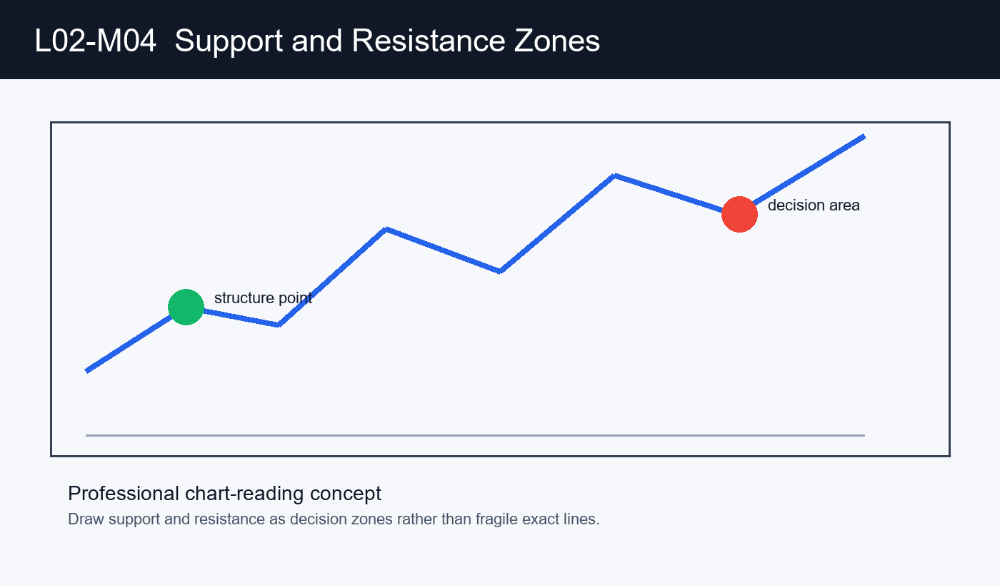

**Case:**

Gold reacts three times around a 10-dollar band, not a single exact tick. Treating the level as one precise price creates unnecessary stop-outs.

**Practice:** Replace three exact horizontal lines on a chart with zones. Explain what evidence justifies each zone.

**Common mistake:** Making zones so wide that they no longer support a clear risk decision.

**Knowledge checks and answer rationale:**

- Why use zones?
  Answer: Because markets often react around areas, not exact prices.
- What gives a zone more value?
  Answer: Repeated structural reaction and context.
- Should zones become excuses for wide risk?
  Answer: No.

**References:**
- [TradingView Help Center](https://www.tradingview.com/support/)

## L02-M05 - Impulse and Pullback

**Objective:** Distinguish directional expansion from corrective movement.

**Why it matters:** A trader who enters during exhaustion often buys after the opportunity has already moved. Understanding impulse and pullback helps students wait for better location.

**Core ideas:**
- An impulse is a stronger directional movement that expands price away from a prior area.
- A pullback is a counter-move that tests whether the trend side can defend structure.
- Healthy pullbacks are usually smaller and less aggressive than the prior impulse.
- Deep or violent pullbacks warn that the trend may be losing quality.

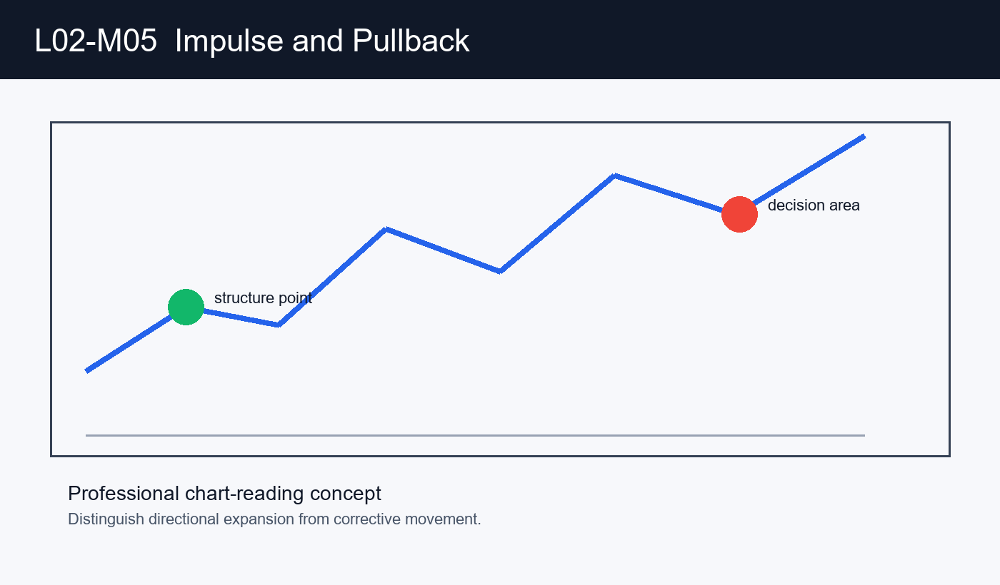

**Case:**

DAX40 breaks higher at the London open, then retraces into a prior resistance zone. The question is whether that pullback is controlled or whether sellers have taken control.

**Practice:** On a trending chart, label three impulses and three pullbacks. Note which pullback was healthiest and why.

**Common mistake:** Chasing the impulse after reward-to-risk has already deteriorated.

**Knowledge checks and answer rationale:**

- What is an impulse?
  Answer: A stronger directional expansion.
- What does a pullback test?
  Answer: Whether the trend side can defend structure.
- What warns of trend weakness?
  Answer: A deep, aggressive, or disorderly pullback.

**References:**
- [TradingView Help Center](https://www.tradingview.com/support/)

## L02-M06 - Break of Structure

**Objective:** Define a break of structure as a meaningful continuation event, not a random wick through a level.

**Why it matters:** BOS is powerful only when used precisely. If every minor break becomes confirmation, the learner will overtrade and confuse liquidity grabs with continuation.

**Core ideas:**
- A bullish BOS occurs when price breaks a meaningful prior structural high in an existing bullish context.
- A bearish BOS occurs when price breaks a meaningful prior structural low in an existing bearish context.
- The broken level must be structurally relevant, not a random candle high or low.
- A better BOS shows displacement, acceptance, or follow-through.

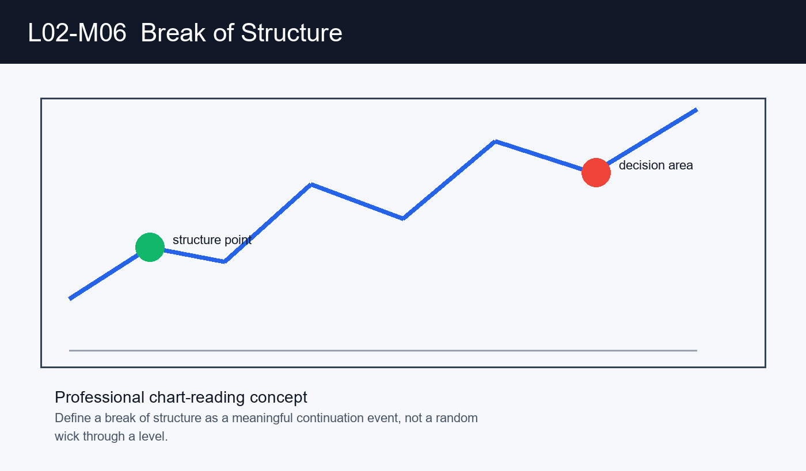

**Case:**

US500 breaks the prior session high by a few ticks and immediately returns into range. That is not the same quality as a strong accepted break with follow-through.

**Practice:** Find two apparent structure breaks. Label one high-quality BOS and one weak break. Explain the difference.

**Common mistake:** Treating a liquidity sweep as automatic continuation confirmation.

**Knowledge checks and answer rationale:**

- What must a BOS break?
  Answer: A meaningful prior structural high or low.
- Is every wick through a level a BOS?
  Answer: No.
- What improves BOS quality?
  Answer: Displacement, acceptance, or follow-through.

**References:**
- [TradingView Help Center](https://www.tradingview.com/support/)

## L02-M07 - Change of Character

**Objective:** Use change of character as an early warning that the current structural behavior may be shifting.

**Why it matters:** Reversals rarely become obvious at the best price. CHoCH helps learners notice when a trend is no longer behaving like the prior trend.

**Core ideas:**
- A CHoCH is an early structural shift against the prior behavior.
- It is not a guaranteed reversal signal.
- A higher-quality CHoCH appears near meaningful liquidity, support, resistance, or session context.
- A CHoCH often needs additional confirmation before execution.

**Case:**

Gold trends lower into New York, sweeps a prior low, then breaks a minor lower high. That may be a change of character, but it still requires a trade plan and invalidation.

**Practice:** Mark one possible bullish CHoCH and one possible bearish CHoCH. Write what would confirm or invalidate each idea.

**Common mistake:** Entering every CHoCH as if it were a completed reversal.

**Knowledge checks and answer rationale:**

- What is CHoCH?
  Answer: An early structural shift against prior behavior.
- Does CHoCH guarantee reversal?
  Answer: No.
- What improves its value?
  Answer: Context and follow-up confirmation.

**References:**
- [TradingView Help Center](https://www.tradingview.com/support/)

## L02-M08 - Breakout Acceptance and Failure

**Objective:** Separate accepted breakouts from failed breakouts.

**Why it matters:** Breakout traders and reversal traders often fight around the same level. The professional skill is not predicting every break, but reading whether price is accepted beyond the level.

**Core ideas:**
- Acceptance means price can hold beyond the broken area and continue doing business there.
- Failure means price breaks out but returns quickly into the prior range or structure.
- Failed breakouts can trap traders who entered late.
- Volume, volatility, session timing, and follow-through can help judge breakout quality.

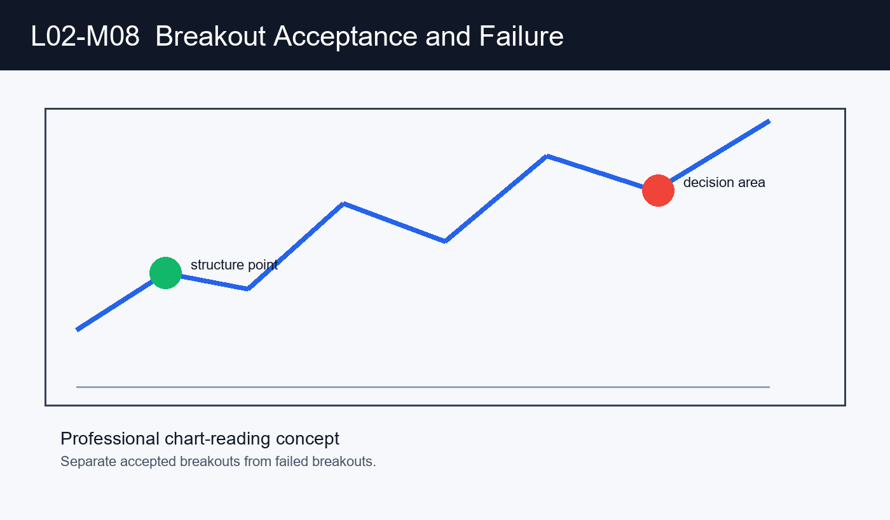

**Case:**

US100 breaks above a pre-market high before the cash open, stalls, then falls back into the range. The breakout trader must recognize failure quickly instead of hoping.

**Practice:** Find one accepted breakout and one failed breakout. Mark the point where a professional would stop trusting the breakout.

**Common mistake:** Assuming a level break is enough without acceptance.

**Knowledge checks and answer rationale:**

- What is breakout acceptance?
  Answer: Holding and continuing beyond the broken area.
- What is breakout failure?
  Answer: Returning quickly back into the prior area.
- Why are failed breakouts important?
  Answer: They can trap late traders and reverse sharply.

**References:**
- [TradingView Help Center](https://www.tradingview.com/support/)

## L02-M09 - Internal and External Structure

**Objective:** Distinguish minor internal shifts from major external structure changes.

**Why it matters:** Many beginners reverse their bias because of a small lower-timeframe move while the higher-timeframe structure remains intact. This creates confusion and overtrading.

**Core ideas:**
- External structure is the major swing framework that defines broader direction.
- Internal structure is the smaller movement inside that broader framework.
- Internal shifts can provide early clues, but they do not always invalidate the larger structure.
- A trade idea should state which structure level it depends on.

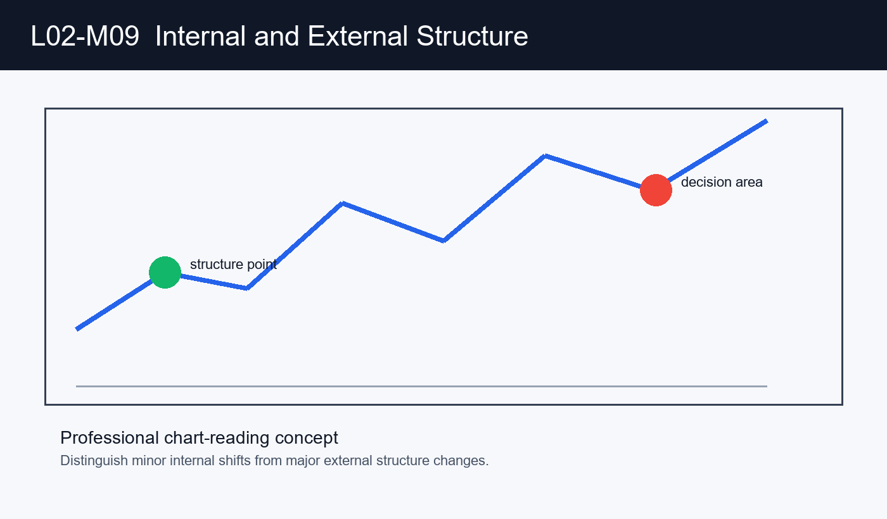

**Case:**

DAX40 is bullish on the 1H chart but bearish on the 1M pullback. A learner must know whether they are reading execution noise or true directional change.

**Practice:** On one chart, mark external structure in one color and internal structure in another. Write which one controls your bias.

**Common mistake:** Letting minor internal movement constantly flip the higher-timeframe bias.

**Knowledge checks and answer rationale:**

- What is external structure?
  Answer: The major swing framework.
- What is internal structure?
  Answer: Smaller movement inside the larger framework.
- Can internal structure shift before external structure?
  Answer: Yes.

**References:**
- [TradingView Help Center](https://www.tradingview.com/support/)

## L02-M10 - Multi-Timeframe Structure Assessment

**Objective:** Demonstrate a complete structure read across higher, working, and execution timeframes.

**Why it matters:** The academy should not allow learners to advance because they recognize vocabulary. They must prove they can apply structure consistently to a real chart.

**Core ideas:**
- Start with the higher-timeframe bias.
- Use the working timeframe to define levels and active structure.
- Use the execution timeframe only after context is clear.
- A valid assessment includes invalidation and no-trade conditions.

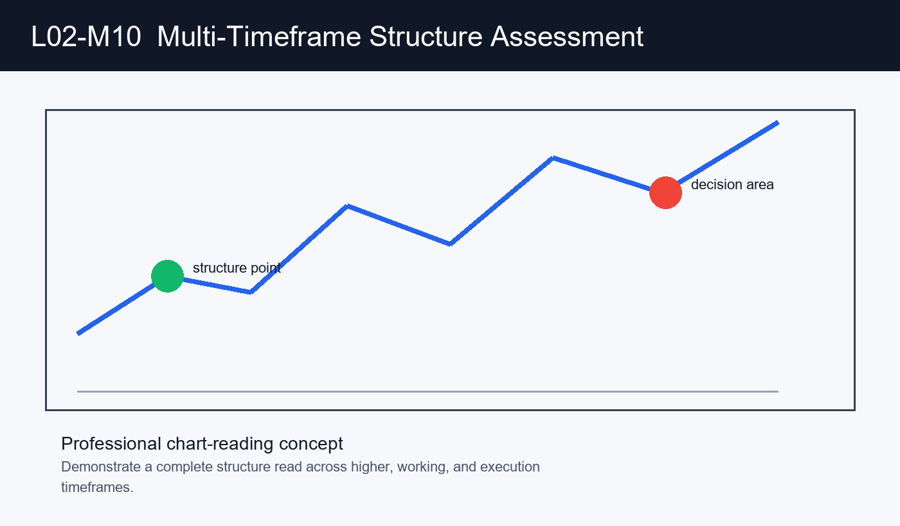

**Case:**

You receive three charts of the same market: 4H, 15M, and 1M. Your task is to describe structure, not to force an entry.

**Practice:** Complete a structure assessment for one index and one gold chart. Include trend/range status, key swings, external structure, internal structure, and invalidation.

**Common mistake:** Using the lowest timeframe to invent a trade before context is understood.

**Knowledge checks and answer rationale:**

- What comes first in multi-timeframe structure?
  Answer: Higher-timeframe context.
- What is the execution timeframe for?
  Answer: Timing after context is clear.
- Can no-trade be a correct assessment result?
  Answer: Yes.

**References:**
- [TradingView Help Center](https://www.tradingview.com/support/)

## L02-M11 - Candlestick Context

**Objective:** Read candles inside market context instead of treating single candles as standalone signals.

**Why it matters:** A candle does not mean the same thing in every location. A strong bullish candle at range resistance may be late buying, while the same candle after a controlled pullback may show trend continuation.

**Core ideas:**
- Candles summarize open, high, low, and close for a selected period.
- A candle's meaning depends on location, prior structure, volatility, and session timing.
- Single-candle patterns are weaker without context.
- Professional reading asks what the candle changed, rejected, confirmed, or failed to do.

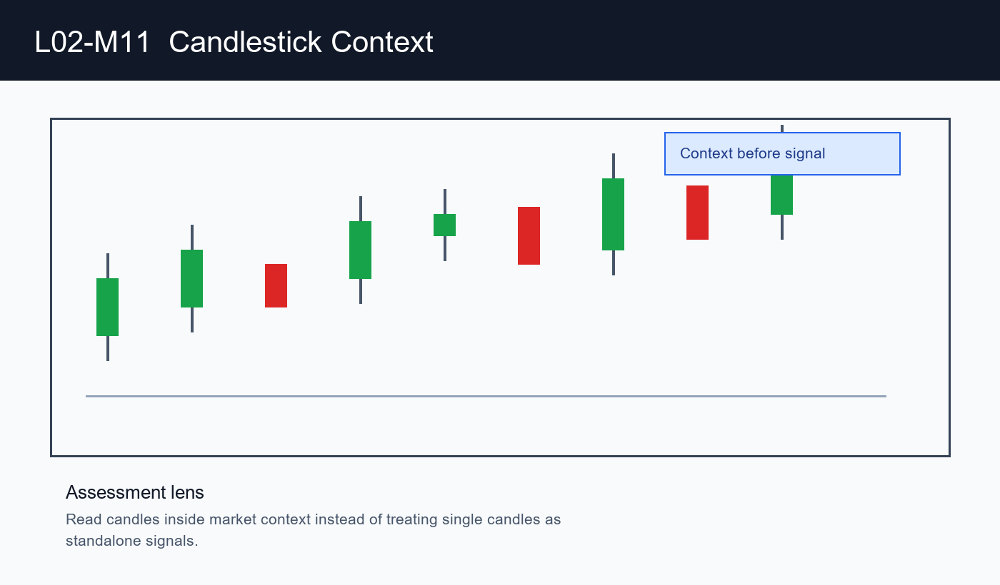

**Case:**

A bullish candle appears on US100. On one chart it breaks from a clean pullback; on another it closes directly into higher-timeframe resistance. Same candle body, different decision quality.

**Practice:** Find three large bullish candles. Label whether each is continuation, exhaustion, breakout, or unclear based on context.

**Common mistake:** Trading memorized candle patterns without context.

**Knowledge checks and answer rationale:**

- Does a candle have the same meaning everywhere?
  Answer: No.
- What gives a candle meaning?
  Answer: Location, structure, volatility, and timing.
- Should a single candle replace a trade plan?
  Answer: No.

**References:**
- [TradingView Help Center](https://www.tradingview.com/support/)

## L02-M12 - Candle Body and Commitment

**Objective:** Use candle bodies to judge directional commitment without confusing size with quality.

**Why it matters:** Large bodies show that price closed away from the open, but they can also appear at exhaustion points. The task is to decide whether the close improves or weakens the trade idea.

**Core ideas:**
- A large body shows directional progress during that candle period.
- A close near the candle extreme often shows stronger control than a close near the middle.
- Body size must be compared with recent volatility.
- A large candle after an extended move can be exhaustion rather than fresh opportunity.

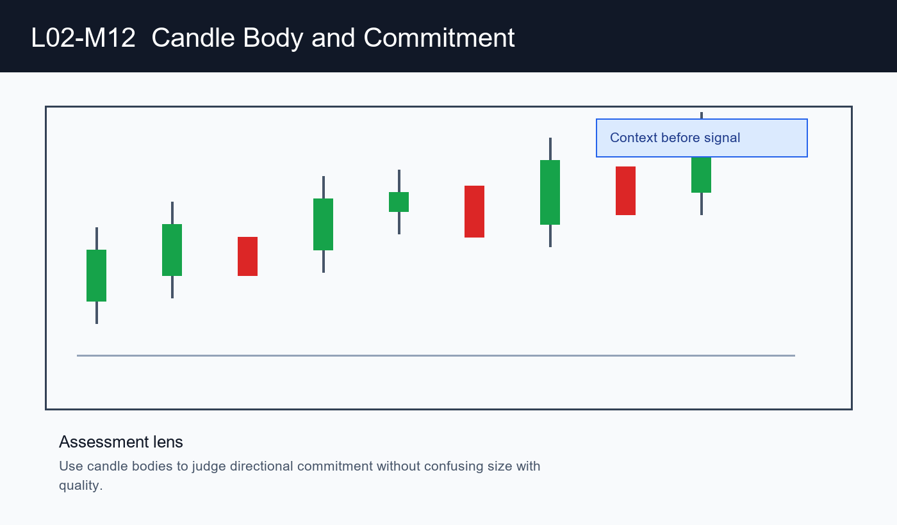

**Case:**

Gold prints a large bullish candle after a long rally into news resistance. The body is strong, but the location may make new long entries risky.

**Practice:** Mark five large-body candles and classify each as useful commitment or possible exhaustion.

**Common mistake:** Assuming the biggest candle is the safest entry candle.

**Knowledge checks and answer rationale:**

- What does a large body show?
  Answer: Directional progress during the candle period.
- Is a large candle always a good entry?
  Answer: No.
- What must body size be compared with?
  Answer: Recent volatility and location.

**References:**
- [TradingView Help Center](https://www.tradingview.com/support/)

## L02-M13 - Wicks and Rejection

**Objective:** Interpret candle wicks as evidence of attempted price discovery and rejection.

**Why it matters:** Wicks often reveal that price tested an area and failed to maintain acceptance there. This is useful for reading liquidity sweeps, failed breakouts, and exhaustion.

**Core ideas:**
- A wick shows the distance price traveled but did not hold by the candle close.
- A long upper wick can indicate rejected higher prices.
- A long lower wick can indicate rejected lower prices.
- Wicks matter most when they occur at meaningful levels or liquidity areas.

**Case:**

UK100 sweeps above the morning range high and closes back inside with a long upper wick. That does not automatically mean short, but it warns that breakout acceptance failed.

**Practice:** Find two long upper wicks and two long lower wicks. Explain what area was tested and whether rejection was meaningful.

**Common mistake:** Calling every wick a reversal signal.

**Knowledge checks and answer rationale:**

- What does a wick show?
  Answer: Price traveled there but did not hold by the close.
- Where are wicks most useful?
  Answer: At meaningful levels or liquidity areas.
- Does every wick create a trade?
  Answer: No.

**References:**
- [TradingView Help Center](https://www.tradingview.com/support/)

## L02-M14 - Inside Bars, Outside Bars, and Compression

**Objective:** Use candle range relationships to identify compression and expansion.

**Why it matters:** Markets alternate between compression and expansion. Recognizing this rhythm helps learners avoid forcing trades in low-quality areas and prepare for possible breakout conditions.

**Core ideas:**
- An inside bar stays within the prior candle's high-low range.
- An outside bar exceeds both the prior high and prior low.
- Several small overlapping candles can show compression.
- Compression often precedes expansion, but direction still requires context.

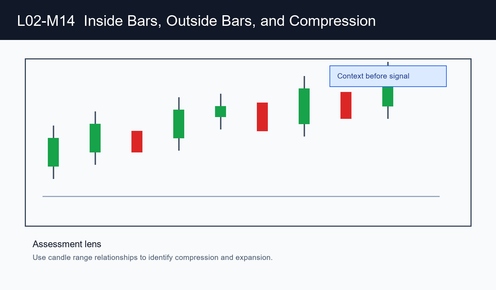

**Case:**

DAX40 compresses for six candles before the London open. A trader should prepare scenarios instead of predicting blindly.

**Practice:** Mark one compression area and write bullish, bearish, and no-trade conditions for the next expansion.

**Common mistake:** Entering before expansion only because the chart became quiet.

**Knowledge checks and answer rationale:**

- What is an inside bar?
  Answer: A candle inside the prior high-low range.
- What can compression precede?
  Answer: Expansion.
- Does compression reveal direction by itself?
  Answer: No.

**References:**
- [TradingView Help Center](https://www.tradingview.com/support/)

## L02-M15 - Volatility-Adjusted Structure

**Objective:** Adjust structure expectations to the current volatility environment.

**Why it matters:** A pullback that is normal during high volatility may be abnormal during a quiet session. Structure cannot be read well without understanding the scale of recent movement.

**Core ideas:**
- Volatility describes movement size, not direction.
- Structural breaks in high volatility need more room and stricter confirmation.
- Quiet markets require patience because small breaks can be noise.
- A level's importance should be interpreted relative to recent range size.

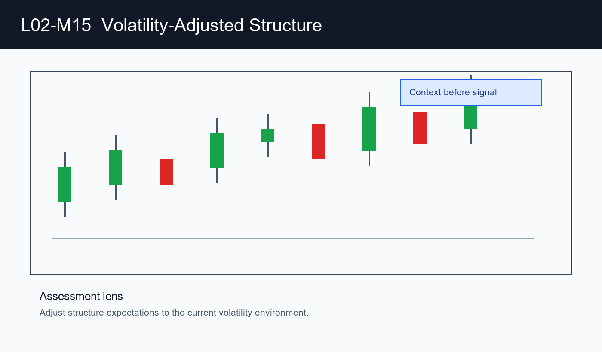

**Case:**

US30 moves 150 points in minutes after news. The same stop distance used during quiet pre-market conditions is no longer structurally comparable.

**Practice:** Compare one quiet session and one high-volatility session. Note how swing size, wick size, and invalidation distance differ.

**Common mistake:** Using the same structural expectations in every volatility regime.

**Knowledge checks and answer rationale:**

- Does volatility indicate direction?
  Answer: No.
- Why adjust structure for volatility?
  Answer: Because normal movement size changes.
- What happens if risk ignores volatility?
  Answer: Stops and targets may become structurally meaningless.

**References:**
- [TradingView Help Center](https://www.tradingview.com/support/)

## L02-M16 - Session Transitions

**Objective:** Read how structure can change when a new trading session begins.

**Why it matters:** London, New York, and major cash opens can bring different participants and liquidity. A structure that looked stable before the open may be repriced quickly afterward.

**Core ideas:**
- Session opens can introduce new liquidity and volatility.
- Pre-session highs and lows often become reference points.
- A new session may accept prior prices, reject them, or expand away from them.
- The first move after an open can be informative, but it can also be a trap.

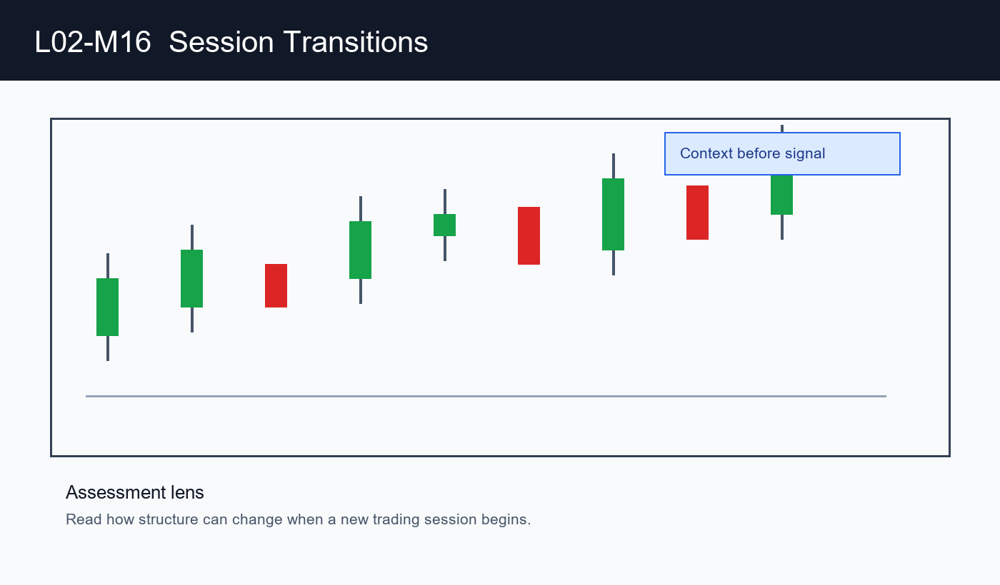

**Case:**

Gold is quiet during Asia, sweeps a high near London, then reverses before New York. The session transition explains why the same level attracted different behavior.

**Practice:** Mark Asia range, London open reaction, and New York open reaction on one chart. Explain what changed at each transition.

**Common mistake:** Ignoring session context when structure suddenly changes speed.

**Knowledge checks and answer rationale:**

- Why do session transitions matter?
  Answer: New participants and liquidity can enter.
- What reference points matter around an open?
  Answer: Pre-session highs and lows.
- Is the first move always reliable?
  Answer: No.

**References:**
- [TradingView Help Center](https://www.tradingview.com/support/)

## L02-M17 - Trend Quality

**Objective:** Evaluate the quality of a trend rather than only naming its direction.

**Why it matters:** A trend can be technically bullish but poor to trade if it is extended, volatile, or losing momentum. Direction and quality are different judgments.

**Core ideas:**
- High-quality trends show clean continuation and controlled pullbacks.
- Weakening trends show overlap, failed continuation, deep pullbacks, or excessive wicks.
- Late-stage trends can still continue but may offer poor reward-to-risk.
- Trend quality should influence whether to enter, wait, reduce size, or avoid.

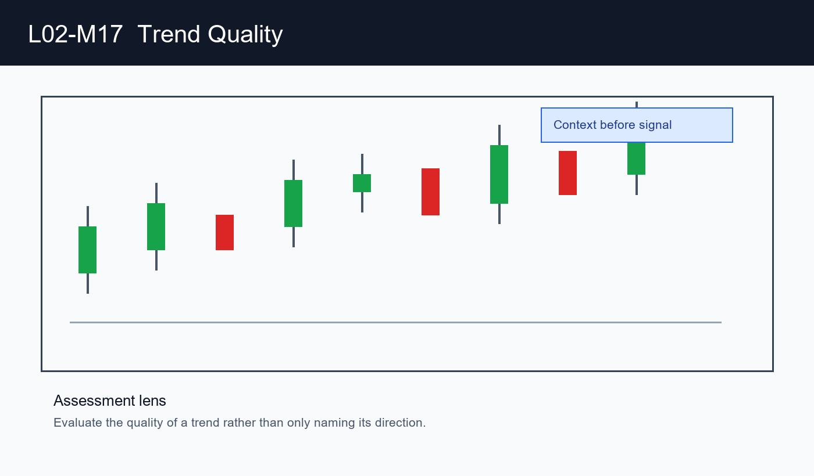

**Case:**

US100 keeps making higher highs, but each new high is smaller and immediately rejected. The trend direction remains up, but the quality is deteriorating.

**Practice:** Rate three trends as high, medium, or low quality. Use structure, pullbacks, wicks, and volatility as evidence.

**Common mistake:** Entering every trend without judging whether the trend is still healthy.

**Knowledge checks and answer rationale:**

- Is trend direction the same as trend quality?
  Answer: No.
- What shows a high-quality trend?
  Answer: Clean continuation and controlled pullbacks.
- What can late-stage trend continuation still have?
  Answer: Poor reward-to-risk.

**References:**
- [TradingView Help Center](https://www.tradingview.com/support/)

## L02-M18 - Pullback Models

**Objective:** Classify pullbacks by depth, speed, and structure before planning continuation trades.

**Why it matters:** Not all pullbacks are equal. A shallow controlled pullback, a deep corrective pullback, and a violent reversal attempt require different decisions.

**Core ideas:**
- A shallow pullback can signal strong trend pressure but may offer limited entry location.
- A moderate pullback can offer better location if structure remains intact.
- A deep pullback may still continue, but it warns that the opposing side has gained influence.
- A pullback plan must define invalidation before entry.

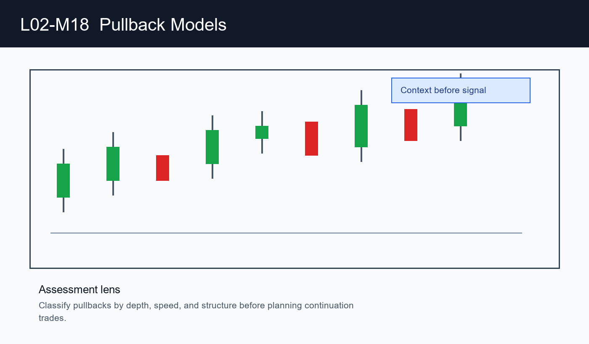

**Case:**

DAX40 rallies, retraces half the move, and holds above the prior external low. The pullback is deeper than ideal but not automatically bearish.

**Practice:** Label three pullbacks as shallow, moderate, or deep. For each, define where the continuation idea becomes invalid.

**Common mistake:** Buying every dip without knowing which structural point must hold.

**Knowledge checks and answer rationale:**

- Why classify pullbacks?
  Answer: Different pullbacks imply different trade quality and risk.
- What must a pullback plan define?
  Answer: Invalidation.
- Is a deep pullback always reversal?
  Answer: No.

**References:**
- [TradingView Help Center](https://www.tradingview.com/support/)

## L02-M19 - No-Trade Structure

**Objective:** Identify structure conditions where the professional decision is to avoid trading.

**Why it matters:** A strong academy must teach students when not to trade. Avoiding low-quality structure is a real skill, especially for beginners and funded-account traders.

**Core ideas:**
- No-trade is valid when structure is unclear.
- No-trade is valid when price is in the middle of a range.
- No-trade is valid when volatility makes risk unreadable.
- No-trade is valid before major news if the plan cannot control event risk.

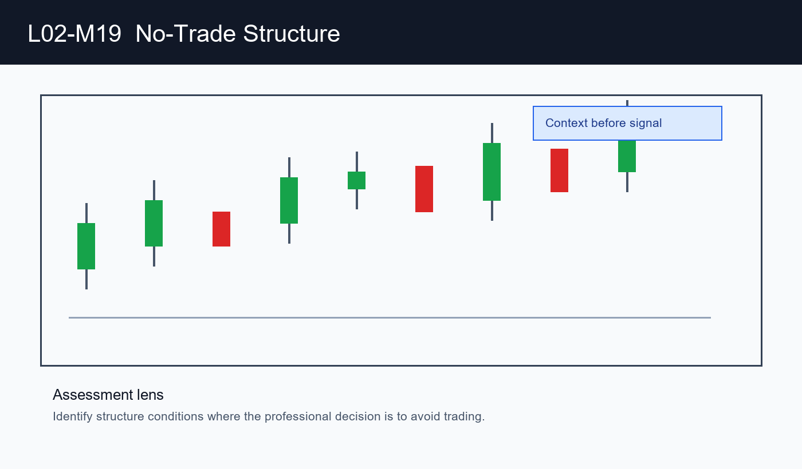

**Case:**

A chart shows mixed internal shifts inside a tight range five minutes before CPI. The professional answer may be no trade, not more analysis.

**Practice:** Collect three screenshots where you intentionally would not trade. Write the exact structural reason for each.

**Common mistake:** Thinking progress requires taking more trades.

**Knowledge checks and answer rationale:**

- Can no-trade be a professional decision?
  Answer: Yes.
- Name one no-trade condition.
  Answer: Unclear structure, range midpoint, unreadable volatility, or uncontrolled news risk.
- Why teach no-trade early?
  Answer: It protects beginners from forcing decisions.

**References:**
- [TradingView Help Center](https://www.tradingview.com/support/)
- [Position and Risk Management - CME Group](https://www.cmegroup.com/education/courses/things-to-know-before-trading-cme-futures/position-and-risk-management)

## L02-M20 - Structure and Volatility Assessment

**Objective:** Demonstrate an integrated read of candles, structure, volatility, sessions, and no-trade conditions.

**Why it matters:** Learners must prove they can combine concepts. The goal is not to predict the next candle; it is to produce a disciplined market read with clear evidence.

**Core ideas:**
- Start with higher-timeframe structure.
- Define whether the market is trending, ranging, or unclear.
- Judge candle behavior in context, not in isolation.
- Adjust invalidation to volatility and session conditions.
- State the best trade idea or explain why no trade is justified.

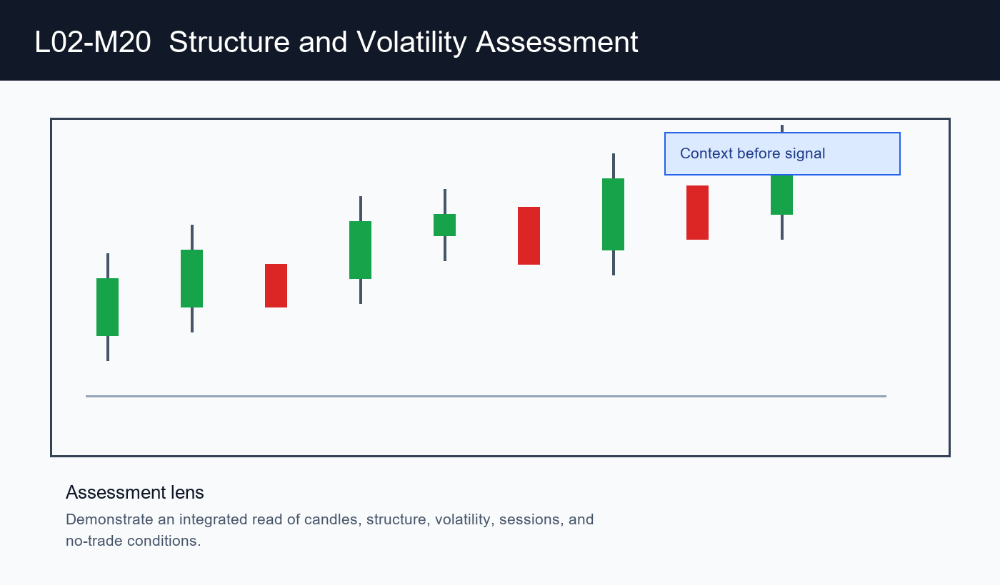

**Case:**

You receive charts of Gold, US100, and UK100 across multiple timeframes. Your task is to produce a structured assessment before any execution decision.

**Practice:** Complete a written assessment for two markets. Include bias, structure, candle evidence, volatility, session context, invalidation, and no-trade condition.

**Common mistake:** Turning every assessment into an entry hunt.

**Knowledge checks and answer rationale:**

- What is the goal of this assessment?
  Answer: A disciplined evidence-based market read.
- Should candle behavior be read alone?
  Answer: No.
- Can no-trade pass the assessment?
  Answer: Yes, if justified with evidence.

**References:**
- [TradingView Help Center](https://www.tradingview.com/support/)
- [Position and Risk Management - CME Group](https://www.cmegroup.com/education/courses/things-to-know-before-trading-cme-futures/position-and-risk-management)

## L03-M01 - Volume Measures Activity, Not Direction

**Objective:** Explain what chart volume measures and avoid treating a large volume bar as a directional signal by itself.

**Why it matters:** Volume shows how much trading activity occurred during a period, but the bar alone does not explain intent or guarantee what price will do next.

**Core ideas:**
- Stock volume is commonly expressed as shares traded, while futures volume is expressed as contracts traded.
- Volume must be interpreted with price location, structure, and the instrument's data source.
- High activity can accompany continuation, reversal, liquidation, or two-sided balance.
- A professional read separates the observed fact from the story used to explain it.

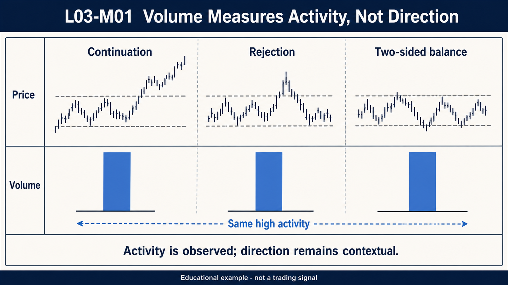

**Case:**

US100 prints its highest five-minute volume bar of the session at a prior range high, but price closes back inside the range. The activity is clear; direction still requires context.

**Practice:** Select five unusually large volume bars. Record only the observable price response before writing any interpretation.

**Common mistake:** Calling every high-volume bar bullish or bearish without examining the price response.

**Knowledge checks and answer rationale:**

- What does a volume bar measure?
  Answer: Trading activity during the selected period.
- Does high volume prove buyers are in control?
  Answer: No.
- What should accompany a volume reading?
  Answer: Price, structure, session, and data-source context.

**References:**
- [Volume - TradingView Help Center](https://www.tradingview.com/support/solutions/43000591617-volume/)

## L03-M02 - Reading Price and Volume Together

**Objective:** Compare trading activity with the resulting price movement instead of interpreting either variable alone.

**Why it matters:** The same amount of activity can produce a wide expansion, a small rotation, or no progress. The price result changes the meaning of the observation.

**Core ideas:**
- Expanding range with rising activity can confirm that a move is attracting participation, but it does not remove risk.
- Heavy activity with little price progress can signal two-sided trade or opposition and requires more evidence.
- Low activity during a move can reflect weak participation, a quiet session, or limitations in the available feed.
- Compare like with like: the same instrument, venue, timeframe, and relevant session.

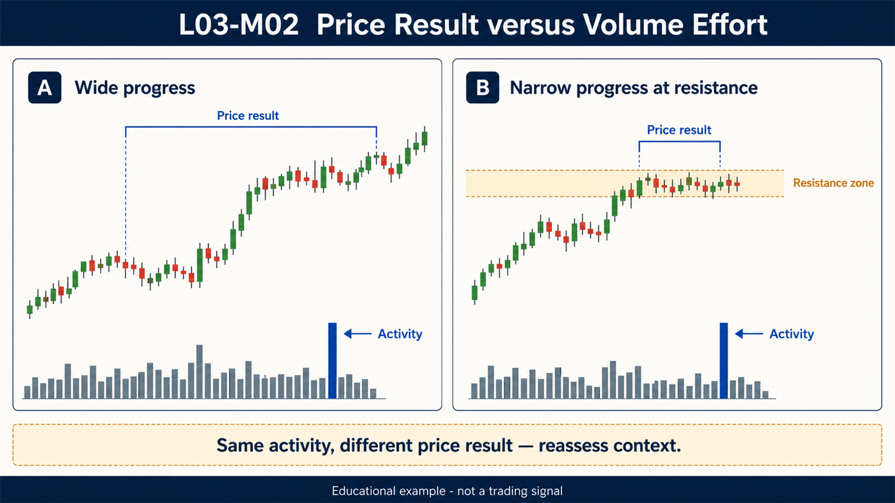

**Case:**

Gold advances on rising volume and wide candles, then prints heavy volume with a narrow body at resistance. The later bar shows effort without equal progress and deserves a fresh assessment.

**Practice:** Find one example each of high activity with wide progress and high activity with little progress. Describe the difference without predicting the next candle.

**Common mistake:** Using a single volume rule regardless of price location or market condition.

**Knowledge checks and answer rationale:**

- Why compare price with volume?
  Answer: Activity matters differently depending on the price result.
- Does heavy activity with little progress prove reversal?
  Answer: No.
- What comparisons are most reliable?
  Answer: Comparable instrument, venue, timeframe, and session data.

**References:**
- [Volume - TradingView Help Center](https://www.tradingview.com/support/solutions/43000591617-volume/)

## L03-M03 - Relative Volume and the Comparison Baseline

**Objective:** Use relative volume to compare current activity with an explicit historical baseline.

**Why it matters:** An absolute volume number is difficult to judge without context. Relative volume makes the comparison visible, but the chosen lookback and session rules still matter.

**Core ideas:**
- A common relative-volume calculation divides current volume by average volume over a defined lookback.
- A value above one means current activity exceeds that calculation's average, not that price must rise.
- Relative volume at time compares activity with similar historical time points to account for intraday seasonality.
- Lookback length, regular versus extended hours, incomplete bars, and provider rules can change the result.

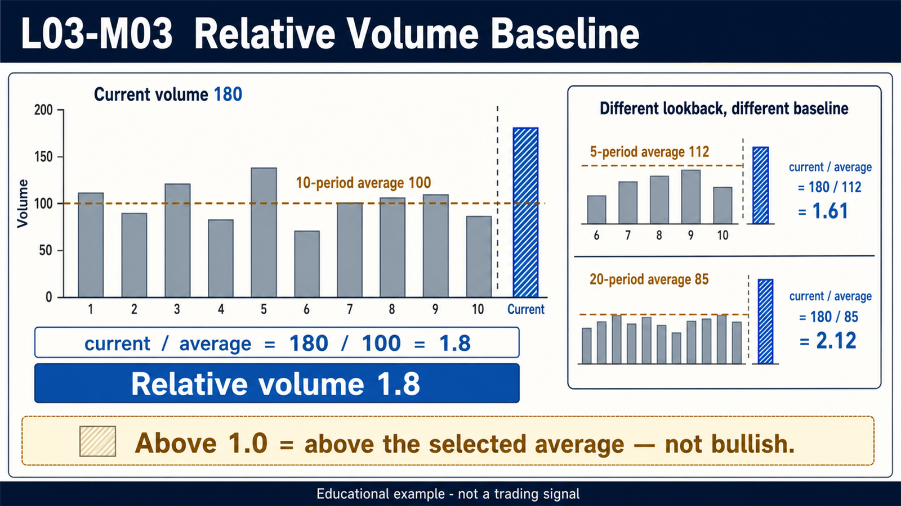

**Case:**

A stock shows relative volume of 1.8 shortly after the open. That confirms activity above the selected baseline, but earnings news and opening volatility still shape the risk.

**Practice:** Calculate a simple ten-period relative-volume ratio for three completed bars, then note how the answer changes when the lookback changes.

**Common mistake:** Quoting relative volume without knowing its lookback, session, or incomplete-bar treatment.

**Knowledge checks and answer rationale:**

- What does relative volume compare?
  Answer: Current volume with an average defined by the calculation.
- Does relative volume above one predict direction?
  Answer: No.
- Why compare the same time of day?
  Answer: Intraday activity often follows a time-dependent pattern.

**References:**
- [How Relative Volume Is Calculated - TradingView Help Center](https://www.tradingview.com/support/solutions/43000635874-how-do-we-calculate-relative-volume-and-relative-volume-at-time/)

## L03-M04 - Session Volume and Participation

**Objective:** Judge volume against the normal participation pattern of the relevant market session.

**Why it matters:** Activity near a major open is not directly comparable with activity during a quiet middle period. Session context prevents false conclusions from raw bar height.

**Core ideas:**
- Market opens, overlaps, scheduled events, and closes can create recurring changes in participation.
- A bar should be compared with relevant historical bars, not automatically with every bar in the day.
- Extended-hours and regular-session data may be calculated or displayed differently.
- Unusual activity identifies a condition to investigate; it does not supply an entry by itself.

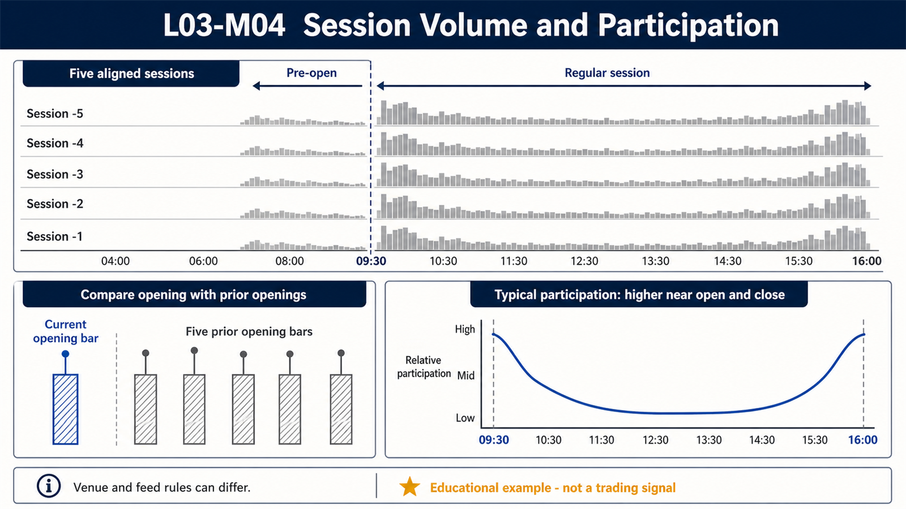

**Case:**

DAX40 volume at the cash open is much larger than pre-open volume. The increase is expected session behavior until it is compared with prior cash opens.

**Practice:** Map the first hour, middle period, and final hour of five sessions. Record typical activity and any genuinely unusual deviations.

**Common mistake:** Treating every opening surge in activity as exceptional.

**Knowledge checks and answer rationale:**

- Why does session context matter?
  Answer: Normal participation changes through the trading day.
- Is open volume fairly compared with a quiet midday bar?
  Answer: Not without an appropriate baseline.
- What does unusual activity provide?
  Answer: A condition for further investigation, not an automatic trade.

**References:**
- [How Relative Volume Is Calculated - TradingView Help Center](https://www.tradingview.com/support/solutions/43000635874-how-do-we-calculate-relative-volume-and-relative-volume-at-time/)
- [Volume - TradingView Help Center](https://www.tradingview.com/support/solutions/43000591617-volume/)

## L03-M05 - VWAP Foundations

**Objective:** Explain how VWAP combines price and volume and use it as a contextual reference rather than an automatic signal.

**Why it matters:** VWAP is widely visible on intraday charts. Understanding its calculation, anchor, and lag helps learners avoid treating the line as guaranteed support or resistance.

**Core ideas:**
- VWAP is a cumulative average price weighted by volume over its anchor period.
- The result depends on the selected price source, volume data, and reset or anchor period.
- Price above or below VWAP describes location relative to the weighted average; it does not guarantee continuation or reversal.
- Because VWAP uses accumulated historical data, it is a lagging reference and should be combined with structure and risk controls.

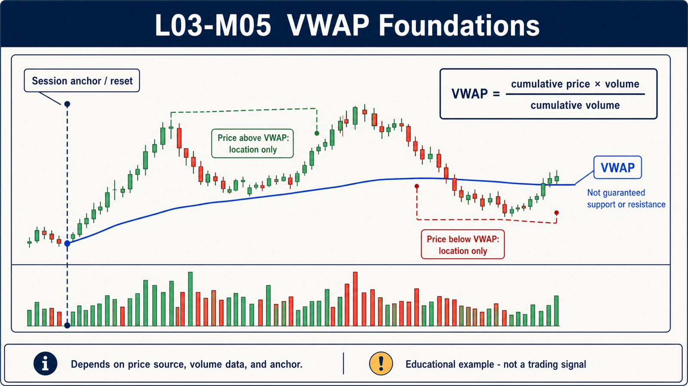

**Case:**

US100 trades above session VWAP after the open but is approaching a higher-timeframe resistance zone. VWAP location supports context, not a blind long entry.

**Practice:** Plot session VWAP on three completed sessions. Mark where price crossed it and explain which crosses mattered only after adding structure and session context.

**Common mistake:** Buying every touch below VWAP or selling every touch above it without context.

**Knowledge checks and answer rationale:**

- What does VWAP weight price by?
  Answer: Volume.
- Why does the anchor matter?
  Answer: It determines where the cumulative calculation starts or resets.
- Is VWAP guaranteed support or resistance?
  Answer: No.

**References:**
- [Volume Weighted Average Price - TradingView Help Center](https://www.tradingview.com/support/solutions/43000502018-volume-weighted-average-price-vwap/)

## L03-M06 - VWAP Context: Trend, Balance, and Distance

**Objective:** Classify price interaction with VWAP in trending, balanced, and extended conditions without turning distance from the line into an automatic trade.

**Why it matters:** The same VWAP location can mean different things in a directional session, a rotating range, or an unusually extended move. Structure and session context determine whether the reference is useful.

**Core ideas:**
- In a directional session, price may remain mostly on one side of VWAP while pullbacks hold away from or near the line.
- In a balanced session, repeated crossings can show rotation around the weighted average rather than a durable directional edge.
- Distance from VWAP is descriptive unless it is compared with the instrument's own historical behavior and current volatility.
- A VWAP cross or touch does not guarantee mean reversion, continuation, support, or resistance.

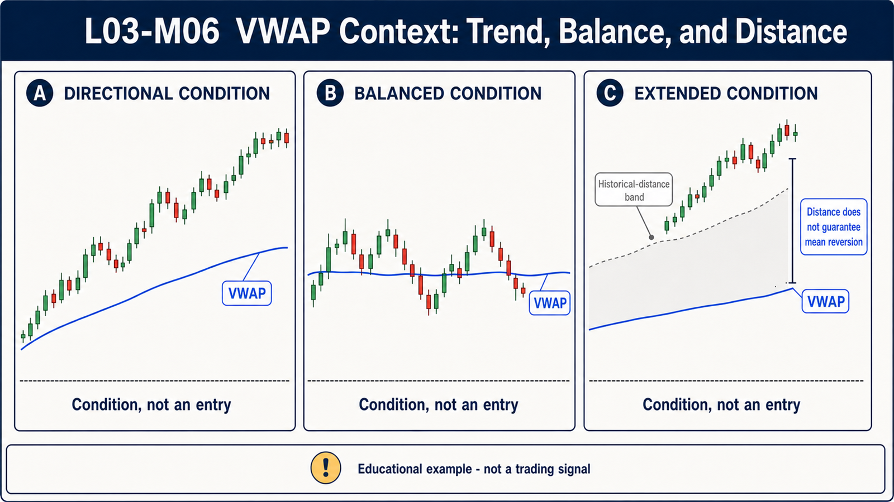

**Case:**

US100 remains above session VWAP through the morning, but its distance from the line expands into prior resistance. The context is directional and extended; neither fact authorizes a chase or a blind fade.

**Practice:** Review three completed sessions. Label each as directional, balanced, or unclear, then describe VWAP location, crossings, and distance without proposing an entry.

**Common mistake:** Fading every extended move or trading every VWAP cross without classifying the market condition.

**Knowledge checks and answer rationale:**

- What can repeated VWAP crossings indicate?
  Answer: Rotation or balance, subject to structure and session context.
- Does large distance from VWAP guarantee mean reversion?
  Answer: No.
- What makes VWAP distance comparable?
  Answer: The instrument's historical behavior, session, and current volatility.

**References:**
- [Volume Weighted Average Price - TradingView Help Center](https://www.tradingview.com/support/solutions/43000502018-volume-weighted-average-price-vwap/)

## L03-M07 - Volume on Breakouts and Failed Breakouts

**Objective:** Evaluate breakout activity together with acceptance, follow-through, and invalidation rather than using volume as standalone confirmation.

**Why it matters:** A large volume bar can appear on both successful and failed breaks. The price response after the level is tested provides essential context.

**Core ideas:**
- A breakout is a move beyond a defined structural boundary; volume describes activity during that move, not its future success.
- Acceptance requires evidence that price can hold or build beyond the level, while a quick return can indicate rejection or failure.
- Higher-than-baseline activity can strengthen the observation that participation changed, but it cannot guarantee follow-through.
- Risk must be defined from structure before entry, especially when event volatility, gaps, or thin liquidity distort the break.

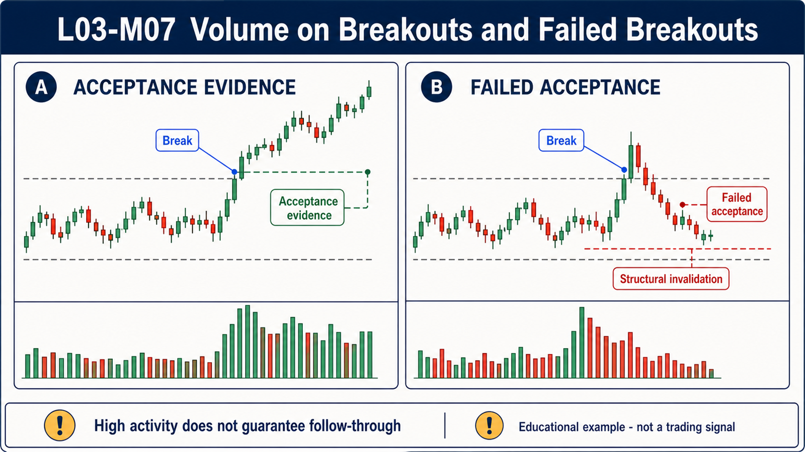

**Case:**

Gold breaks a prior session high on high relative volume, pauses above it, then closes back inside the range. The activity was unusual, but the failed acceptance changes the assessment.

**Practice:** Compare two completed breaks of similar levels. Record baseline activity, price acceptance, follow-through, and the earliest objective invalidation for each.

**Common mistake:** Calling a breakout confirmed from one high-volume bar before checking acceptance and invalidation.

**Knowledge checks and answer rationale:**

- Does high volume guarantee a breakout will hold?
  Answer: No.
- What distinguishes acceptance from a brief excursion?
  Answer: Price holding or building beyond the boundary.
- Why define invalidation before entry?
  Answer: Because active breakouts can reverse quickly and activity does not remove risk.

**References:**
- [Volume - TradingView Help Center](https://www.tradingview.com/support/solutions/43000591617-volume/)
- [How Relative Volume Is Calculated - TradingView Help Center](https://www.tradingview.com/support/solutions/43000635874-how-do-we-calculate-relative-volume-and-relative-volume-at-time/)
- [Position and Risk Management - CME Group](https://www.cmegroup.com/education/courses/things-to-know-before-trading-cme-futures/position-and-risk-management)

## L03-M08 - Absorption, Effort, and Result Without Overclaiming

**Objective:** Describe high activity with limited price progress as an effort-versus-result observation while avoiding unsupported claims about hidden participants.

**Why it matters:** Traders often label stalled price on heavy activity as absorption. Chart volume and price can reveal the condition, but they usually cannot prove who traded or why.

**Core ideas:**
- High activity with limited progress is an observable mismatch between trading effort and price result.
- The label absorption is an interpretation that requires location, repeated response, and follow-up evidence.
- Aggregated chart data usually does not identify participant intent, inventory, or whether one institution caused the response.
- The condition can resolve in either direction, so confirmation and predefined risk remain necessary.

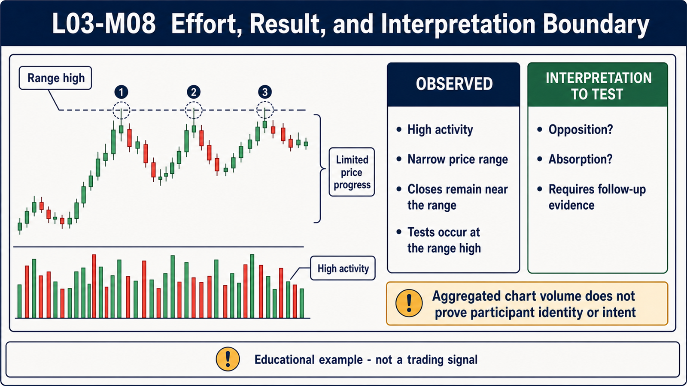

**Case:**

DAX40 repeatedly trades heavy volume at a range high while candles close within the range. The chart supports an effort-with-limited-result observation, not a claim that a named participant is secretly selling.

**Practice:** Find three examples of high activity with little progress. Separate facts from interpretations, then record what later evidence supported or rejected each interpretation.

**Common mistake:** Presenting a plausible absorption story as proven participant intent or a guaranteed reversal.

**Knowledge checks and answer rationale:**

- What is directly observable in an effort-versus-result comparison?
  Answer: Activity and the amount of price progress.
- Can aggregated chart volume prove institutional intent?
  Answer: No.
- Does suspected absorption predict direction by itself?
  Answer: No.

**References:**
- [Volume - TradingView Help Center](https://www.tradingview.com/support/solutions/43000591617-volume/)

## L03-M09 - No-Trade Volume Conditions and Data Limitations

**Objective:** Recognize when volume information is incomplete, incomparable, or too ambiguous to support a trade decision.

**Why it matters:** A disciplined volume process includes conditions that stop analysis. Poor data, mismatched sessions, and unstable event conditions can make apparent precision misleading.

**Core ideas:**
- Volume availability and meaning vary across centralized exchanges, futures contracts, stocks, indices, CFDs, and foreign-exchange feeds.
- Provider changes, missing bars, contract rolls, extended-hours settings, and partial candles can break historical comparisons.
- Scheduled events, opening gaps, and thin liquidity can create extreme readings that need separate treatment.
- When the baseline or data provenance is unclear, the professional decision is to repair the comparison or stand aside.

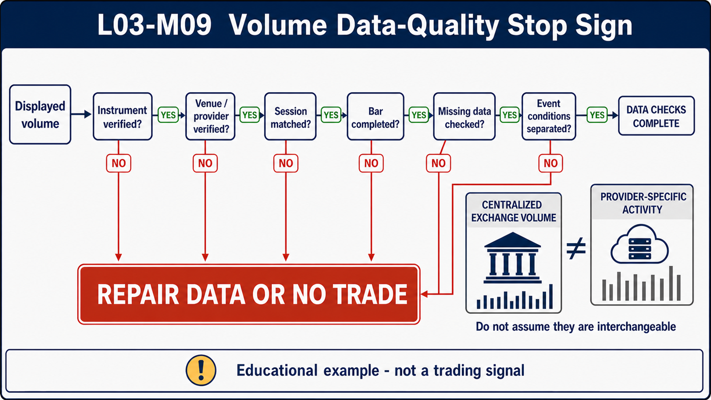

**Case:**

A CFD chart shows a sudden volume spike after the provider reconnects, while the related futures chart does not. Until the feed and session settings are verified, the spike is not decision-grade evidence.

**Practice:** Audit one chart's symbol, venue or provider, session settings, volume type, missing bars, and current-bar status. Write explicit conditions that would make you decline a trade.

**Common mistake:** Treating every displayed volume series as complete, centralized, and directly comparable.

**Knowledge checks and answer rationale:**

- Why can volume differ across feeds?
  Answer: Venue, instrument, provider, and calculation rules can differ.
- Should a partial bar be compared directly with completed bars?
  Answer: Not without accounting for its incomplete state.
- What is appropriate when data provenance is unclear?
  Answer: Repair the comparison or stand aside.

**References:**
- [Volume - TradingView Help Center](https://www.tradingview.com/support/solutions/43000591617-volume/)
- [How Relative Volume Is Calculated - TradingView Help Center](https://www.tradingview.com/support/solutions/43000635874-how-do-we-calculate-relative-volume-and-relative-volume-at-time/)
- [Position and Risk Management - CME Group](https://www.cmegroup.com/education/courses/things-to-know-before-trading-cme-futures/position-and-risk-management)

## L03-M10 - Volume and Auction Assessment

**Objective:** Demonstrate a disciplined volume and VWAP read that distinguishes observed facts, contextual interpretations, risk, and no-trade conditions.

**Why it matters:** The first volume-reading assessment tests process rather than prediction. A passing answer must use comparable data and state uncertainty without inventing participant intent.

**Core ideas:**
- Verify instrument, provider, session, timeframe, and whether bars are complete before interpreting activity.
- Compare current activity with an explicit baseline and describe the accompanying price result.
- Use VWAP as a contextual reference inside trend, balance, structure, and volatility conditions.
- Separate observations from interpretations and identify what evidence would invalidate the interpretation.
- Pass by recommending a controlled plan or a justified no-trade decision; prediction is not required.

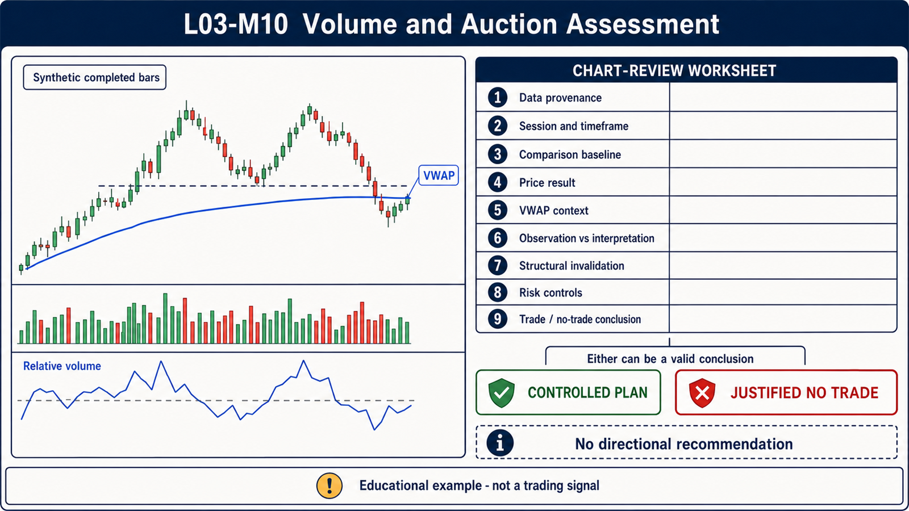

**Case:**

You receive completed intraday charts for Gold and US100 with volume, relative volume, session VWAP, marked structure, and data-source notes. Produce an evidence-led read for each without assuming a trade is necessary.

**Practice:** Complete two written assessments covering data quality, session, baseline activity, price result, VWAP context, structural invalidation, risk, and a trade-or-no-trade conclusion.

**Common mistake:** Forcing an entry or inventing intent because an assessment chart contains unusual volume.

**Knowledge checks and answer rationale:**

- What must be verified before interpreting volume?
  Answer: The instrument, provider, session, timeframe, and bar completeness.
- What is the assessment designed to measure?
  Answer: A disciplined evidence-based volume process, not prediction.
- Can a justified no-trade conclusion pass?
  Answer: Yes.

**References:**
- [Volume - TradingView Help Center](https://www.tradingview.com/support/solutions/43000591617-volume/)
- [How Relative Volume Is Calculated - TradingView Help Center](https://www.tradingview.com/support/solutions/43000635874-how-do-we-calculate-relative-volume-and-relative-volume-at-time/)
- [Volume Weighted Average Price - TradingView Help Center](https://www.tradingview.com/support/solutions/43000502018-volume-weighted-average-price-vwap/)
- [Position and Risk Management - CME Group](https://www.cmegroup.com/education/courses/things-to-know-before-trading-cme-futures/position-and-risk-management)

## L03-M11 - Volume Profile Maps Activity by Price

**Objective:** Explain how a volume profile distributes recorded activity across price levels for a defined dataset and window without treating the profile as a forecast.

**Why it matters:** Time-based volume bars show when activity occurred; a volume profile reorganizes the selected data to show where activity accumulated by price.

**Core ideas:**
- A volume profile is a histogram of recorded activity at price levels across a selected symbol, data source, and window.
- The profile describes where activity occurred in the selected historical sample; it does not reveal participant intent or predict the next move.
- Rows, lower-timeframe inputs, session boundaries, and the platform's volume type can change the displayed distribution.
- Stocks may use trade volume while some indices, forex feeds, and CFDs use tick volume, so provenance must be checked before comparison.
- Profile features are contextual references, not guaranteed support, resistance, entries, stops, or targets.

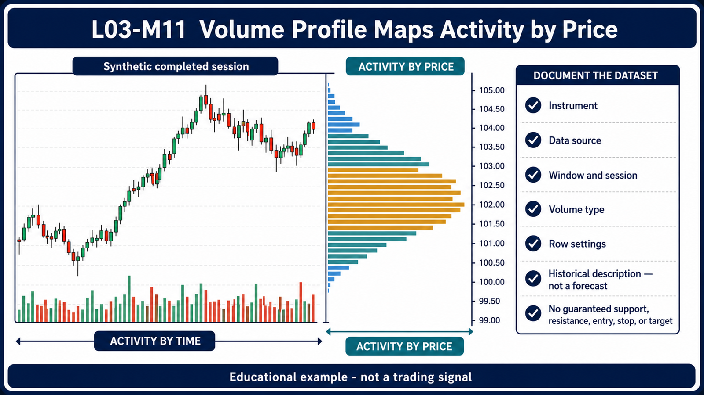

**Case:**

Gold shows a broad concentration of activity near the middle of a completed session and little activity near its high. Record the distribution as an observation, then require fresh price and participation evidence before considering any plan.

**Practice:** Build profiles for two completed sessions of the same instrument using identical settings. Record the window, session, data source, row settings, and observed concentrations; finish with either a risk-defined hypothesis or a justified no-trade conclusion.

**Common mistake:** Treating a historical concentration of activity as proof of intent or a guaranteed future reaction.

**Knowledge checks and answer rationale:**

- What does a volume profile organize?
  Answer: Recorded activity by price for a defined dataset and window.
- Does a high-activity price guarantee future support or resistance?
  Answer: No.
- Which settings must be documented?
  Answer: Instrument, data source, window, session, volume type, and profile calculation settings.

**References:**
- [Volume Profile Indicators: Basic Concepts - TradingView Help Center](https://www.tradingview.com/support/solutions/43000502040-volume-profile-indicators-basic-concepts/)
- [Position and Risk Management - CME Group](https://www.cmegroup.com/education/courses/things-to-know-before-trading-cme-futures/position-and-risk-management)

## L03-M12 - Building and Comparing Profile Windows

**Objective:** Build and compare volume profiles with explicit, consistent windows while explaining how window selection changes the distribution shown.

**Why it matters:** A profile is inseparable from its selected sample. Comparing windows can reveal different historical distributions, but only when the instrument, data, session, and calculation settings are documented.

**Core ideas:**
- A profile window defines the bars or session whose recorded activity is distributed by price; changing the window changes the sample and may change every profile feature.
- A fixed range answers a question about a deliberately selected interval, while a session or visible-range profile follows a platform-defined or changing boundary.
- Comparisons are strongest when symbol, provider, volume type, session template, row settings, and calculation method remain consistent.
- Overlapping or unequal windows can answer different questions, so label each boundary and do not present their differences as evidence of participant intent.
- Use completed windows for baseline comparison where possible, then require current price and participation evidence before forming a risk-defined plan.

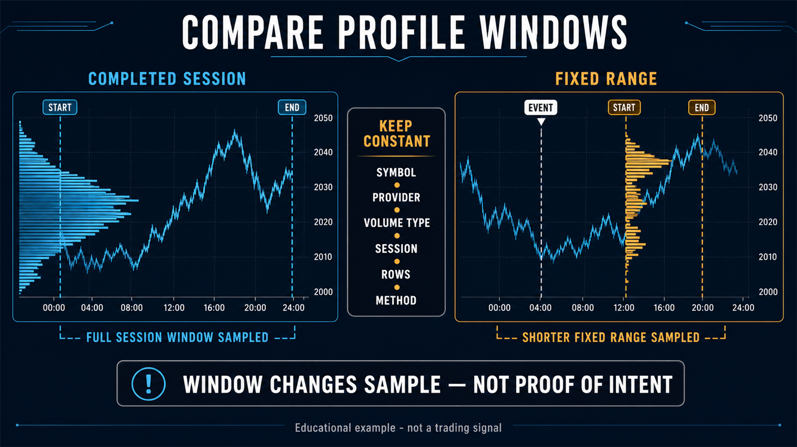

**Case:**

Two Gold profiles appear different: one covers the full regular session and the other starts after a major data release. Before interpreting the shapes, label the boundaries and rebuild both with a common session and identical settings.

**Practice:** Create one completed-session profile and one fixed-range profile on the same instrument. Document every boundary and setting, state what each window can and cannot answer, and finish with a conditional hypothesis or a no-trade conclusion.

**Common mistake:** Comparing unlabeled or mismatched profile windows and treating the resulting differences as a predictive signal.

**Knowledge checks and answer rationale:**

- Why can two profiles of the same instrument differ?
  Answer: They may use different windows, sessions, data, volume types, or calculation settings.
- What should remain consistent in a controlled comparison?
  Answer: The symbol, provider, volume type, session template, row settings, and calculation method.
- Does a chosen window prove participant intent?
  Answer: No.

**References:**
- [Volume Profile Indicators: Basic Concepts - TradingView Help Center](https://www.tradingview.com/support/solutions/43000502040-volume-profile-indicators-basic-concepts/)
- [Position and Risk Management - CME Group](https://www.cmegroup.com/education/courses/things-to-know-before-trading-cme-futures/position-and-risk-management)

## L03-M13 - Point of Control as a Descriptive Reference

**Objective:** Identify the Point of Control for a defined volume-profile window and use it as a descriptive reference without assuming that price must return to, hold, or reject it.

**Why it matters:** The Point of Control highlights the profile row with the greatest recorded activity in the selected sample. It can help organize context, but its location depends on the data and calculation settings and does not forecast the next price move.

**Core ideas:**
- The Point of Control, or POC, is the price row with the highest recorded activity in a defined volume-profile window under the platform's calculation method.
- Changing the symbol, provider, volume type, window, session, row size, or lower-timeframe data can move the displayed POC.
- A POC records where activity concentrated in the selected sample; it does not identify participant intent or prove fair value.
- Price trading above, below, through, or near a prior POC is descriptive until structure, current participation, and price response provide additional evidence.
- A POC is not guaranteed support, resistance, a magnet, an entry, a stop, or a target; unclear data or conflicting context supports a no-trade decision.

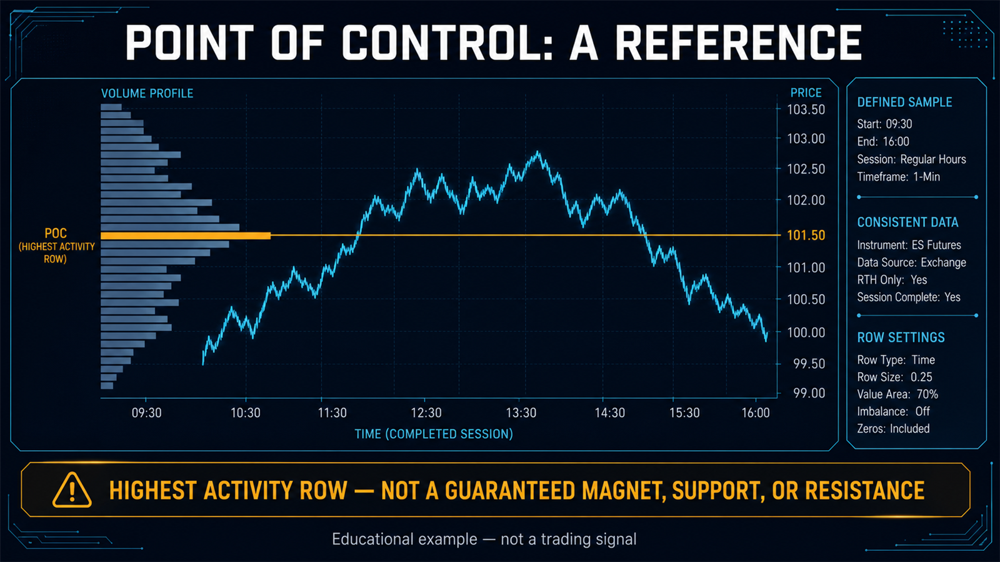

**Case:**

A completed Gold session has a POC near the middle of its range. The next session opens above it and later rotates toward it. Record the approach and price response without assuming attraction or support, then require current participation, structure, and predefined invalidation before considering a plan.

**Practice:** Mark the POC on three completed, consistently configured session profiles. Document the data and settings, describe each later interaction using only observable facts, and finish with either a conditional risk-defined hypothesis or a justified no-trade conclusion.

**Common mistake:** Treating the POC as proven fair value or as a guaranteed price magnet, support, resistance, entry, stop, or target.

**Knowledge checks and answer rationale:**

- What does a volume-profile POC identify?
  Answer: The price row with the highest recorded activity in the defined sample under the selected calculation settings.
- Can changing the profile window or row settings move the POC?
  Answer: Yes.
- Does a prior POC guarantee support, resistance, or a return to that price?
  Answer: No.

**References:**
- [Volume Profile Indicators: Basic Concepts - TradingView Help Center](https://www.tradingview.com/support/solutions/43000502040-volume-profile-indicators-basic-concepts/)
- [Position and Risk Management - CME Group](https://www.cmegroup.com/education/courses/things-to-know-before-trading-cme-futures/position-and-risk-management)

## L03-M14 - Value Area, VAH, and VAL

**Objective:** Define the value area and identify its upper and lower boundaries for a documented volume-profile sample without treating VAH or VAL as guaranteed trade levels.

**Why it matters:** The value area summarizes where a platform assigns a selected share of profile activity. Its boundaries can organize context, but they depend on the sample and calculation method and cannot predict acceptance, rejection, or direction.

**Core ideas:**
- A value area is the set of profile rows selected by the platform's calculation method to contain a configured share of recorded activity, commonly but not universally 70 percent.
- Value Area High, or VAH, is the upper boundary of that calculated area, while Value Area Low, or VAL, is its lower boundary.
- Changing the symbol, provider, volume type, profile window, session, row size, lower-timeframe input, target percentage, or allocation method can change the value area and its boundaries.
- VAH and VAL describe a historical distribution; they do not prove fair value, participant intent, acceptance, rejection, support, resistance, or a likely return inside the area.
- A plan requires current price response, participation, structural context, predefined invalidation, and controlled risk; inconsistent settings or unclear evidence supports no trade.

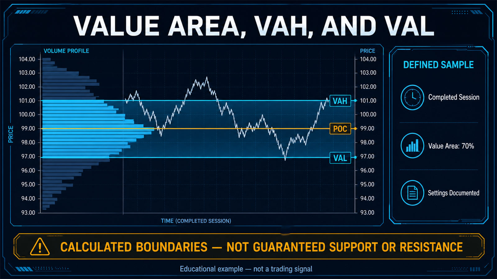

**Case:**

A completed Gold session displays a 70-percent value area. The next session opens above VAH and later tests that boundary. Record the location and observable response without assuming rejection or acceptance, then require current participation, structure, and predefined invalidation before considering a plan.

**Practice:** Calculate and mark VAH and VAL on three completed session profiles of the same instrument using consistent settings. Document the provider, volume type, window, session, row size, lower-timeframe input, target percentage, and allocation method; describe later interactions and finish with a conditional risk-defined hypothesis or a justified no-trade conclusion.

**Common mistake:** Treating a calculated value-area boundary as proven fair value or as an automatic entry, stop, target, support, resistance, acceptance, or rejection signal.

**Knowledge checks and answer rationale:**

- What does a value area represent?
  Answer: The profile rows selected by the platform's method to contain a configured share of recorded activity in a defined sample.
- Can changing the target percentage or row settings move VAH and VAL?
  Answer: Yes.
- Does trading at VAH or VAL guarantee acceptance, rejection, support, or resistance?
  Answer: No.

**References:**
- [Volume Profile Indicators: Basic Concepts - TradingView Help Center](https://www.tradingview.com/support/solutions/43000502040-volume-profile-indicators-basic-concepts/)
- [Position and Risk Management - CME Group](https://www.cmegroup.com/education/courses/things-to-know-before-trading-cme-futures/position-and-risk-management)

## L03-M15 - High- and Low-Volume Nodes

**Objective:** Identify high- and low-volume nodes in a documented volume-profile sample and use them as descriptive context without treating either node type as a guaranteed trade level.

**Why it matters:** Nodes show where a selected profile records relatively more or less activity by price. They can help describe the shape of that historical distribution, but their location depends on the sample and settings and does not predict future price behavior.

**Core ideas:**
- A high-volume node, or HVN, is a price region where the selected profile records relatively high activity compared with nearby rows; a low-volume node, or LVN, records relatively low activity compared with nearby rows.
- HVNs and LVNs are relative features of a particular distribution, not universal thresholds; the symbol, venue, provider, volume type, profile window, session, row size, and allocation method can change their shape and location.
- A node describes completed activity by price; it does not reveal participant intent or prove fair value, acceptance, rejection, support, resistance, a price magnet, or a fast-travel zone.
- Observe current price response and participation before forming a hypothesis because similar-looking nodes can produce different outcomes in different structural and volatility contexts.
- If the node is poorly defined, the data is incomplete, settings are inconsistent, or current evidence is mixed, no trade is a valid conclusion.

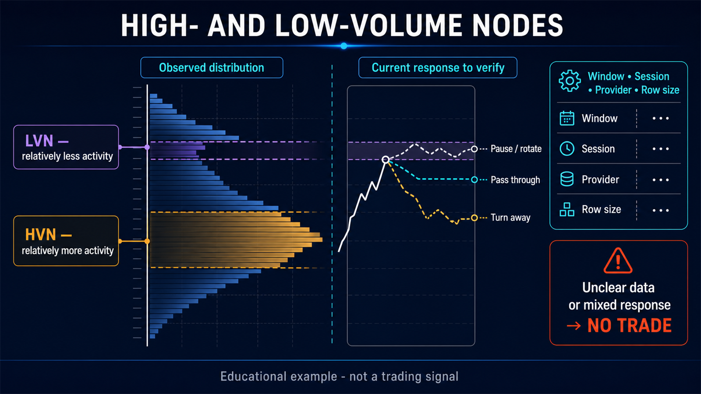

**Case:**

A completed index-futures session profile contains one broad HVN and a thin LVN above it. During the next session, price approaches the LVN. Record the node and the current price-and-volume response without assuming that price must accelerate, reverse, or return to the HVN; require structural confirmation, predefined invalidation, and controlled risk before considering a plan.

**Practice:** Mark the clearest HVN and LVN on three completed profiles of the same instrument using consistent settings. Document the provider, volume type, window, session, row size, and allocation method; separate the historical node observation from later interpretation and finish with a conditional risk-defined hypothesis or a justified no-trade conclusion.

**Common mistake:** Converting a descriptive node into an automatic entry, stop, target, support, resistance, price magnet, or fast-travel prediction.

**Knowledge checks and answer rationale:**

- What distinguishes an HVN from an LVN?
  Answer: An HVN records relatively high activity compared with nearby profile rows, while an LVN records relatively low activity in the selected sample.
- Can changing the profile window or row size move the nodes?
  Answer: Yes.
- Does an LVN guarantee fast movement or an HVN guarantee support, resistance, or a return?
  Answer: No.

**References:**
- [Volume Profile Indicators: Basic Concepts - TradingView Help Center](https://www.tradingview.com/support/solutions/43000502040-volume-profile-indicators-basic-concepts/)
- [Position and Risk Management - CME Group](https://www.cmegroup.com/education/courses/things-to-know-before-trading-cme-futures/position-and-risk-management)

## L03-M16 - Balance, Imbalance, and Auction Rotation

**Objective:** Describe balance, imbalance, and rotation from observable price-and-volume behavior while avoiding assumptions about participant intent or guaranteed continuation and reversal.

**Why it matters:** Auction language can organize how price explores and revisits an area, but these labels are interpretations of observed behavior rather than predictive signals. A disciplined process separates the record from the hypothesis and preserves no trade when evidence is mixed.

**Core ideas:**
- Balance describes a contextual condition in which price repeatedly trades across an overlapping area; define the window and observable overlap instead of treating balance as a fixed pattern.
- Imbalance describes directional displacement or reduced two-way overlap during the selected window; it does not identify who caused the move or guarantee continuation.
- Auction rotation is a descriptive sequence of price moving through and revisiting parts of a defined area; rotation is not proof that every boundary will hold or that price must cross the area again.
- Classify the completed evidence first, then test a conditional hypothesis with current participation, structure, volatility, and price response because balance can persist, break, or reorganize.
- Define invalidation and controlled risk before acting; incomplete volume, inconsistent settings, unclear boundaries, or conflicting evidence makes no trade a valid outcome.

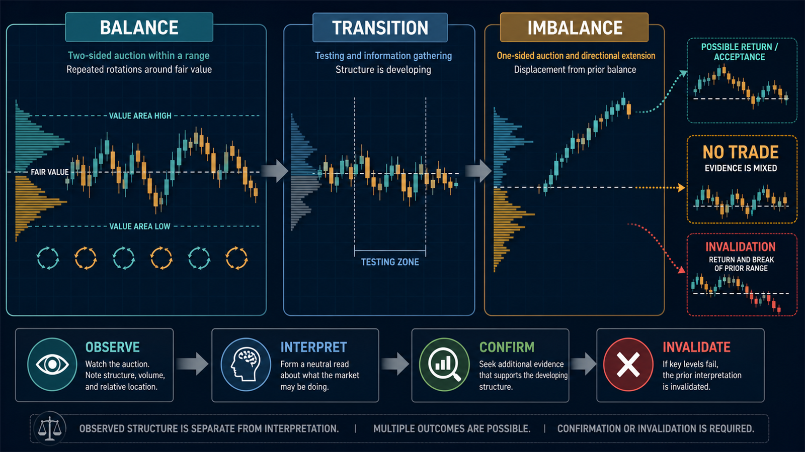

**Case:**

A completed index-futures session repeatedly crosses an overlapping middle region, then the next session displaces above that region with greater observed participation. Record the balance and later displacement without claiming intent or guaranteed continuation; require acceptance evidence, structural invalidation, and controlled risk, or choose no trade if price immediately rotates back and evidence conflicts.

**Practice:** Review three completed sessions of the same instrument with consistent data and settings. Mark observable overlap, directional displacement, and any later rotation; label each statement as observation or interpretation, define what would invalidate the hypothesis, and finish with either a risk-defined conditional plan or a justified no-trade conclusion.

**Common mistake:** Turning balance, imbalance, or rotation into an automatic reversal, breakout, continuation, entry, stop, or target rule.

**Knowledge checks and answer rationale:**

- What evidence supports a description of balance?
  Answer: Repeated trade and overlap across a defined area and window.
- Does directional displacement prove participant intent or guarantee continuation?
  Answer: No.
- What should follow an auction-context label before considering a trade?
  Answer: Current participation and structure evidence, predefined invalidation, controlled risk, and a no-trade option.

**References:**
- [Volume Profile Indicators: Basic Concepts - TradingView Help Center](https://www.tradingview.com/support/solutions/43000502040-volume-profile-indicators-basic-concepts/)
- [Position and Risk Management - CME Group](https://www.cmegroup.com/education/courses/things-to-know-before-trading-cme-futures/position-and-risk-management)

## L03-M17 - Acceptance and Rejection Without Certainty

**Objective:** Evaluate acceptance and rejection as conditional interpretations of observable price and participation evidence without treating either label as certain or predictive.

**Why it matters:** Price moving beyond or away from a reference is only an observation. Acceptance and rejection become useful hypotheses when subsequent trade, participation, structure, and time support them, but the evidence can remain mixed or change.

**Core ideas:**
- Acceptance is a contextual interpretation that price is continuing to trade and build activity beyond a defined reference; specify the reference, window, and observable evidence rather than inferring intent.
- Rejection is a contextual interpretation that price tested an area and then moved away without sustained trade there; a wick, single close, or brief response alone does not prove rejection.
- Evidence can include time spent beyond the reference, repeated closes or overlap, developing activity by price, relative participation, and later retests, but no single measure guarantees the conclusion.
- The same initial move can develop into acceptance, rejection, or unresolved rotation, so update the hypothesis as completed evidence arrives and preserve an uncertain classification when signals conflict.
- Before acting, verify data and settings, require structural context, define invalidation and controlled risk, and choose no trade when the response is incomplete, late, or ambiguous.

**Case:**

Gold trades above a prior session's VAH, holds there for several completed bars, and begins building activity above the boundary. Record those facts as possible acceptance evidence, not proof. If price then returns through VAH while participation and structure conflict, reclassify the situation as unresolved and stand aside unless a new risk-defined hypothesis becomes clear.

**Practice:** Review four completed interactions with a consistently configured profile reference. For each, separate the initial observation from later acceptance, rejection, or unresolved evidence; document data limitations, structural context, invalidation, and controlled risk, then finish with a conditional plan or justified no-trade conclusion.

**Common mistake:** Labeling the first move through or away from a profile reference as confirmed acceptance or rejection and treating it as an automatic entry, stop, target, or directional forecast.

**Knowledge checks and answer rationale:**

- What turns a move beyond a reference into possible acceptance evidence?
  Answer: Subsequent trade and activity beyond the defined reference across a stated window, supported by current participation and structure.
- Does a wick or one close prove rejection?
  Answer: No.
- What is appropriate when acceptance and rejection evidence conflicts?
  Answer: Keep the classification unresolved, update it as completed evidence arrives, and choose no trade when a risk-defined plan is not clear.

**References:**
- [Volume Profile Indicators: Basic Concepts - TradingView Help Center](https://www.tradingview.com/support/solutions/43000502040-volume-profile-indicators-basic-concepts/)
- [Position and Risk Management - CME Group](https://www.cmegroup.com/education/courses/things-to-know-before-trading-cme-futures/position-and-risk-management)

## L03-M18 - Combining Profile Context with Market Structure

**Objective:** Combine documented volume-profile references with observable market structure to form conditional, risk-defined hypotheses without turning either evidence set into a standalone signal.

**Why it matters:** Profile context describes where activity occurred in a selected sample, while market structure describes observable price organization. Using both can clarify a hypothesis, but agreement does not create certainty and disagreement may be a reason to wait.

**Core ideas:**
- Begin with separate observations: document the profile instrument, venue, provider, volume type, window, session, row settings, and reference, then record completed structural evidence such as swings, overlap, displacement, and closes.
- A profile reference and a structural feature can coincide, but that confluence is still historical context; it does not prove support, resistance, acceptance, rejection, direction, or participant intent.
- Build a conditional hypothesis only after current price response and participation provide evidence, and state which observation would invalidate the idea before considering risk.
- When profile and structure evidence disagree, preserve both observations instead of forcing a narrative; wait for completed evidence or classify the situation as unresolved.
- Use controlled risk and a valid no-trade outcome. Incomplete volume, inconsistent settings, unclear structure, excessive volatility, poor reward relative to invalidation, or late evidence can each justify standing aside.

**Case:**

A prior-session LVN aligns with a recently broken swing high. Price later returns to that area, but the first response is a single wick on declining participation. Record the LVN and swing separately; do not call the area support or rejection. Require completed structural and participation evidence, define invalidation below observable structure, and choose no trade if the response remains mixed or the required risk is excessive.

**Practice:** Review four completed interactions where a documented POC, value-area boundary, HVN, or LVN sits near an observable swing or balance boundary. Separate profile facts, structure facts, and interpretation; note data limitations, specify confirmation and invalidation, estimate controlled risk, and finish with a conditional hypothesis or justified no-trade conclusion.

**Common mistake:** Calling confluence a high-probability signal and entering because a profile reference overlaps a swing or range boundary without current evidence, predefined invalidation, and controlled risk.

**Knowledge checks and answer rationale:**

- Does a profile reference aligning with a structural level guarantee a reaction?
  Answer: No.
- What should be recorded before combining profile and structure context?
  Answer: The profile data and settings, the exact reference, and completed structural observations should be documented separately.
- What is appropriate when profile context and market structure conflict?
  Answer: Keep the evidence separate, wait for completed confirmation, or choose no trade when a risk-defined hypothesis is not clear.

**References:**
- [Volume Profile Indicators: Basic Concepts - TradingView Help Center](https://www.tradingview.com/support/solutions/43000502040-volume-profile-indicators-basic-concepts/)
- [Position and Risk Management - CME Group](https://www.cmegroup.com/education/courses/things-to-know-before-trading-cme-futures/position-and-risk-management)

## L03-M19 - No-Trade Profile Conditions and Data Limitations

**Objective:** Identify volume-profile data, configuration, and market conditions that make a no-trade decision more appropriate than forcing a directional interpretation.

**Why it matters:** A profile can look precise even when its input data, window, or calculation settings are incomplete or inconsistent. A disciplined process treats data quality and comparability as prerequisites and preserves no trade when the evidence is not decision-grade.

**Core ideas:**
- Document the instrument, venue or provider, volume type, profile window, session template, row size, value-area setting, contract treatment, and whether the current sample is complete before comparing profile references.
- Centralized exchange volume may represent activity on that venue, while foreign-exchange, CFD, index, and some composite feeds can be decentralized, provider-specific, proxy-based, or otherwise incomplete; a displayed profile is not automatically a complete market record.
- Missing bars, feed reconnects, contract rolls, symbol changes, partial sessions, extended-hours changes, and different row or value-area settings can move POC, VAH, VAL, HVNs, and LVNs without any change in the underlying trading hypothesis.
- Event-driven volatility, thin participation, opening gaps, unstable developing profiles, unclear structural invalidation, or excessive distance to invalidation can make a profile reference unsuitable for a controlled-risk decision even when the data itself is valid.
- Repair the dataset or comparison when possible. Otherwise label the evidence unresolved and choose no trade; do not replace missing evidence with assumptions about intent, support, resistance, or future direction.

**Case:**

A CFD profile appears to shift its POC after a provider reconnect, while the related centralized futures profile shows no comparable change and the session templates differ. Record the mismatch, stop the comparison, and verify feeds and settings. If a comparable dataset cannot be established before the opportunity passes, choose no trade rather than treating either POC as a directional signal.

**Practice:** Audit four profile charts: one centralized instrument, one provider-specific or decentralized feed, one contract-roll period, and one developing event session. Record provenance and settings, identify comparability failures and risk constraints, state what could be repaired, and finish each case with either a conditional evidence plan or a justified no-trade conclusion.

**Common mistake:** Forcing a trade because profile levels look precise while ignoring incomplete feeds, inconsistent settings, unstable samples, unclear invalidation, or excessive required risk.

**Knowledge checks and answer rationale:**

- Does a displayed volume profile necessarily represent complete market-wide activity?
  Answer: No. Coverage depends on the instrument, venue, provider, volume type, and dataset.
- What should be checked before comparing profile references?
  Answer: Data provenance, instrument and contract, window, session, completion state, and calculation settings should be consistent and documented.
- What is appropriate when profile data cannot be made comparable or risk cannot be controlled?
  Answer: Label the evidence unresolved and choose no trade.

**References:**
- [Volume Profile Indicators: Basic Concepts - TradingView Help Center](https://www.tradingview.com/support/solutions/43000502040-volume-profile-indicators-basic-concepts/)
- [Volume - TradingView Help Center](https://www.tradingview.com/support/solutions/43000591617-volume/)
- [Position and Risk Management - CME Group](https://www.cmegroup.com/education/courses/things-to-know-before-trading-cme-futures/position-and-risk-management)

## L03-M20 - Volume Profile and Auction Assessment

**Objective:** Demonstrate an evidence-based volume-profile and auction read that documents data limitations, separates observation from interpretation, and reaches a controlled plan or justified no-trade decision.

**Why it matters:** The completed Volume and Auction track requires judgment rather than memorized level rules. A passing assessment must show that profile references depend on their dataset and settings and that uncertainty can make no trade the strongest conclusion.

**Core ideas:**
- Audit the instrument, venue or provider, volume type, profile window, session, completion state, row and value-area settings, and contract treatment before interpreting POC, VAH, VAL, HVNs, or LVNs.
- Record profile features, market structure, price response, participation, and volatility as separate observations before proposing acceptance, rejection, balance, imbalance, or rotation as a conditional interpretation.
- Do not convert confluence, a boundary test, a wick, or a node into proof of intent, fair value, support, resistance, direction, or a guaranteed entry, stop, or target.
- A passing plan states the current evidence, confirmation requirement, structural invalidation, controlled risk, and the evidence that would cancel the idea; prediction is not required.
- Choose no trade when data is incomplete or incomparable, settings are inconsistent, the sample is unstable, evidence conflicts, confirmation is late, or required risk is excessive.

**Case:**

You receive completed and developing profiles for Gold and an index CFD, plus a related centralized futures chart. The charts include prior POC, value-area boundaries, nodes, structure, and current participation, but one provider reconnected and two session templates differ. Audit comparability, classify only supported auction context, and produce a risk-defined decision for each market without assuming that either requires a trade.

**Practice:** Complete two written assessments. For each, document provenance and settings; separate profile, structure, and current-response observations from interpretation; evaluate acceptance, rejection, balance, or rotation; state confirmation, invalidation, and controlled risk; and finish with a conditional plan or a justified no-trade conclusion.

**Common mistake:** Passing the assessment by naming profile levels and forcing a directional trade while ignoring data provenance, conflicting evidence, invalidation, or excessive risk.

**Knowledge checks and answer rationale:**

- What must be verified before comparing or interpreting profile references?
  Answer: The instrument, venue or provider, volume type, window, session, completion state, calculation settings, and contract treatment.
- Does agreement between a profile reference and market structure prove a reaction or direction?
  Answer: No.
- Can an assessment pass with no trade?
  Answer: Yes, when data, evidence, timing, or risk limitations are identified and the conclusion is justified.

**References:**
- [Volume Profile Indicators: Basic Concepts - TradingView Help Center](https://www.tradingview.com/support/solutions/43000502040-volume-profile-indicators-basic-concepts/)
- [Volume - TradingView Help Center](https://www.tradingview.com/support/solutions/43000591617-volume/)
- [Position and Risk Management - CME Group](https://www.cmegroup.com/education/courses/things-to-know-before-trading-cme-futures/position-and-risk-management)

## L04-M01 - Liquidity: Spread, Depth, and Cost to Trade

**Objective:** Distinguish liquidity from trading volume and assess spread, displayed depth, order size, and expected execution cost as separate evidence.

**Why it matters:** A market can print substantial volume yet still be expensive or difficult to enter and exit at a particular moment. Liquidity must be assessed relative to order size, venue, time, and current conditions.

**Core ideas:**
- Liquidity is multi-dimensional. Common observable measures include the bid-ask spread, available quantity at price levels, the cost to trade a stated size, and how quickly the book changes after orders and trades.
- Depth is size-specific: a book that can absorb a small order near the best price may still produce material price impact for a larger order.
- Volume records completed trading activity, while displayed depth records resting interest that is currently shown in the order book. They answer different questions.
- Compare liquidity only across equivalent instruments, venues, session windows, data feeds, and order sizes. A raw depth number without these conditions is not decision-grade.
- Displayed liquidity can be added, reduced, executed, or cancelled. Treat it as a current state, not as a promise that the quantity will remain available.

**Case:**

An index future shows a one-tick spread and substantial quantity at the best bid and ask during the main session. Ten minutes before a scheduled release, the spread widens and nearby depth falls. The earlier volume total does not remove the new execution risk.

**Practice:** Compare three snapshots of the same instrument: normal session, thin session, and scheduled-event conditions. Record spread, depth within five levels, hypothetical cost to trade two different sizes, and whether the evidence supports participation or no trade.

**Common mistake:** Calling a market liquid from the daily volume total while ignoring the current spread, nearby depth, order size, and event conditions.

**Knowledge checks and answer rationale:**

- Is high traded volume the same as deep current liquidity?
  Answer: No. Volume is completed activity; depth is displayed resting quantity and can change.
- Why must order size be stated when assessing liquidity?
  Answer: Because the expected price impact and cost depend on how much quantity must be executed.
- What makes two liquidity observations comparable?
  Answer: The instrument, venue, session, feed, measurement method, and order size should be equivalent.

**References:**
- [Understanding the CME Liquidity Tool Methodology - CME Group](https://www.cmegroup.com/education/articles-and-reports/understanding-the-cme-liquidity-tool-methodology)
- [Position and Risk Management - CME Group](https://www.cmegroup.com/education/courses/things-to-know-before-trading-cme-futures/position-and-risk-management)

## L04-M02 - The Limit Order Book: Price, Queue, and Displayed Size

**Objective:** Explain how displayed limit orders are organized by price and priority, and distinguish price-level summaries from individual-order data.

**Why it matters:** A depth ladder compresses a changing queue into numbers. Understanding what the feed contains prevents false claims about participant identity, queue position, or guaranteed execution.

**Core ideas:**
- A central limit order book organizes executable bids and offers by price. Orders at the same price are then handled according to the venue and product matching algorithm.
- Market-by-price data aggregates quantity and order count at each price level. Market-by-order data can expose anonymous individual orders, full depth, and queue information, but not customer identity.
- Price-time priority is common in some products, but matching rules can also include pro-rata, size-priority, or hybrid allocation. Never assume universal first-in-first-out behavior.
- Queue position affects the probability and timing of a resting order fill. A displayed quantity ahead of an order can execute, cancel, or change before the market reaches the price.
- Iceberg, synthetic, implied, hidden, and cross-venue interest can make the visible book an incomplete representation of total trading interest.

**Case:**

Two traders place limit buys at the same price. One feed shows only total quantity at that level; another provides anonymous order-level records. Even with order-level data, the product matching algorithm must be known before estimating priority.

**Practice:** For one futures contract, document whether the feed is market-by-price or market-by-order, the number of levels shown, the matching algorithm, and what queue information is and is not available. Finish with three statements you are not entitled to make from the display.

**Common mistake:** Treating the displayed quantity at a price as one participant, assuming FIFO without checking the product rules, or claiming a known fill from an estimated queue.

**Knowledge checks and answer rationale:**

- Does market-by-price data show each individual order?
  Answer: No. It normally aggregates quantity and order count by price level.
- Is every electronic market matched strictly by price-time priority?
  Answer: No. Matching algorithms vary by venue and product.
- Does an anonymous order ID reveal the customer behind the order?
  Answer: No. Order-level transparency does not provide customer identity.

**References:**
- [Market by Order (MBO) - CME Group](https://www.cmegroup.com/articles/faqs/market-by-order-mbo.html)
- [How CME Group Ag Markets Operate - Matching Algorithms](https://www.cmegroup.com/education/articles-and-reports/overview-what-makes-ags-markets-work)
- [Position and Risk Management - CME Group](https://www.cmegroup.com/education/courses/things-to-know-before-trading-cme-futures/position-and-risk-management)

## L04-M03 - Depth of Market: A Moving Snapshot

**Objective:** Read a depth-of-market ladder as a time-sensitive display of bids and asks while documenting feed, venue, refresh, and aggregation limitations.

**Why it matters:** DOM numbers change continuously. A single screenshot can be useful for observation, but it cannot prove that displayed liquidity will remain, execute, or predict the next move.

**Core ideas:**
- A DOM displays bid and ask quantities at multiple prices. The visible data comes from a broker, venue, or data provider and may differ from the chart feed.
- Top-of-book shows the best bid and ask; deeper levels show additional displayed quantity. The number of levels and aggregation method depend on the subscription and feed.
- Orders can be added, modified, executed, or cancelled between updates. Read changes over time rather than treating one large number as permanent support or resistance.
- Compare displayed depth with actual trades and subsequent price response. Resting quantity and executed volume are different datasets.
- Stale updates, dropped packets, delayed subscriptions, provider mismatches, and fast markets can make the DOM unsuitable for a controlled decision.

**Case:**

A large offer appears three ticks above price, then repeatedly reduces before price reaches it. Record the additions and cancellations, but do not claim the participant intent. Wait for execution and price-response evidence or choose no trade.

**Practice:** Record a 60-second DOM observation at normal speed and around a scheduled event. Note best bid/ask, five-level depth, additions, reductions, trades, and feed status. Explain which conclusions remain unsupported.

**Common mistake:** Freezing one DOM snapshot and converting the largest displayed quantity into a guaranteed barrier or directional signal.

**Knowledge checks and answer rationale:**

- What does the DOM primarily show?
  Answer: Displayed bid and ask quantities at different prices from the connected data source.
- Does a large displayed order guarantee that price will stop there?
  Answer: No. It can execute, change, or cancel.
- Why compare the DOM with trades?
  Answer: Because resting orders and executed volume describe different parts of market activity.

**References:**
- [Depth of Market (DOM) - TradingView Help Center](https://www.tradingview.com/support/solutions/43000516459-depth-of-market-dom-what-it-is-and-how-traders-can-use-it/)
- [Understanding the CME Liquidity Tool Methodology - CME Group](https://www.cmegroup.com/education/articles-and-reports/understanding-the-cme-liquidity-tool-methodology)
- [Market by Order (MBO) - CME Group](https://www.cmegroup.com/articles/faqs/market-by-order-mbo.html)

## L04-M04 - Liquidity Zones, Stop Orders, and Hidden Information

**Objective:** Separate observable liquidity from inferred chart zones and explain why stop orders, hidden size, and cross-venue interest cannot be read directly from a normal price chart.

**Why it matters:** Traders often label prior highs, lows, or range edges as liquidity pools. These locations may attract activity, but the chart does not reveal the exact quantity, ownership, order type, or intent waiting there.

**Core ideas:**
- Observable liquidity includes displayed bids and offers from a specified order-book feed. Executed trades are observed separately in trade or volume data.
- A chart-based liquidity zone is an inference that orders may cluster near a visible reference such as a prior high, low, range boundary, or round price. The quantity is unknown unless a suitable feed shows it.
- Stop orders are conditional. In the equity example described by Investor.gov, a stop becomes a market order when the stop price is reached; broker and venue policies can differ.
- Hidden, iceberg, synthetic, implied, and cross-venue orders mean the displayed book may not contain all available interest.
- Use precise language: observed displayed depth, observed executions, or inferred potential order concentration. Do not merge these categories.

**Case:**

Price approaches a prior session high that many analysts call a buy-stop pool. The chart confirms the reference but not the stop quantity. A DOM shows some offers, while hidden and off-venue interest remain unknown. Plan only around observable response and controlled invalidation.

**Practice:** Mark six commonly cited liquidity zones on historical charts. For each, list what is directly observed, what is inferred, what data would be needed to strengthen the claim, and what would justify no trade.

**Common mistake:** Presenting every prior high or low as a measured pool of stop orders and describing unknown participants or intent as fact.

**Knowledge checks and answer rationale:**

- Can a price chart show the exact quantity of stop orders above a prior high?
  Answer: No. The location may be inferred, but the quantity and ownership are not visible on a normal chart.
- Is displayed depth the complete market interest?
  Answer: Not necessarily. Hidden, iceberg, synthetic, implied, and other-venue interest can be absent.
- What language should distinguish evidence quality?
  Answer: Label displayed orders and executions as observed, and potential order concentrations as inferred.

**References:**
- [Stop, Stop-Limit, and Trailing Stop Orders - Investor.gov](https://www.investor.gov/introduction-investing/general-resources/news-alerts/alerts-bulletins/investor-bulletins-15)
- [Market by Order (MBO) - CME Group](https://www.cmegroup.com/articles/faqs/market-by-order-mbo.html)
- [Position and Risk Management - CME Group](https://www.cmegroup.com/education/courses/things-to-know-before-trading-cme-futures/position-and-risk-management)

## L04-M05 - Sweeps, Breaks, and Post-Event Evidence

**Objective:** Classify a move through a reference level without assuming manipulation, then evaluate acceptance, rejection, execution conditions, and invalidation after the event.

**Why it matters:** A brief move beyond a prior high or low can be called a sweep, stop run, breakout, or failed break. The label does not explain cause or determine the next direction.

**Core ideas:**
- Describe the observable event first: price traded beyond a defined reference, available depth changed, trades occurred, and price either remained beyond or returned.
- A market order prioritizes execution, not a guaranteed price. When liquidity is thin or orders are triggered together, fills can occur across several prices.
- Post-event acceptance requires evidence over time, such as sustained trading beyond the level, compatible structure, participation, and a clear invalidation. A single wick is insufficient.
- Rejection is also contextual. A return inside a range can fail again, and neither rejection nor acceptance proves participant intent.
- Use the event to update a scenario, not to manufacture certainty. Late confirmation, excessive stop distance, or conflicting data can require no trade.

**Case:**

Gold trades above a prior session high during a data release, fills across several prices, and closes back below. The move is observable; whether it was a stop run, failed breakout, or temporary volatility is interpretive. Assess the next completed evidence and the required risk.

**Practice:** Review ten moves through prior highs or lows. Record the reference, spread and depth conditions, executed response, time spent beyond the level, structural outcome, and whether a controlled plan existed after confirmation.

**Common mistake:** Buying or selling automatically after any wick through a prior level and explaining the move with unobservable participant intent.

**Knowledge checks and answer rationale:**

- Does trading beyond a prior high prove manipulation?
  Answer: No. The event is observable, but cause and intent require evidence not supplied by the price path alone.
- What does a market order guarantee?
  Answer: It prioritizes execution, but it does not guarantee the execution price.
- When should a post-sweep idea be rejected?
  Answer: When confirmation is absent or late, structure invalidates, data conflicts, or required risk is excessive.

**References:**
- [Executing an Order - Investor.gov](https://www.investor.gov/introduction-investing/investing-basics/how-stock-markets-work/executing-order)
- [Volume Profile Indicators: Basic Concepts - TradingView Help Center](https://www.tradingview.com/support/solutions/43000502040-volume-profile-indicators-basic-concepts/)
- [Position and Risk Management - CME Group](https://www.cmegroup.com/education/courses/things-to-know-before-trading-cme-futures/position-and-risk-management)

## L04-M06 - Footprint Charts: Traded Volume at Price

**Objective:** Explain what a footprint chart displays, distinguish executed volume from resting orders, and verify how the platform classifies bid and ask activity.

**Why it matters:** Footprints add price-level detail inside each bar, but platforms can construct them from different data. Without checking the method, similar-looking cells can represent materially different evidence.

**Core ideas:**
- A footprint or numbers bar distributes traded activity across price levels within each chart bar. It may show bid volume, ask volume, total volume, delta, or comparison thresholds.
- Executed volume is not the same as displayed depth. A footprint records trades after they occur; a DOM or heatmap records resting orders before execution or cancellation.
- With suitable tick data, trades can be classified relative to the bid and ask. Some platforms instead estimate buy and sell categories from lower-timeframe price movement.
- Historical precision can change with the intrabar interval, available tick history, row size, aggregation, and session settings. Document these before comparison.
- Cell imbalance, POC, value area, and delta are descriptive calculations. They do not independently establish direction, support, resistance, or participant identity.

**Case:**

Two footprint platforms display different delta at the same bar. One uses historical bid/ask trade data; the other categorizes lower-timeframe volume by intrabar direction. The visual disagreement is a methodology difference, not automatically a data error.

**Practice:** Build the same footprint view on two platforms or data settings. Document symbol, venue, session, tick or intrabar source, row size, buy/sell classification method, and resulting differences.

**Common mistake:** Assuming every footprint cell is true exchange bid/ask volume and treating a highlighted imbalance as a direct entry signal.

**Knowledge checks and answer rationale:**

- Does a footprint display resting limit orders?
  Answer: No. It primarily displays executed volume at price; resting orders belong to depth data.
- Can two platforms calculate different footprint values?
  Answer: Yes. Data source, trade classification, intrabar precision, and row settings can differ.
- Does a highlighted imbalance guarantee continuation?
  Answer: No. It is a descriptive comparison that requires price, structure, and risk context.

**References:**
- [Volume Footprint Charts: A Complete Guide - TradingView Help Center](https://www.tradingview.com/support/solutions/43000726164-volume-footprint-charts-a-complete-guide/)
- [Numbers Bars - Sierra Chart Documentation](https://www.sierrachart.com/index.php?page=doc%2FNumbersBars.php)
- [Position and Risk Management - CME Group](https://www.cmegroup.com/education/courses/things-to-know-before-trading-cme-futures/position-and-risk-management)

## L04-M07 - Delta: Aggressive Trade Imbalance Without Certainty

**Objective:** Calculate and interpret volume delta as a difference between classified buy-side and sell-side activity without treating its sign as a price forecast.

**Why it matters:** Positive or negative delta describes how a platform classified executed activity. Price can advance, stall, or reverse under the same delta sign, so the response matters more than the number alone.

**Core ideas:**
- In bid/ask trade data, delta is commonly calculated as ask volume minus bid volume for a price level, bar, or period.
- In estimated implementations, lower-timeframe price movement can be used to assign volume to positive or negative categories. This is not equivalent to direct exchange bid/ask classification.
- Positive delta means the classified buy-side volume exceeded the classified sell-side volume for the selected calculation. It does not guarantee a higher close or future rise.
- Compare delta with price progress, location, volatility, and structure. Large delta with limited progress is an observation that may justify further testing, not proof of absorption.
- Normalize expectations by instrument, session, bar type, and feed. Raw delta values from different markets or settings are not directly comparable.

**Case:**

A footprint bar shows strongly positive delta at a prior range high, but price makes little progress and closes inside the range. Record the aggressive buy-side imbalance and weak price result separately; do not assume either immediate reversal or continuation.

**Practice:** Collect twenty bars with extreme positive or negative delta. Classify the price result as progress, stall, rejection, or unresolved, then test whether context improves the interpretation over delta sign alone.

**Common mistake:** Buying every positive-delta bar or selling every negative-delta bar without considering methodology, price response, structure, and risk.

**Knowledge checks and answer rationale:**

- How is bid/ask volume delta commonly calculated?
  Answer: Ask volume minus bid volume.
- Does positive delta guarantee a rising price?
  Answer: No. It describes classified executed activity, not the next price move.
- Why can delta differ between platforms?
  Answer: The trade data, classification algorithm, intrabar precision, bar type, and session settings can differ.

**References:**
- [Numbers Bars - Sierra Chart Documentation](https://www.sierrachart.com/index.php?page=doc%2FNumbersBars.php)
- [Volume Delta - TradingView Help Center](https://www.tradingview.com/support/solutions/43000725057-volume-delta/)
- [Position and Risk Management - CME Group](https://www.cmegroup.com/education/courses/things-to-know-before-trading-cme-futures/position-and-risk-management)

## L04-M08 - Cumulative Volume Delta: Anchor, Reset, and Data Integrity

**Objective:** Interpret cumulative volume delta only after verifying the underlying delta method, reset anchor, session, and historical data completeness.

**Why it matters:** CVD converts a sequence of delta values into a running total. A different starting point, session template, or classification method can change the entire path and any apparent divergence.

**Core ideas:**
- CVD adds each bar or trade delta to a running total. The calculation may reset at the start of a trading day or another selected anchor period.
- A direct bid/ask implementation requires historical bid-volume and ask-volume data. Missing historical fields can produce incomplete or empty results.
- An estimated CVD may classify lower-timeframe volume from price movement. Lower intervals improve granularity but can reduce historical coverage.
- Price-CVD divergence is a descriptive disagreement between paths. It is not a stand-alone reversal or continuation signal and can persist.
- Compare CVD only when symbol, venue, contract, session, anchor, data source, bar construction, and calculation method are documented and equivalent.

**Case:**

One CVD chart resets at the cash-session open and uses bid/ask trades; another anchors weekly and estimates delta from one-minute intrabars. Their slopes disagree. The correct response is to stop the comparison until method and anchor are aligned.

**Practice:** Recalculate one session using two reset anchors and, where available, two delta methods. Document how the path and any apparent divergence change, then state what evidence would be needed before using CVD in a plan.

**Common mistake:** Comparing CVD lines with different anchors or methods and treating any divergence as a guaranteed turning point.

**Knowledge checks and answer rationale:**

- What is CVD?
  Answer: A running sum of volume delta over a defined period or session.
- Why does the reset anchor matter?
  Answer: Changing the starting point changes every subsequent cumulative value.
- Does a price-CVD divergence guarantee reversal?
  Answer: No. It is a contextual observation and can persist or disappear with different data and settings.

**References:**
- [Cumulative AskVolume and BidVolume Difference Bars - Sierra Chart Documentation](https://www.sierrachart.com/index.php?page=doc%2Fhelpdetails71.html)
- [Cumulative Volume Delta - TradingView Help Center](https://www.tradingview.com/support/solutions/43000725058-cumulative-volume-delta/)
- [Position and Risk Management - CME Group](https://www.cmegroup.com/education/courses/things-to-know-before-trading-cme-futures/position-and-risk-management)

## L04-M09 - Heatmaps, Order Changes, and Liquidity Reliability

**Objective:** Use an order-book heatmap to observe displayed liquidity through time while avoiding unsupported conclusions about permanence, intent, or spoofing.

**Why it matters:** A heatmap preserves the history of visible order-book changes that a single DOM snapshot loses. It still shows displayed orders, not private intent, and the result depends on feed depth, latency, and aggregation.

**Core ideas:**
- An order-book heatmap maps displayed quantity by price and time. Greater visual intensity normally represents more displayed resting liquidity in the chosen feed.
- Because the display retains history, the learner can observe where quantity was added, reduced, cancelled, executed against, or left untouched as price approached.
- An order cancellation is not automatically deceptive. Legitimate orders are routinely modified or cancelled as conditions change.
- Spoofing is a legal and intent-based concept: bidding or offering with the intent to cancel before execution. A chart pattern alone does not establish that intent.
- Feed depth, aggregation, hidden orders, venue coverage, latency, and replay reconstruction can make heatmaps incomparable. Validate settings and combine them with trades and price response.

**Case:**

A bright offer band appears, moves away twice, and disappears before price reaches it. The heatmap proves displayed changes in the chosen feed, but not why they occurred. Record the sequence and avoid accusing a participant or predicting direction.

**Practice:** Replay five heatmap events. Separate displayed additions, reductions, executions, and price response; document feed limitations; and write one neutral interpretation plus one reason to choose no trade.

**Common mistake:** Calling every disappearing order spoofing or treating every bright band as guaranteed support or resistance.

**Knowledge checks and answer rationale:**

- What does heatmap intensity normally represent?
  Answer: The amount of displayed resting liquidity at a price in the selected feed.
- Is every cancelled order spoofing?
  Answer: No. Spoofing depends on intent to cancel before execution and broader facts and circumstances.
- What should accompany a heatmap observation?
  Answer: Feed and setting documentation, executed trades, price response, structure, and risk.

**References:**
- [Heatmap in Trading: Market Depth Visualization - Bookmap](https://bookmap.com/blog/heatmap-in-trading-the-complete-guide-to-market-depth-visualization)
- [Market by Order (MBO) - CME Group](https://www.cmegroup.com/articles/faqs/market-by-order-mbo.html)
- [CFTC Interpretive Guidance on Disruptive Practices and Spoofing](https://www.cftc.gov/LawRegulation/FederalRegister/FinalRules/2013-12365.html)
- [Position and Risk Management - CME Group](https://www.cmegroup.com/education/courses/things-to-know-before-trading-cme-futures/position-and-risk-management)

## L04-M10 - Liquidity and Order Flow Assessment

**Objective:** Demonstrate a reproducible liquidity and order-flow review that separates resting orders, executed trades, estimates, interpretations, and risk decisions.

**Why it matters:** Order-flow tools create dense and persuasive displays. A passing assessment must prove that the learner understands the data pipeline and can decline a trade when evidence or execution quality is insufficient.

**Core ideas:**
- Audit the instrument, venue, contract, session, feed, depth level, latency status, bar construction, footprint classification, delta method, CVD anchor, and heatmap settings before interpretation.
- Separate displayed resting orders, executed trades, estimated classifications, price structure, and narrative interpretation into distinct evidence categories.
- Use DOM and heatmap changes to describe displayed liquidity; use footprint, delta, and CVD to describe classified executions. Do not treat either dataset as participant identity or intent.
- A passing conditional plan states confirmation, structural invalidation, expected execution risk, maximum loss, and evidence that cancels the idea. Tool agreement is not a substitute for these controls.
- Choose no trade when feeds are stale or mismatched, methods are incomparable, visible liquidity is unstable, confirmation is late, or slippage and invalidation cannot be bounded.

**Case:**

You receive a futures DOM and heatmap, a true bid/ask footprint, an estimated CVD from another platform, and a CFD chart for the same underlying theme. The tools appear to agree directionally, but the venues and methods differ. Audit comparability before deciding whether any plan is valid.

**Practice:** Complete two assessment cases. For each, submit a data-provenance sheet, observation-versus-interpretation table, liquidity and execution review, structure map, confirmation and invalidation plan, risk statement, and final conditional-trade or no-trade decision.

**Common mistake:** Passing the assessment by showing several colourful tools that appear aligned while ignoring data provenance, method differences, slippage, and invalidation.

**Knowledge checks and answer rationale:**

- What is the first task in an order-flow assessment?
  Answer: Audit the instrument, venue, feed, data method, session, and settings.
- Can agreement among DOM, footprint, and CVD replace risk controls?
  Answer: No. Confirmation, invalidation, execution risk, and maximum loss remain mandatory.
- Can no trade receive a passing assessment?
  Answer: Yes, when data, comparability, timing, liquidity, or risk limitations are correctly identified and justified.

**References:**
- [Understanding the CME Liquidity Tool Methodology - CME Group](https://www.cmegroup.com/education/articles-and-reports/understanding-the-cme-liquidity-tool-methodology)
- [Market by Order (MBO) - CME Group](https://www.cmegroup.com/articles/faqs/market-by-order-mbo.html)
- [Volume Footprint Charts: A Complete Guide - TradingView Help Center](https://www.tradingview.com/support/solutions/43000726164-volume-footprint-charts-a-complete-guide/)
- [Cumulative AskVolume and BidVolume Difference Bars - Sierra Chart Documentation](https://www.sierrachart.com/index.php?page=doc%2Fhelpdetails71.html)
- [CFTC Interpretive Guidance on Disruptive Practices and Spoofing](https://www.cftc.gov/LawRegulation/FederalRegister/FinalRules/2013-12365.html)
- [Position and Risk Management - CME Group](https://www.cmegroup.com/education/courses/things-to-know-before-trading-cme-futures/position-and-risk-management)

## L04-M11 - Absorption Hypotheses

**Objective:** Evaluate absorption hypotheses using reproducible observations and a conditional risk decision.

**Why it matters:** Separating observation from interpretation makes the decision auditable and exposes alternatives before risk is taken.

**Core ideas:**
- Aggressive volume with limited price progress is consistent with absorption, but does not establish a hidden seller or reversal.
- Compare equal-duration windows, volatility, trade classification and price location. Resting size alone cannot establish absorption.
- Wait for a defined structural response; invalidate the reversal hypothesis on accepted continuation above the test.
- All numeric examples are synthetic and must not be interpreted as historical performance.

**Case:**

700 ask-classified contracts trade while the high advances only one tick; 100 contracts traded in the comparison window.

**Practice:** Recalculate the worked case, state one alternative explanation, and submit a decision-time record with data settings, confirmation, invalidation, costs and a justified no-trade condition.

**Common mistake:** Inferring participant identity or a trade signal from a descriptive metric without validating data and risk.

**Knowledge checks and answer rationale:**

- What does the worked case establish?
  Answer: Aggressive volume with limited price progress is consistent with absorption, but does not establish a hidden seller or reversal.
- What cancels or limits the interpretation?
  Answer: Wait for a defined structural response; invalidate the reversal hypothesis on accepted continuation above the test.
- Does this example establish a profitable strategy?
  Answer: No. It is a synthetic reasoning exercise; an edge requires separate cost-aware evaluation.

**References:**
- [Numbers Bars - Sierra Chart Documentation](https://www.sierrachart.com/index.php?page=doc%2FNumbersBars.php)
- [Market by Order (MBO) - CME Group](https://www.cmegroup.com/articles/faqs/market-by-order-mbo.html)

## L04-M12 - Exhaustion Hypotheses

**Objective:** Evaluate exhaustion hypotheses using reproducible observations and a conditional risk decision.

**Why it matters:** Separating observation from interpretation makes the decision auditable and exposes alternatives before risk is taken.

**Core ideas:**
- Declining participation and progress can support an exhaustion hypothesis. A quiet period or incomplete feed can produce similar observations.
- Absorption emphasizes opposing liquidity against aggressive trades; exhaustion emphasizes declining aggressive activity. They can coexist.
- Reject the hypothesis if participation and directional progress return; avoid inferring direction from low volume alone.
- All numeric examples are synthetic and must not be interpreted as historical performance.

**Case:**

A push trades 300 contracts across six ticks; the next equal-duration push trades 80 across one tick.

**Practice:** Recalculate the worked case, state one alternative explanation, and submit a decision-time record with data settings, confirmation, invalidation, costs and a justified no-trade condition.

**Common mistake:** Inferring participant identity or a trade signal from a descriptive metric without validating data and risk.

**Knowledge checks and answer rationale:**

- What does the worked case establish?
  Answer: Declining participation and progress can support an exhaustion hypothesis. A quiet period or incomplete feed can produce similar observations.
- What cancels or limits the interpretation?
  Answer: Reject the hypothesis if participation and directional progress return; avoid inferring direction from low volume alone.
- Does this example establish a profitable strategy?
  Answer: No. It is a synthetic reasoning exercise; an edge requires separate cost-aware evaluation.

**References:**
- [Numbers Bars - Sierra Chart Documentation](https://www.sierrachart.com/index.php?page=doc%2FNumbersBars.php)

## L04-M13 - Stacked Imbalances

**Objective:** Evaluate stacked imbalances using reproducible observations and a conditional risk decision.

**Why it matters:** Separating observation from interpretation makes the decision auditable and exposes alternatives before risk is taken.

**Core ideas:**
- The ratios are 4, 3.75 and 4.5, so all three satisfy this explicitly defined synthetic rule.
- Platform diagonal conventions, zero handling, tick grouping and minimum-volume filters change results. A stack describes a calculation, not a profitable entry.
- Require contextual acceptance; cancel if price returns through the tested area or the settings cannot be reproduced.
- All numeric examples are synthetic and must not be interpreted as historical performance.

**Case:**

Three consecutive diagonal ask/bid comparisons are 120/30, 150/40 and 90/20. The test ratio is 3 and minimum numerator is 80.

**Practice:** Recalculate the worked case, state one alternative explanation, and submit a decision-time record with data settings, confirmation, invalidation, costs and a justified no-trade condition.

**Common mistake:** Inferring participant identity or a trade signal from a descriptive metric without validating data and risk.

**Knowledge checks and answer rationale:**

- What does the worked case establish?
  Answer: The ratios are 4, 3.75 and 4.5, so all three satisfy this explicitly defined synthetic rule.
- What cancels or limits the interpretation?
  Answer: Require contextual acceptance; cancel if price returns through the tested area or the settings cannot be reproduced.
- Does this example establish a profitable strategy?
  Answer: No. It is a synthetic reasoning exercise; an edge requires separate cost-aware evaluation.

**References:**
- [Numbers Bars - Sierra Chart Documentation](https://www.sierrachart.com/index.php?page=doc%2FNumbersBars.php)

## L04-M14 - Price and Delta Divergence

**Objective:** Evaluate price and delta divergence using reproducible observations and a conditional risk decision.

**Why it matters:** Separating observation from interpretation makes the decision auditable and exposes alternatives before risk is taken.

**Core ideas:**
- Price and delta are not obliged to move together. Passive liquidity and different volume distributions can explain divergence.
- Use the same contract, venue, session boundaries and classification method. Do not compare estimated spot/CFD delta with exchange futures delta as identical evidence.
- Accepted higher prices can invalidate a bearish interpretation despite divergence.
- All numeric examples are synthetic and must not be interpreted as historical performance.

**Case:**

Price highs move from 5000 to 5002 while comparable-window delta falls from +600 to +200.

**Practice:** Recalculate the worked case, state one alternative explanation, and submit a decision-time record with data settings, confirmation, invalidation, costs and a justified no-trade condition.

**Common mistake:** Inferring participant identity or a trade signal from a descriptive metric without validating data and risk.

**Knowledge checks and answer rationale:**

- What does the worked case establish?
  Answer: Price and delta are not obliged to move together. Passive liquidity and different volume distributions can explain divergence.
- What cancels or limits the interpretation?
  Answer: Accepted higher prices can invalidate a bearish interpretation despite divergence.
- Does this example establish a profitable strategy?
  Answer: No. It is a synthetic reasoning exercise; an edge requires separate cost-aware evaluation.

**References:**
- [Cumulative AskVolume and BidVolume Difference Bars - Sierra Chart Documentation](https://www.sierrachart.com/index.php?page=doc%2Fhelpdetails71.html)
- [Numbers Bars - Sierra Chart Documentation](https://www.sierrachart.com/index.php?page=doc%2FNumbersBars.php)

## L04-M15 - Book Resiliency

**Objective:** Evaluate book resiliency using reproducible observations and a conditional risk decision.

**Why it matters:** Separating observation from interpretation makes the decision auditable and exposes alternatives before risk is taken.

**Core ideas:**
- The observed recovery is 200 contracts in 500 milliseconds; it does not show that the same participant replenished.
- Separate cancellations, additions and executions. Timestamp resolution and feed gaps can invalidate a recovery-time estimate.
- Avoid execution when spread and depth fail to recover within the predefined observation window.
- All numeric examples are synthetic and must not be interpreted as historical performance.

**Case:**

Displayed depth falls from 400 to 100 after a trade burst, then recovers to 300 after 500 milliseconds.

**Practice:** Recalculate the worked case, state one alternative explanation, and submit a decision-time record with data settings, confirmation, invalidation, costs and a justified no-trade condition.

**Common mistake:** Inferring participant identity or a trade signal from a descriptive metric without validating data and risk.

**Knowledge checks and answer rationale:**

- What does the worked case establish?
  Answer: The observed recovery is 200 contracts in 500 milliseconds; it does not show that the same participant replenished.
- What cancels or limits the interpretation?
  Answer: Avoid execution when spread and depth fail to recover within the predefined observation window.
- Does this example establish a profitable strategy?
  Answer: No. It is a synthetic reasoning exercise; an edge requires separate cost-aware evaluation.

**References:**
- [Market by Order (MBO) - CME Group](https://www.cmegroup.com/articles/faqs/market-by-order-mbo.html)

## L04-M16 - Order Flow Confluence

**Objective:** Evaluate order flow confluence using reproducible observations and a conditional risk decision.

**Why it matters:** Separating observation from interpretation makes the decision auditable and exposes alternatives before risk is taken.

**Core ideas:**
- These can be three representations of the same executions, rather than three independent confirmations.
- List each observation and its underlying input. Structure and execution cost answer different questions from signed traded volume.
- A repeated metric cannot compensate for an invalid structural plan or excessive spread.
- All numeric examples are synthetic and must not be interpreted as historical performance.

**Case:**

Footprint ask-minus-bid equals +250, candle delta is +250 and CVD increases by +250.

**Practice:** Recalculate the worked case, state one alternative explanation, and submit a decision-time record with data settings, confirmation, invalidation, costs and a justified no-trade condition.

**Common mistake:** Inferring participant identity or a trade signal from a descriptive metric without validating data and risk.

**Knowledge checks and answer rationale:**

- What does the worked case establish?
  Answer: These can be three representations of the same executions, rather than three independent confirmations.
- What cancels or limits the interpretation?
  Answer: A repeated metric cannot compensate for an invalid structural plan or excessive spread.
- Does this example establish a profitable strategy?
  Answer: No. It is a synthetic reasoning exercise; an edge requires separate cost-aware evaluation.

**References:**
- [Numbers Bars - Sierra Chart Documentation](https://www.sierrachart.com/index.php?page=doc%2FNumbersBars.php)
- [Cumulative AskVolume and BidVolume Difference Bars - Sierra Chart Documentation](https://www.sierrachart.com/index.php?page=doc%2Fhelpdetails71.html)

## L04-M17 - Replay Without Lookahead

**Objective:** Evaluate replay without lookahead using reproducible observations and a conditional risk decision.

**Why it matters:** Separating observation from interpretation makes the decision auditable and exposes alternatives before risk is taken.

**Core ideas:**
- Save the decision timestamp, visible data window, settings and written conditional plan before revealing the outcome.
- A chart screenshot taken afterward can contain hindsight labels. Mark which evidence was genuinely available at the pause.
- Discard a trial if future bars or outcomes were seen before recording the decision.
- All numeric examples are synthetic and must not be interpreted as historical performance.

**Case:**

Pause at 09:35, record a plan, then reveal the 09:36 bar. The later high is unavailable at decision time.

**Practice:** Recalculate the worked case, state one alternative explanation, and submit a decision-time record with data settings, confirmation, invalidation, costs and a justified no-trade condition.

**Common mistake:** Inferring participant identity or a trade signal from a descriptive metric without validating data and risk.

**Knowledge checks and answer rationale:**

- What does the worked case establish?
  Answer: Save the decision timestamp, visible data window, settings and written conditional plan before revealing the outcome.
- What cancels or limits the interpretation?
  Answer: Discard a trial if future bars or outcomes were seen before recording the decision.
- Does this example establish a profitable strategy?
  Answer: No. It is a synthetic reasoning exercise; an edge requires separate cost-aware evaluation.

**References:**
- [Replay Chart - Sierra Chart](https://www.sierrachart.com/index.php?page=doc/ReplayChart.html)

## L04-M18 - Replay Measurement and Costs

**Objective:** Evaluate replay measurement and costs using reproducible observations and a conditional risk decision.

**Why it matters:** Separating observation from interpretation makes the decision auditable and exposes alternatives before risk is taken.

**Core ideas:**
- Net result is 5 ticks. Cost assumptions must match size, instrument and execution conditions; a replay fill is not proof of a live fill.
- Select sessions before viewing outcomes, retain losses and no-trades, separate development from held-out evaluation, and report sample size and uncertainty.
- Stop evaluation if fills are modeled from unavailable depth or if the test set influenced parameter selection.
- All numeric examples are synthetic and must not be interpreted as historical performance.

**Case:**

A synthetic trade earns 10 gross ticks; fees equal 2 ticks and modeled slippage is 3 ticks.

**Practice:** Recalculate the worked case, state one alternative explanation, and submit a decision-time record with data settings, confirmation, invalidation, costs and a justified no-trade condition.

**Common mistake:** Inferring participant identity or a trade signal from a descriptive metric without validating data and risk.

**Knowledge checks and answer rationale:**

- What does the worked case establish?
  Answer: Net result is 5 ticks. Cost assumptions must match size, instrument and execution conditions; a replay fill is not proof of a live fill.
- What cancels or limits the interpretation?
  Answer: Stop evaluation if fills are modeled from unavailable depth or if the test set influenced parameter selection.
- Does this example establish a profitable strategy?
  Answer: No. It is a synthetic reasoning exercise; an edge requires separate cost-aware evaluation.

**References:**
- [Replay Chart - Sierra Chart](https://www.sierrachart.com/index.php?page=doc/ReplayChart.html)
- [Position and Risk Management - CME Group](https://www.cmegroup.com/education/courses/things-to-know-before-trading-cme-futures/position-and-risk-management)

## L04-M19 - Advanced No-Trade Conditions

**Objective:** Evaluate advanced no-trade conditions using reproducible observations and a conditional risk decision.

**Why it matters:** Separating observation from interpretation makes the decision auditable and exposes alternatives before risk is taken.

**Core ideas:**
- A stale depth snapshot and current price are not a synchronized order-flow view. Restore and verify timestamps before interpreting.
- No trade is justified for missing history, inconsistent sessions, unsuitable venue comparisons, late confirmation or unbounded execution cost.
- Resume observation only after the original data and risk conditions can be verified again.
- All numeric examples are synthetic and must not be interpreted as historical performance.

**Case:**

A depth feed is 2 seconds stale during a burst while the price feed updates every 100 milliseconds.

**Practice:** Recalculate the worked case, state one alternative explanation, and submit a decision-time record with data settings, confirmation, invalidation, costs and a justified no-trade condition.

**Common mistake:** Inferring participant identity or a trade signal from a descriptive metric without validating data and risk.

**Knowledge checks and answer rationale:**

- What does the worked case establish?
  Answer: A stale depth snapshot and current price are not a synchronized order-flow view. Restore and verify timestamps before interpreting.
- What cancels or limits the interpretation?
  Answer: Resume observation only after the original data and risk conditions can be verified again.
- Does this example establish a profitable strategy?
  Answer: No. It is a synthetic reasoning exercise; an edge requires separate cost-aware evaluation.

**References:**
- [Market by Order (MBO) - CME Group](https://www.cmegroup.com/articles/faqs/market-by-order-mbo.html)
- [Position and Risk Management - CME Group](https://www.cmegroup.com/education/courses/things-to-know-before-trading-cme-futures/position-and-risk-management)

## L04-M20 - Level 4 Completion Assessment

**Objective:** Evaluate level 4 completion assessment using reproducible observations and a conditional risk decision.

**Why it matters:** Separating observation from interpretation makes the decision auditable and exposes alternatives before risk is taken.

**Core ideas:**
- Submit provenance, settings, observations, competing hypotheses, conditional confirmation, invalidation, costs and a trade/no-trade conclusion for both cases.
- Score provenance 25, interpretation 25, replay integrity 20 and risk 30. Require 80/100 and no critical failure: lookahead, unbounded loss or false data equivalence.
- Case B should be declined until comparability is established. Case A still needs a defensible risk plan; bullish evidence alone is insufficient.
- All numeric examples are synthetic and must not be interpreted as historical performance.

**Case:**

Case A has synchronized futures data; case B combines delayed depth with estimated CFD delta. Both appear bullish.

**Practice:** Recalculate the worked case, state one alternative explanation, and submit a decision-time record with data settings, confirmation, invalidation, costs and a justified no-trade condition.

**Common mistake:** Inferring participant identity or a trade signal from a descriptive metric without validating data and risk.

**Knowledge checks and answer rationale:**

- What does the worked case establish?
  Answer: Submit provenance, settings, observations, competing hypotheses, conditional confirmation, invalidation, costs and a trade/no-trade conclusion for both cases.
- What cancels or limits the interpretation?
  Answer: Case B should be declined until comparability is established. Case A still needs a defensible risk plan; bullish evidence alone is insufficient.
- Does this example establish a profitable strategy?
  Answer: No. It is a synthetic reasoning exercise; an edge requires separate cost-aware evaluation.

**References:**
- [Market by Order (MBO) - CME Group](https://www.cmegroup.com/articles/faqs/market-by-order-mbo.html)
- [Numbers Bars - Sierra Chart Documentation](https://www.sierrachart.com/index.php?page=doc%2FNumbersBars.php)
- [Replay Chart - Sierra Chart](https://www.sierrachart.com/index.php?page=doc/ReplayChart.html)
- [Position and Risk Management - CME Group](https://www.cmegroup.com/education/courses/things-to-know-before-trading-cme-futures/position-and-risk-management)

## L05-M01 - A Conditional Trading Plan

**Objective:** Demonstrate a conditional trading plan with a timestamped, cost-aware decision.

**Why it matters:** Assess decisions before outcomes and preserve unknowns rather than reward hindsight.

**Core ideas:**
- Context is not an entry. Separate the observation, testable hypothesis, trigger, invalidation and execution instruction.
- Write the plan before revealing later bars. The correct outcome here is no trade, not a retrospective entry.
- Do not trade without the stated trigger; cancel after the observation window expires.
- All cases are original synthetic exercises, not live recommendations or historical performance.

**Case:**

A synthetic index trades at 5000 below resistance at 5004. Plan a short only after a test above 5004 and a close back below 5003. The trigger never occurs.

**Practice:** Record the visible evidence, alternative explanation, exact trigger, cancellation, entry/stop/target, size and modeled costs before revealing the result. State unknown fields explicitly. Then grade the decision, not the profit.

**Common mistake:** Using a favorable outcome to excuse missing risk controls or fabricated execution evidence.

**Knowledge checks and answer rationale:**

- What is the correct interpretation of this case?
  Answer: No trade. Record an untriggered plan rather than inventing a fill.
- What prevents or cancels the trade?
  Answer: Do not trade without the stated trigger; cancel after the observation window expires.
- Does a good process guarantee profit?
  Answer: No. Losses and execution uncertainty remain; separate strategy testing is required.

**References:**
- [Position and Risk Management - CME Group](https://www.cmegroup.com/education/courses/things-to-know-before-trading-cme-futures/position-and-risk-management)

## L05-M02 - Invalidation and Protective Stops

**Objective:** Demonstrate invalidation and protective stops with a timestamped, cost-aware decision.

**Why it matters:** Assess decisions before outcomes and preserve unknowns rather than reward hindsight.

**Core ideas:**
- The planned price risk is 2.2 per unit; the gross reward is 3, or approximately 1.36R.
- Place a stop for a stated invalidation, then size to the budget. Do not tighten it merely to manufacture a preferred reward/risk ratio. Stops may fill worse than their trigger.
- Skip if the minimum tradable size exceeds the budget or the expected fill cannot be bounded sufficiently.
- All cases are original synthetic exercises, not live recommendations or historical performance.

**Case:**

A hypothetical long entry is 100, structural invalidation is below 98, planned stop is 97.8 and the nearest target is 103.

**Practice:** Record the visible evidence, alternative explanation, exact trigger, cancellation, entry/stop/target, size and modeled costs before revealing the result. State unknown fields explicitly. Then grade the decision, not the profit.

**Common mistake:** Using a favorable outcome to excuse missing risk controls or fabricated execution evidence.

**Knowledge checks and answer rationale:**

- What is the correct interpretation of this case?
  Answer: 3 / 2.2 = 1.36 gross R, before fees and slippage; this is not a guarantee.
- What prevents or cancels the trade?
  Answer: Skip if the minimum tradable size exceeds the budget or the expected fill cannot be bounded sufficiently.
- Does a good process guarantee profit?
  Answer: No. Losses and execution uncertainty remain; separate strategy testing is required.

**References:**
- [Position and Risk Management - CME Group](https://www.cmegroup.com/education/courses/things-to-know-before-trading-cme-futures/position-and-risk-management)

## L05-M03 - Sizing From a Loss Budget

**Objective:** Demonstrate sizing from a loss budget with a timestamped, cost-aware decision.

**Why it matters:** Assess decisions before outcomes and preserve unknowns rather than reward hindsight.

**Core ideas:**
- Modeled risk is 12 x 2 + 6 = $30 per contract. Floor(100 / 30) gives 3 contracts and $90 modeled loss.
- Check currency, multiplier, tick size, minimum quantity and cost units. Margin is not the loss budget. A gap can exceed this model.
- Reject the order if contract specifications are unknown or even one unit exceeds the budget.
- All cases are original synthetic exercises, not live recommendations or historical performance.

**Case:**

An educational simulation has a $100 risk budget, a 12-point stop, $2 per point per contract and $6 modeled round-trip cost per contract.

**Practice:** Record the visible evidence, alternative explanation, exact trigger, cancellation, entry/stop/target, size and modeled costs before revealing the result. State unknown fields explicitly. Then grade the decision, not the profit.

**Common mistake:** Using a favorable outcome to excuse missing risk controls or fabricated execution evidence.

**Knowledge checks and answer rationale:**

- What is the correct interpretation of this case?
  Answer: Three contracts; four would model $120 and breach the budget.
- What prevents or cancels the trade?
  Answer: Reject the order if contract specifications are unknown or even one unit exceeds the budget.
- Does a good process guarantee profit?
  Answer: No. Losses and execution uncertainty remain; separate strategy testing is required.

**References:**
- [Position and Risk Management - CME Group](https://www.cmegroup.com/education/courses/things-to-know-before-trading-cme-futures/position-and-risk-management)

## L05-M04 - Order Choice and Fill Uncertainty

**Objective:** Demonstrate order choice and fill uncertainty with a timestamped, cost-aware decision.

**Why it matters:** Assess decisions before outcomes and preserve unknowns rather than reward hindsight.

**Core ideas:**
- A touched price does not prove that a queued limit order filled. Record no confirmed fill until execution evidence exists.
- A market order prioritizes execution over price; a limit controls the worst acceptable price but may not fill. Stop-limit orders can remain unfilled.
- Do not turn an unfilled limit into a market chase without a new documented plan.
- All cases are original synthetic exercises, not live recommendations or historical performance.

**Case:**

A buy limit at 100 is touched but no execution confirmation appears. The next bar rises to 102.

**Practice:** Record the visible evidence, alternative explanation, exact trigger, cancellation, entry/stop/target, size and modeled costs before revealing the result. State unknown fields explicitly. Then grade the decision, not the profit.

**Common mistake:** Using a favorable outcome to excuse missing risk controls or fabricated execution evidence.

**Knowledge checks and answer rationale:**

- What is the correct interpretation of this case?
  Answer: Unconfirmed, not a winning trade. Price movement alone cannot establish queue priority.
- What prevents or cancels the trade?
  Answer: Do not turn an unfilled limit into a market chase without a new documented plan.
- Does a good process guarantee profit?
  Answer: No. Losses and execution uncertainty remain; separate strategy testing is required.

**References:**
- [Position and Risk Management - CME Group](https://www.cmegroup.com/education/courses/things-to-know-before-trading-cme-futures/position-and-risk-management)

## L05-M05 - Costs Change the Decision

**Objective:** Demonstrate costs change the decision with a timestamped, cost-aware decision.

**Why it matters:** Assess decisions before outcomes and preserve unknowns rather than reward hindsight.

**Core ideas:**
- Net target is 17 ticks and modeled loss is 13 ticks, giving 17 / 13 = 1.31 reward/risk.
- At those fixed outcomes the break-even win fraction is 13 / 30 = 43.33%, ignoring other costs. The original gross 2R label overstates this modeled payoff.
- Skip if costs consume the planned advantage; actual distributions and gap risk require separate testing.
- All cases are original synthetic exercises, not live recommendations or historical performance.

**Case:**

A modeled setup risks 10 ticks and targets 20. Round-trip fees equal 2 ticks and adverse slippage is modeled at 1 tick on either outcome.

**Practice:** Record the visible evidence, alternative explanation, exact trigger, cancellation, entry/stop/target, size and modeled costs before revealing the result. State unknown fields explicitly. Then grade the decision, not the profit.

**Common mistake:** Using a favorable outcome to excuse missing risk controls or fabricated execution evidence.

**Knowledge checks and answer rationale:**

- What is the correct interpretation of this case?
  Answer: 1.31 modeled net reward/risk; break-even 43.33% under the stated assumptions only.
- What prevents or cancels the trade?
  Answer: Skip if costs consume the planned advantage; actual distributions and gap risk require separate testing.
- Does a good process guarantee profit?
  Answer: No. Losses and execution uncertainty remain; separate strategy testing is required.

**References:**
- [Position and Risk Management - CME Group](https://www.cmegroup.com/education/courses/things-to-know-before-trading-cme-futures/position-and-risk-management)

## L05-M06 - Daily Loss and Correlated Exposure

**Objective:** Demonstrate daily loss and correlated exposure with a timestamped, cost-aware decision.

**Why it matters:** Assess decisions before outcomes and preserve unknowns rather than reward hindsight.

**Core ideas:**
- Only $50 remains under the session ceiling before existing open risk. The new $60 plan does not fit.
- Aggregate open risk and related exposures rather than counting each chart as independent. A daily limit is an operational control, not a guaranteed cap during gaps.
- Stop opening risk when the remaining budget is insufficient; do not increase the ceiling to recover losses.
- All cases are original synthetic exercises, not live recommendations or historical performance.

**Case:**

A simulated session loss ceiling is $200. Two completed trades lost $70 and $80. A new plan risks $60; another Nasdaq-related position is already open.

**Practice:** Record the visible evidence, alternative explanation, exact trigger, cancellation, entry/stop/target, size and modeled costs before revealing the result. State unknown fields explicitly. Then grade the decision, not the profit.

**Common mistake:** Using a favorable outcome to excuse missing risk controls or fabricated execution evidence.

**Knowledge checks and answer rationale:**

- What is the correct interpretation of this case?
  Answer: Decline the new plan; include open exposure before calculating any remaining capacity.
- What prevents or cancels the trade?
  Answer: Stop opening risk when the remaining budget is insufficient; do not increase the ceiling to recover losses.
- Does a good process guarantee profit?
  Answer: No. Losses and execution uncertainty remain; separate strategy testing is required.

**References:**
- [Position and Risk Management - CME Group](https://www.cmegroup.com/education/courses/things-to-know-before-trading-cme-futures/position-and-risk-management)

## L05-M07 - Managing a Losing Trade

**Objective:** Demonstrate managing a losing trade with a timestamped, cost-aware decision.

**Why it matters:** Assess decisions before outcomes and preserve unknowns rather than reward hindsight.

**Core ideas:**
- Planned 1R is 2 price units. Gross realized result is -2.2 / 2 = -1.1R before costs.
- Keep the original denominator for review. Do not widen the stop, add to a loser or redefine R afterward to hide the loss.
- Follow the planned exit and record slippage; investigate whether execution conditions exceeded assumptions.
- All cases are original synthetic exercises, not live recommendations or historical performance.

**Case:**

A synthetic long is filled at 100 with a protective stop at 98 and a target at 104. Price trades down and the exit fills at 97.8.

**Practice:** Record the visible evidence, alternative explanation, exact trigger, cancellation, entry/stop/target, size and modeled costs before revealing the result. State unknown fields explicitly. Then grade the decision, not the profit.

**Common mistake:** Using a favorable outcome to excuse missing risk controls or fabricated execution evidence.

**Knowledge checks and answer rationale:**

- What is the correct interpretation of this case?
  Answer: -1.1 gross R, with a worse net result after costs. A planned stop did not guarantee -1R.
- What prevents or cancels the trade?
  Answer: Follow the planned exit and record slippage; investigate whether execution conditions exceeded assumptions.
- Does a good process guarantee profit?
  Answer: No. Losses and execution uncertainty remain; separate strategy testing is required.

**References:**
- [Position and Risk Management - CME Group](https://www.cmegroup.com/education/courses/things-to-know-before-trading-cme-futures/position-and-risk-management)

## L05-M08 - A Disciplined Skipped Trade

**Objective:** Demonstrate a disciplined skipped trade with a timestamped, cost-aware decision.

**Why it matters:** Assess decisions before outcomes and preserve unknowns rather than reward hindsight.

**Core ideas:**
- The appropriate action is to skip under this plan even if later price reaches the target.
- Grade compliance using evidence available at decision time. A profitable counterfactual does not make breaking a risk rule correct.
- Resume only when the written event window and post-event spread conditions are satisfied.
- All cases are original synthetic exercises, not live recommendations or historical performance.

**Case:**

A valid-looking gold pattern appears immediately before a scheduled announcement. The written simulator rule excludes new positions within five minutes of that event.

**Practice:** Record the visible evidence, alternative explanation, exact trigger, cancellation, entry/stop/target, size and modeled costs before revealing the result. State unknown fields explicitly. Then grade the decision, not the profit.

**Common mistake:** Using a favorable outcome to excuse missing risk controls or fabricated execution evidence.

**Knowledge checks and answer rationale:**

- What is the correct interpretation of this case?
  Answer: A compliant no-trade. The five-minute window is an exercise assumption, not a universal safety rule.
- What prevents or cancels the trade?
  Answer: Resume only when the written event window and post-event spread conditions are satisfied.
- Does a good process guarantee profit?
  Answer: No. Losses and execution uncertainty remain; separate strategy testing is required.

**References:**
- [Position and Risk Management - CME Group](https://www.cmegroup.com/education/courses/things-to-know-before-trading-cme-futures/position-and-risk-management)

## L05-M09 - Ambiguous Evidence and Review

**Objective:** Demonstrate ambiguous evidence and review with a timestamped, cost-aware decision.

**Why it matters:** Assess decisions before outcomes and preserve unknowns rather than reward hindsight.

**Core ideas:**
- A chart annotation and reported outcome are not verified execution. Preserve an explicit unknown status.
- Request the missing evidence before calculating realized R. Review the reasoning independently of whether the reported result is positive.
- Do not use an unverifiable claim as proof of edge, certification or a real trade record.
- All cases are original synthetic exercises, not live recommendations or historical performance.

**Case:**

A chart contains a risk/reward box and a claimed 6R result, but no timestamped plan, quantity, fills, stop history or costs.

**Practice:** Record the visible evidence, alternative explanation, exact trigger, cancellation, entry/stop/target, size and modeled costs before revealing the result. State unknown fields explicitly. Then grade the decision, not the profit.

**Common mistake:** Using a favorable outcome to excuse missing risk controls or fabricated execution evidence.

**Knowledge checks and answer rationale:**

- What is the correct interpretation of this case?
  Answer: Insufficient evidence. Do not invent entry, stop, quantity, fill sequence or net performance.
- What prevents or cancels the trade?
  Answer: Do not use an unverifiable claim as proof of edge, certification or a real trade record.
- Does a good process guarantee profit?
  Answer: No. Losses and execution uncertainty remain; separate strategy testing is required.

**References:**
- [Position and Risk Management - CME Group](https://www.cmegroup.com/education/courses/things-to-know-before-trading-cme-futures/position-and-risk-management)

## L05-M10 - Level 5 Planning Assessment

**Objective:** Demonstrate level 5 planning assessment with a timestamped, cost-aware decision.

**Why it matters:** Assess decisions before outcomes and preserve unknowns rather than reward hindsight.

**Core ideas:**
- Score six dimensions from 0 to 2: context, trigger, invalidation, sizing and costs, contradictory evidence, and review integrity.
- Require at least 10/12 plus no critical safety failure. Missing loss budget, lookahead, fabricated fills or publishing private source material is a critical failure regardless of score.
- Remediate failed dimensions with a new unseen case before advancing; this internal assessment is not professional accreditation.
- All cases are original synthetic exercises, not live recommendations or historical performance.

**Case:**

Submit four synthetic cases: one triggered loss, one untriggered plan, one announcement skip and one ambiguous reported result.

**Practice:** Record the visible evidence, alternative explanation, exact trigger, cancellation, entry/stop/target, size and modeled costs before revealing the result. State unknown fields explicitly. Then grade the decision, not the profit.

**Common mistake:** Using a favorable outcome to excuse missing risk controls or fabricated execution evidence.

**Knowledge checks and answer rationale:**

- What is the correct interpretation of this case?
  Answer: Include a decision-time record and outcome evidence for each case. Correctly declining a case can earn full credit.
- What prevents or cancels the trade?
  Answer: Remediate failed dimensions with a new unseen case before advancing; this internal assessment is not professional accreditation.
- Does a good process guarantee profit?
  Answer: No. Losses and execution uncertainty remain; separate strategy testing is required.

**References:**
- [Position and Risk Management - CME Group](https://www.cmegroup.com/education/courses/things-to-know-before-trading-cme-futures/position-and-risk-management)

## L05-M11 - Partial Exits and Weighted R

**Objective:** Apply partial exits and weighted r to a reproducible decision record.

**Why it matters:** Honest measurement prevents outcome bias and unsupported claims.

**Core ideas:**
- Weight every exit by its fraction of the original quantity. Keep the original risk denominator.
- Every example here is original and synthetic. It is not verified historical performance or a trading recommendation.
- Arithmetic is illustrative; rules and assessment thresholds are curriculum policy, not evidence of profitable edge.

**Case:**

A simulated position starts with $100 planned risk. Half exits at +1R and half at +3R. Total costs are $12.

**Practice:** Compute gross and net R; compare with exiting all at +3R without assuming that target always fills.

**Common mistake:** Treating an attractive chart or small sample as proof of net realized performance.

**Knowledge checks and answer rationale:**

- Explain the result and its limitations.
  Answer: 0.5 x 1 + 0.5 x 3 = 2 gross R; ($200 - $12) / $100 = 1.88 net R.
- What evidence must remain unknown?
  Answer: Any execution, cost or timing field not established by the supplied record.

**References:**
- [Position and Risk Management - CME Group](https://www.cmegroup.com/education/courses/things-to-know-before-trading-cme-futures/position-and-risk-management)
- [Asset Allocation and Diversification - Investor.gov](https://www.investor.gov/introduction-investing/getting-started/asset-allocation)
- [Commodity Trading Systems Sold on the Internet - CFTC](https://www.cftc.gov/LearnAndProtect/AdvisoriesAndArticles/fraudadv_tradingsystem.html)

## L05-M12 - Precommitted Time Stops

**Objective:** Apply precommitted time stops to a reproducible decision record.

**Why it matters:** Honest measurement prevents outcome bias and unsupported claims.

**Core ideas:**
- Distinguish an entry expiry from a time-based exit of an existing position. Define the clock, timezone and exact rule before replay.
- Every example here is original and synthetic. It is not verified historical performance or a trading recommendation.
- Arithmetic is illustrative; rules and assessment thresholds are curriculum policy, not evidence of profitable edge.

**Case:**

A synthetic plan requires a review after six completed five-minute bars. Price has not reached its trigger at that time.

**Practice:** Write separate expiry and filled-position exit rules. Mark which applies to this unfilled case.

**Common mistake:** Treating an attractive chart or small sample as proof of net realized performance.

**Knowledge checks and answer rationale:**

- Explain the result and its limitations.
  Answer: The entry plan expires after 30 minutes under this exercise rule. There is no filled position to exit.
- What evidence must remain unknown?
  Answer: Any execution, cost or timing field not established by the supplied record.

**References:**
- [Position and Risk Management - CME Group](https://www.cmegroup.com/education/courses/things-to-know-before-trading-cme-futures/position-and-risk-management)
- [Asset Allocation and Diversification - Investor.gov](https://www.investor.gov/introduction-investing/getting-started/asset-allocation)
- [Commodity Trading Systems Sold on the Internet - CFTC](https://www.cftc.gov/LearnAndProtect/AdvisoriesAndArticles/fraudadv_tradingsystem.html)

## L05-M13 - Breakeven Is Not Risk-Free

**Objective:** Apply breakeven is not risk-free to a reproducible decision record.

**Why it matters:** Honest measurement prevents outcome bias and unsupported claims.

**Core ideas:**
- A stop trigger at entry does not guarantee a flat net result. Trailing rules change the payoff distribution and require testing.
- Every example here is original and synthetic. It is not verified historical performance or a trading recommendation.
- Arithmetic is illustrative; rules and assessment thresholds are curriculum policy, not evidence of profitable edge.

**Case:**

A simulated long fills at 100 and its stop moves to 100. The exit fills at 99.8; quantity is 50 and total costs are $5.

**Practice:** Calculate net P/L and explain why moving a stop cannot be called removing all risk.

**Common mistake:** Treating an attractive chart or small sample as proof of net realized performance.

**Knowledge checks and answer rationale:**

- Explain the result and its limitations.
  Answer: (99.8 - 100) x 50 - 5 = -$15. Gaps, slippage and costs remain.
- What evidence must remain unknown?
  Answer: Any execution, cost or timing field not established by the supplied record.

**References:**
- [Position and Risk Management - CME Group](https://www.cmegroup.com/education/courses/things-to-know-before-trading-cme-futures/position-and-risk-management)
- [Asset Allocation and Diversification - Investor.gov](https://www.investor.gov/introduction-investing/getting-started/asset-allocation)
- [Commodity Trading Systems Sold on the Internet - CFTC](https://www.cftc.gov/LearnAndProtect/AdvisoriesAndArticles/fraudadv_tradingsystem.html)

## L05-M14 - Correlated Portfolio Scenarios

**Objective:** Apply correlated portfolio scenarios to a reproducible decision record.

**Why it matters:** Honest measurement prevents outcome bias and unsupported claims.

**Core ideas:**
- More tickers do not establish independent exposures. Evaluate common drivers and stressed combined loss; correlations are not fixed.
- Every example here is original and synthetic. It is not verified historical performance or a trading recommendation.
- Arithmetic is illustrative; rules and assessment thresholds are curriculum policy, not evidence of profitable edge.

**Case:**

Two index-related simulated positions each have $100 planned risk. A common shock causes losses of $140 and $160.

**Practice:** Compare the sum of planned stop risks with the stated common-shock result. Do not infer a covariance matrix from this example.

**Common mistake:** Treating an attractive chart or small sample as proof of net realized performance.

**Knowledge checks and answer rationale:**

- Explain the result and its limitations.
  Answer: $200 planned risk versus $300 scenario loss. The shock exceeds the planned sum by 50%.
- What evidence must remain unknown?
  Answer: Any execution, cost or timing field not established by the supplied record.

**References:**
- [Position and Risk Management - CME Group](https://www.cmegroup.com/education/courses/things-to-know-before-trading-cme-futures/position-and-risk-management)
- [Asset Allocation and Diversification - Investor.gov](https://www.investor.gov/introduction-investing/getting-started/asset-allocation)
- [Commodity Trading Systems Sold on the Internet - CFTC](https://www.cftc.gov/LearnAndProtect/AdvisoriesAndArticles/fraudadv_tradingsystem.html)

## L05-M15 - Journal Evidence and Missing Fills

**Objective:** Apply journal evidence and missing fills to a reproducible decision record.

**Why it matters:** Honest measurement prevents outcome bias and unsupported claims.

**Core ideas:**
- Separate plan, submitted order, confirmed execution and claimed result. Preserve unknowns; do not turn annotations into audited performance.
- Every example here is original and synthetic. It is not verified historical performance or a trading recommendation.
- Arithmetic is illustrative; rules and assessment thresholds are curriculum policy, not evidence of profitable edge.

**Case:**

A chart box shows a target reached. The journal has no order confirmation, quantity or exit fill.

**Practice:** Create a record with timestamp, instrument/feed, plan version, order IDs, fill quantities/prices and costs. Leave unsupported fields unknown.

**Common mistake:** Treating an attractive chart or small sample as proof of net realized performance.

**Knowledge checks and answer rationale:**

- Explain the result and its limitations.
  Answer: This is an unverified outcome, not a realized winner. Missing evidence is a review task, not permission to invent fills.
- What evidence must remain unknown?
  Answer: Any execution, cost or timing field not established by the supplied record.

**References:**
- [Position and Risk Management - CME Group](https://www.cmegroup.com/education/courses/things-to-know-before-trading-cme-futures/position-and-risk-management)
- [Asset Allocation and Diversification - Investor.gov](https://www.investor.gov/introduction-investing/getting-started/asset-allocation)
- [Commodity Trading Systems Sold on the Internet - CFTC](https://www.cftc.gov/LearnAndProtect/AdvisoriesAndArticles/fraudadv_tradingsystem.html)

## L05-M16 - Expectancy and Sample Uncertainty

**Objective:** Apply expectancy and sample uncertainty to a reproducible decision record.

**Why it matters:** Honest measurement prevents outcome bias and unsupported claims.

**Core ideas:**
- Sample mean is an estimate, not proof of future edge. Dependence, changing conditions and selective reporting can invalidate simple confidence arguments.
- Every example here is original and synthetic. It is not verified historical performance or a trading recommendation.
- Arithmetic is illustrative; rules and assessment thresholds are curriculum policy, not evidence of profitable edge.

**Case:**

Ten synthetic outcomes contain four +2R wins and six -1R losses before costs. Modeled costs total 1R.

**Practice:** Compute gross and net mean R. List missing evidence before accepting the strategy.

**Common mistake:** Treating an attractive chart or small sample as proof of net realized performance.

**Knowledge checks and answer rationale:**

- Explain the result and its limitations.
  Answer: (4 x 2 - 6) / 10 = +0.2R gross per trade; (2 - 1) / 10 = +0.1R net. Ten outcomes do not establish a stable edge.
- What evidence must remain unknown?
  Answer: Any execution, cost or timing field not established by the supplied record.

**References:**
- [Position and Risk Management - CME Group](https://www.cmegroup.com/education/courses/things-to-know-before-trading-cme-futures/position-and-risk-management)
- [Asset Allocation and Diversification - Investor.gov](https://www.investor.gov/introduction-investing/getting-started/asset-allocation)
- [Commodity Trading Systems Sold on the Internet - CFTC](https://www.cftc.gov/LearnAndProtect/AdvisoriesAndArticles/fraudadv_tradingsystem.html)

## L05-M17 - Drawdown and Recovery

**Objective:** Apply drawdown and recovery to a reproducible decision record.

**Why it matters:** Honest measurement prevents outcome bias and unsupported claims.

**Core ideas:**
- Measure drawdown from a prior peak, not the starting deposit. Recovery uses the smaller current balance as denominator.
- Every example here is original and synthetic. It is not verified historical performance or a trading recommendation.
- Arithmetic is illustrative; rules and assessment thresholds are curriculum policy, not evidence of profitable edge.

**Case:**

A synthetic equity series starts at 10000, peaks at 12000 and falls to 9000.

**Practice:** Calculate peak-to-trough drawdown and the percentage gain needed to regain the peak. Ignore deposits and withdrawals in this example.

**Common mistake:** Treating an attractive chart or small sample as proof of net realized performance.

**Knowledge checks and answer rationale:**

- Explain the result and its limitations.
  Answer: (12000 - 9000) / 12000 = 25% drawdown. 3000 / 9000 = 33.33% recovery gain.
- What evidence must remain unknown?
  Answer: Any execution, cost or timing field not established by the supplied record.

**References:**
- [Position and Risk Management - CME Group](https://www.cmegroup.com/education/courses/things-to-know-before-trading-cme-futures/position-and-risk-management)
- [Asset Allocation and Diversification - Investor.gov](https://www.investor.gov/introduction-investing/getting-started/asset-allocation)
- [Commodity Trading Systems Sold on the Internet - CFTC](https://www.cftc.gov/LearnAndProtect/AdvisoriesAndArticles/fraudadv_tradingsystem.html)

## L05-M18 - Losing Streaks and Risk Controls

**Objective:** Apply losing streaks and risk controls to a reproducible decision record.

**Why it matters:** Honest measurement prevents outcome bias and unsupported claims.

**Core ideas:**
- Compounding changes risk dollars. Streak probabilities require assumptions; a small backtest cannot guarantee a maximum future losing streak.
- Every example here is original and synthetic. It is not verified historical performance or a trading recommendation.
- Arithmetic is illustrative; rules and assessment thresholds are curriculum policy, not evidence of profitable edge.

**Case:**

Five simulated losses each remove 1% of then-current equity from an initial 10000, ignoring costs.

**Practice:** Compute remaining equity. Write a precommitted pause/review rule without increasing size to recover losses.

**Common mistake:** Treating an attractive chart or small sample as proof of net realized performance.

**Knowledge checks and answer rationale:**

- Explain the result and its limitations.
  Answer: 10000 x 0.99^5 = 9509.90, approximately 4.90% drawdown. The next trade is not owed a win.
- What evidence must remain unknown?
  Answer: Any execution, cost or timing field not established by the supplied record.

**References:**
- [Position and Risk Management - CME Group](https://www.cmegroup.com/education/courses/things-to-know-before-trading-cme-futures/position-and-risk-management)
- [Asset Allocation and Diversification - Investor.gov](https://www.investor.gov/introduction-investing/getting-started/asset-allocation)
- [Commodity Trading Systems Sold on the Internet - CFTC](https://www.cftc.gov/LearnAndProtect/AdvisoriesAndArticles/fraudadv_tradingsystem.html)

## L05-M19 - Held-Out Testing Without Leakage

**Objective:** Apply held-out testing without leakage to a reproducible decision record.

**Why it matters:** Honest measurement prevents outcome bias and unsupported claims.

**Core ideas:**
- A test set used for tuning is no longer untouched. Split chronologically, preserve configurations and account for overlapping labels or forward-looking features.
- Every example here is original and synthetic. It is not verified historical performance or a trading recommendation.
- Arithmetic is illustrative; rules and assessment thresholds are curriculum policy, not evidence of profitable edge.

**Case:**

A researcher tunes rules on January-June, evaluates July-August, then repeatedly changes rules after viewing September-October test results.

**Practice:** Design training, validation and final held-out periods. Explain how contaminated results must be labeled.

**Common mistake:** Treating an attractive chart or small sample as proof of net realized performance.

**Knowledge checks and answer rationale:**

- Explain the result and its limitations.
  Answer: September-October became development data. Freeze a new specification and evaluate on new untouched data; do not relabel the old test as independent evidence.
- What evidence must remain unknown?
  Answer: Any execution, cost or timing field not established by the supplied record.

**References:**
- [Position and Risk Management - CME Group](https://www.cmegroup.com/education/courses/things-to-know-before-trading-cme-futures/position-and-risk-management)
- [Asset Allocation and Diversification - Investor.gov](https://www.investor.gov/introduction-investing/getting-started/asset-allocation)
- [Commodity Trading Systems Sold on the Internet - CFTC](https://www.cftc.gov/LearnAndProtect/AdvisoriesAndArticles/fraudadv_tradingsystem.html)

## L05-M20 - Performance Review Assessment

**Objective:** Apply performance review assessment to a reproducible decision record.

**Why it matters:** Honest measurement prevents outcome bias and unsupported claims.

**Core ideas:**
- Score arithmetic, evidence integrity, risk aggregation, uncertainty, test separation and remediation from 0 to 2. Require 10/12 and no critical failure.
- Every example here is original and synthetic. It is not verified historical performance or a trading recommendation.
- Arithmetic is illustrative; rules and assessment thresholds are curriculum policy, not evidence of profitable edge.

**Case:**

Review an unseen synthetic journal containing partial exits, costs, a missing fill, correlated positions and an overstated result.

**Practice:** Submit calculations, corrected unknowns, a stress scenario and a reproducible evaluation plan. A fabricated fill, hidden cost or leaked test is a critical failure.

**Common mistake:** Treating an attractive chart or small sample as proof of net realized performance.

**Knowledge checks and answer rationale:**

- Explain the result and its limitations.
  Answer: Advance only after the rubric passes and all critical failures are repaired on a new case. This is an internal educational assessment, not accreditation.
- What evidence must remain unknown?
  Answer: Any execution, cost or timing field not established by the supplied record.

**References:**
- [Position and Risk Management - CME Group](https://www.cmegroup.com/education/courses/things-to-know-before-trading-cme-futures/position-and-risk-management)
- [Asset Allocation and Diversification - Investor.gov](https://www.investor.gov/introduction-investing/getting-started/asset-allocation)
- [Commodity Trading Systems Sold on the Internet - CFTC](https://www.cftc.gov/LearnAndProtect/AdvisoriesAndArticles/fraudadv_tradingsystem.html)
